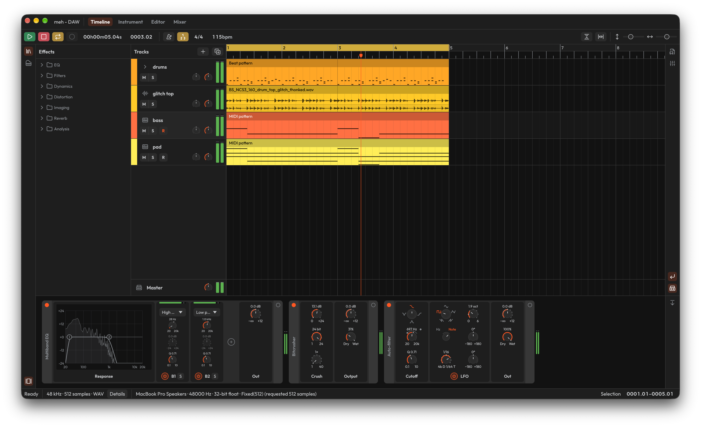
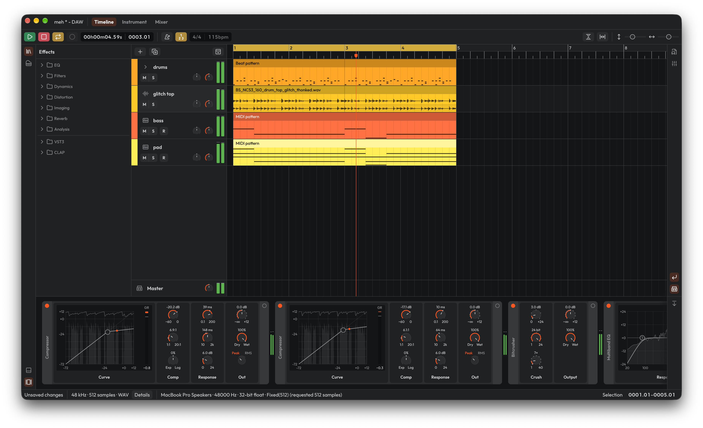
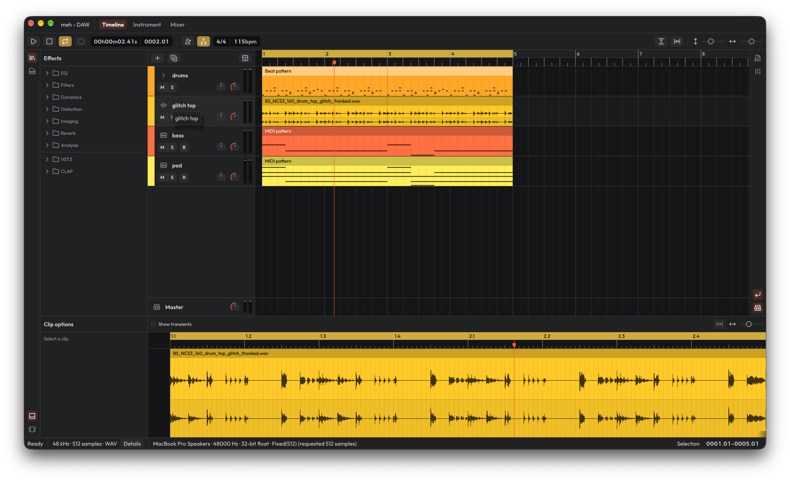
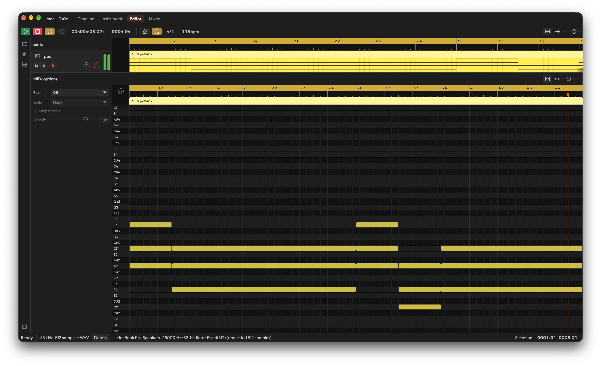
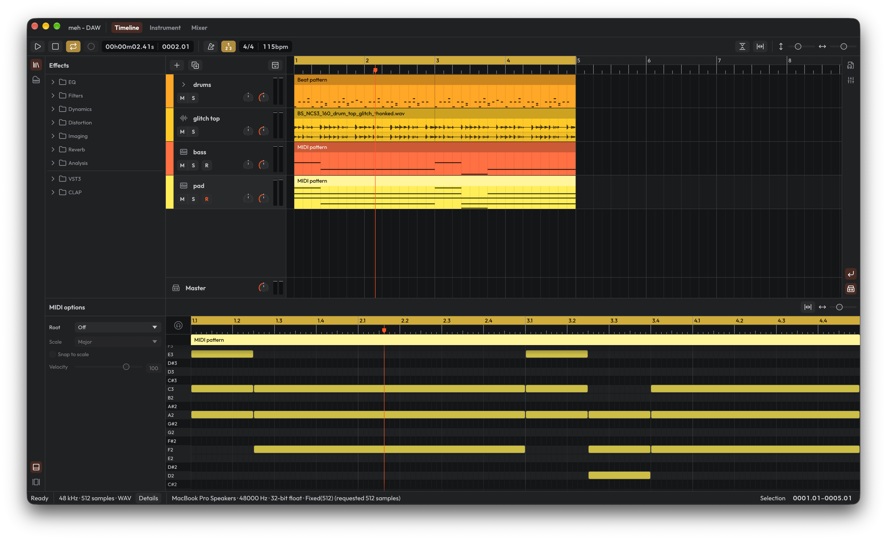
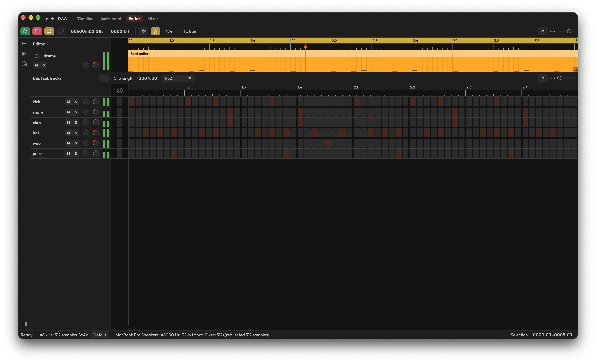
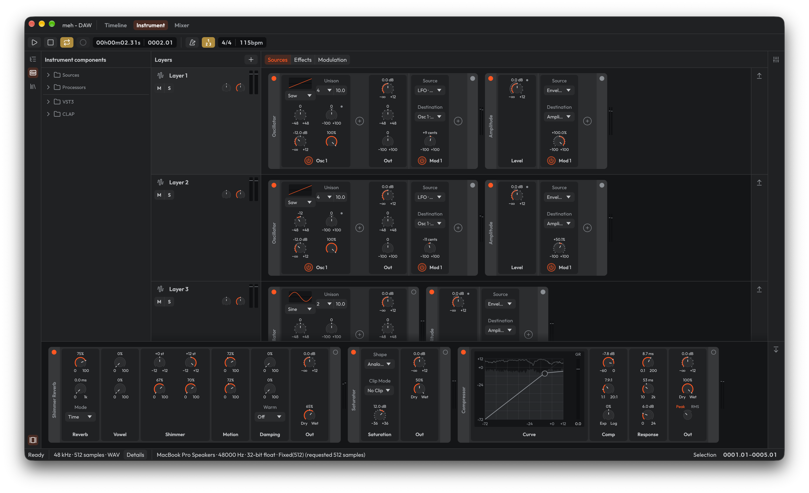
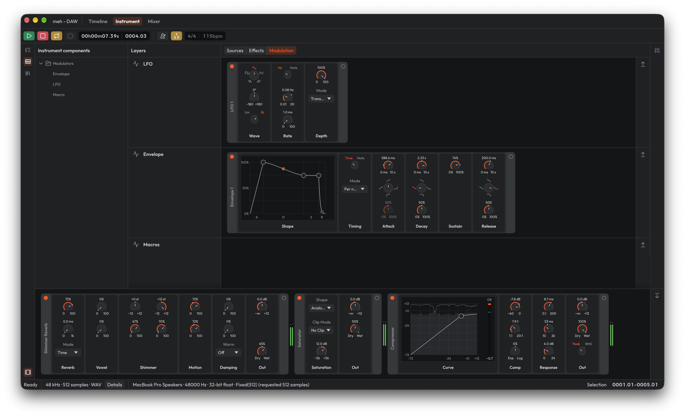
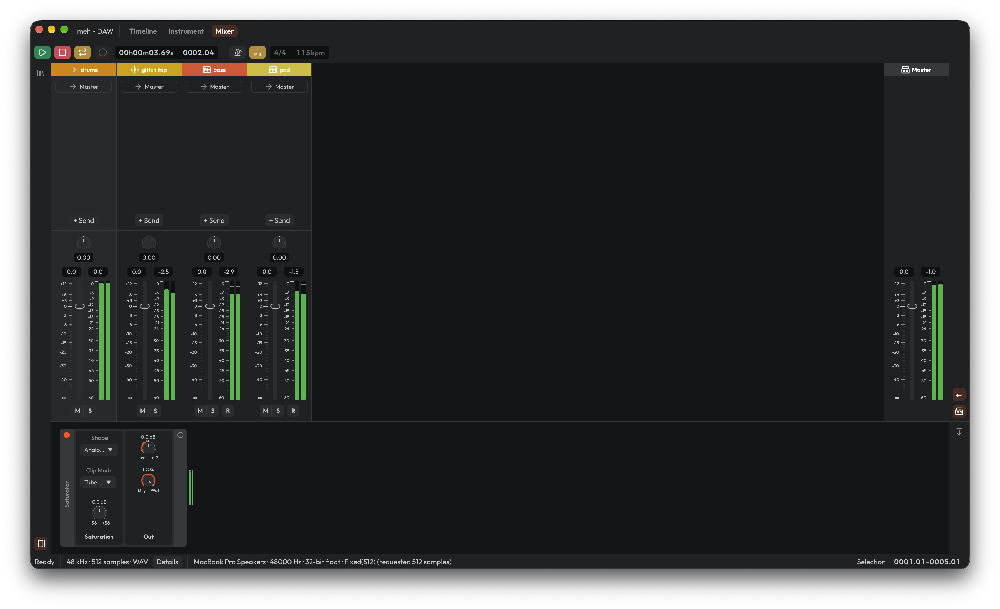

# Desktop DAW

A desktop digital audio workstation for macOS, Windows and Linux, written in Rust. It imports external WAV, MP3, AAC, and Opus sources, and shares its rendering engine with a headless command-line interface.

<h2>More screenshots</h2>

**[Timeline effects](docs/views/timeline.md#add-effects)**

**[Audio editor](docs/views/editor.md#audio-clips)**

**[MIDI editor](docs/views/editor.md#create-and-edit-a-pattern)**

**[Beat editor](docs/views/beat-editor.md)**

**[Instrument](docs/views/instrument.md)**

**[Mixer](docs/views/mixer.md)**

<h2>Features</h2>

- **Bounce:** [render selected clips or complete tracks](docs/editing/bounce.md) to new audio tracks while retaining the disabled originals.
- **Timeline:** arrange, trim, loop, stretch, transpose, split, merge, move, copy, and duplicate audio, MIDI and beat clips or a selected time range, with grid snapping, edit previews, clip settings, and a chord catalog. Audio clips support editable fades and adjacent crossfades. The [Timeline editor pane](docs/views/editor.md) edits audio, MIDI, and beat clips.
- **Beat editor:** build rhythms with [step patterns](docs/views/beat-editor.md) and independently configured subtrack instruments.
- **Live MIDI:** play and record one or several MIDI tracks with sustain, count-in and private take recovery. See [live MIDI](docs/instruments/live-midi.md) and [recording](docs/editing/midi-recording.md).
- **MIDI editor:** create patterns and edit notes in a piano roll, with a project track browser, track controls and optional scale snapping.
- **Instruments:** build layered synthesizers, samplers, and granular instruments, with instrument-wide LFO and Envelope lanes and a shared Output bus. Browse project tracks and groups from Instrument.
- **Modulation:** Envelope, LFO, Macro and [audio sidechain sources](docs/modulation/audio-sidechain.md) control compatible instrument and effect parameters.
- **Instrument components:** [Oscillator](docs/instruments/oscillator.md), [Sampler](docs/instruments/sampler.md), [Granulizer](docs/instruments/granulizer.md), [Noise](docs/instruments/noise.md), [Envelope](docs/instruments/envelope.md), [LFO](docs/instruments/lfo.md), [Amplitude](docs/instruments/amplitude.md), and [Macro](docs/instruments/macro.md).
- **Effects:** [3-band EQ](docs/effects/equalizer.md), [Multiband EQ](docs/effects/multiband-eq.md), [Drive](docs/effects/drive.md), [Drive v2](docs/effects/drive-v2.md), [Bitcrusher](docs/effects/bitcrusher.md), [Saturator](docs/effects/saturator.md), [Multiband Exciter](docs/effects/exciter.md), [Harmonic Lift](docs/effects/harmonic-lift.md), [Filter](docs/effects/filter.md), [Auto-filter](docs/effects/auto-filter.md), [Compressor](docs/effects/compressor.md), [Expander](docs/effects/expander.md), [Transient Shaper](docs/effects/transient-shaper.md), [Multiband Compressor](docs/effects/multiband-compressor.md), [OTT](docs/effects/ott.md), [Limiter](docs/effects/limiter.md), [Direction Mixer](docs/effects/direction-mixer.md), [Stereo Spread](docs/effects/stereo-spread.md), and [Chorus](docs/effects/chorus.md), [Plate Reverb](docs/effects/plate-reverb.md), and [Ambient Reverb](docs/effects/ambient-reverb.md), [Shimmer Reverb](docs/effects/shimmer-reverb.md), and [Loudness Meter](docs/effects/loudness-meter.md).
- **Mixer:** track gain, pan, mute, and solo controls, [track group buses](docs/editing/track-groups.md) with shared effects, [sends and Return buses](docs/editing/track-sends.md), and master gain.
- **Arrangement timing:** named markers and saved tempo/time-signature maps in the [Timeline](docs/views/timeline.md).
- **Playback:** tempo and saved time-signature controls, a playback metronome, loop playback, stereo level meters, and [audio device settings](docs/projects/README.md#audio-devices) for device selection and new-project quality defaults. Each project saves its own sample rate, output bit depth and buffer size. Input-device selection is saved for future recording.
- **Editing history:** [undo and redo](docs/editing/undo-redo.md) for project edits.
- **Projects:** open the editor while audio prepares in the background, reuse saved audio caches, save projects, [collect media sources](docs/projects/README.md#collect-project-sources), and configure audio processing settings. Normal imports retain external references. Included recordings and saved stems stay inside the project folder. Missing audio remains visible and plays as silence.
- **Appearance:** Dark, Light, and Mist themes, accent colors, and colored clips.
- **Export and CLI.** Export stereo or mono WAV, MP3, or AAC at a selectable sample rate. The [CLI](docs/cli/README.md) edits saved projects, manages plugins and sources, and exports mixes, ranges, and stems.
- **Standalone audio tools:** experimental offline time stretching and pitch shifting, with three-engine comparisons.
- **Stem separation:** use local HTDemucs models through Charon to create four or six aligned stem tracks in a group and retain the disabled original clip. See [Stem separation](docs/audio/stem-separation.md) for setup and limits.
- **External plugins:** use VST3 and CLAP effects and instruments in the shared renderer, with plugin discovery, mapped controls, native editors, shared modulation and audio sidechains. See [External plugins](docs/plugins.md) for use and platform limits.

<h2>Status and planned work</h2>

Most of the features are experimental, including (but not limited to) the project manifest format and the layout of both the main application and the effects.

Pending feature work includes audio recording and monitoring, timeline automation, advanced beat editing, additional effects and custom instrument routing. The [features and roadmap](docs/roadmap.md) separates implemented milestones, remaining feature work and native acceptance checks.

## Documentation

- [User guide](docs/README.md): working with clips, instruments, modulation, and effects.
- [CLI guide](docs/cli/README.md) for the command catalog, project editing, export, and standalone WAV processing.
- [Development guides](docs/development/README.md): platform setup, build and run steps, packaging, plugin builds, and CI downloads.
- [Features and roadmap](docs/roadmap.md), including current limits and planned capabilities.
- [Reusable audio analysis](crates/audio-analysis/README.md): portable energy/spectral transient detection.
- [Time stretching and offline pitch changes](docs/audio/time-stretch.md) and the [standalone comparison tool guide](docs/cli/timestretch.md).
- [Implementation specifications](specs/README.md): architecture, data formats, requirements, and acceptance criteria.
- [Validation records](specs/validation/README.md): completed checks and remaining verification limits.
- [Repository instructions](AGENTS.md): contribution rules and development workflows.

## AI disclosure

Development of this project has been assisted by AI. While most of the code has been AI-generated, all the designs and decisions are (and will always be) ultimately made by humans.

## Licenses

Original code uses the [BSD 2-Clause License](LICENSE). Bundled dependencies have separate terms. Their notices are included with the [media libraries](crates/media/assets/licenses), [fonts](crates/unit-ui/assets/fonts), [icons](crates/ui/assets/icons), [UI dependencies](crates/ui/assets/licenses), and [oscillator dependencies](crates/oscillator/assets/licenses), and [EQ dependencies](crates/equalizer/assets/licenses), and [stem-separation dependencies](crates/separation/assets/licenses).

The [native dependency audit](specs/audio/stem-native-dependencies.md) records platform runtime requirements and license obligations for the combined applications. The original-code BSD license does not replace bundled-library terms or corresponding-source requirements.
