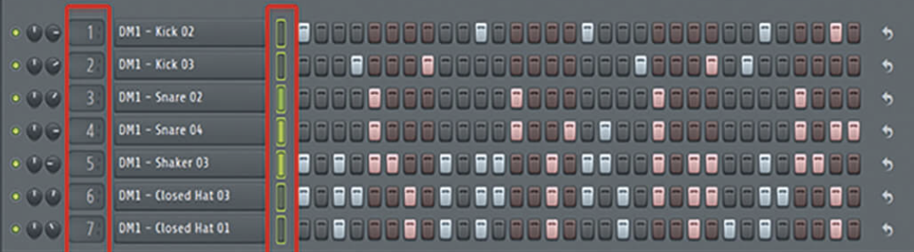

# Beat pattern editor design and decisions

Status: design baseline; implementation pending. Last updated: 2026-10-12.

The beat pattern editor in the future Editor view will let users create beats through lanes of step toggles. Editor will choose an editor by clip type: audio editor for audio clips, MIDI pattern editor for MIDI clips, and beat pattern editor for beat clips. Each lane will be an audio lane or a MIDI lane, with its own sources and effects. The user will set pattern length and step resolution for all lanes together. The Units view will control lane sources, effects, and modulators. Mixer will control each beat track as a whole. Beat tracks will join audio and MIDI tracks as the third track type. Beat and MIDI patterns will be clip sources, with clip editing separate from source editing. The accepted MVP scope below defines the initial controls, playback, navigation, and routing.

## Confirmed requirements

| ID | Requirement | Consequence |
| --- | --- | --- |
| B01 | Support audio, MIDI, and beat track types. | Keep track type separate from editor view mode. |
| B02 | Add a beat pattern editor in the Editor view with lanes and step toggles. | Users can enable or disable steps to build beats. |
| B03 | Each beat lane is an audio lane or a MIDI lane. | Model lane type independently within a beat track. |
| B04 | Each lane has its own sources and effects, including samples or synths as appropriate. | Lane processing must be independent and use the shared modular-unit core. |
| B05 | Mixer controls tracks only, including each beat track as a whole. | Beat lanes do not have individual mixer strips. |
| B06 | The Units view controls sources, effects, and modulators for beat lanes. | Keep lane processing controls in that view. |
| B07 | The beat pattern editor handles beat creation only. | Keep step and pattern editing in Editor and processing configuration in Units. |
| B08 | Each beat lane has one instrument. MIDI lanes can support multiple voices in a later implementation. Different lanes can use different instruments. | Keep the instrument model ready for future MIDI polyphony. |
| B09 | Use Timeline, Units, Editor, and Mixer as the view names. | Editor chooses the clip editor; Units handles processing and Mixer handles tracks. |
| B10 | Treat beat and MIDI patterns as clip audio sources, like audio files. | Clip trimming and looping change the clip without changing its underlying source. |
| B11 | Editing a beat or MIDI pattern creates a new source. | Other clips retain their existing source and content. |
| B12 | A parent beat track has its own effects, in addition to each lane's effects. | Units supports separate lane-level and track-level effect configuration. |
| B13 | Beat lanes have independent controls. | Expose lane processing controls in Units while Mixer controls the parent track. |
| B14 | The user sets pattern length and step resolution. | Store these settings with the pattern source. |
| B15 | All lanes in a pattern share its length and resolution. | Lane-specific lengths and resolutions are not supported. |
| B16 | Eventually allow customized trigger duration, including one step, until the next trigger, or stopping based on another lane. | Keep trigger duration separate from pattern length and grid resolution. |
| B17 | Let users connect lanes so triggering one stops another. | Use lane trigger events to stop the connected lane; an open/closed hi-hat pair is the reference example. |
| B18 | Initially allow at most one active instrument voice per MIDI track and per beat lane. | Each lane has its own voice limit; the parent beat track can contain several sounding lanes. |
| B19 | The Beat MVP provides on/off steps, per-step velocity, and one pitch setting per MIDI lane. | Defer per-step pitch, swing, probability, and repeated hits. |
| B20 | Audio hits play to their end; MIDI notes send note-off after one step. New triggers replace the active voice. | Preserve the one-voice limit and use a short fade for lane stops. |
| B21 | The Beat MVP includes simple lane-stop connections. If connected lanes trigger together, the stopping lane wins. | Stop or suppress the target lane's hit and play the stopping lane's hit. |
| B22 | Open a beat clip from Timeline in Editor using the beat pattern editor, and retain its clip/lane selection when switching to Units. Fix lane type at creation. | Defer audio/MIDI lane conversion. |
| B23 | Units provides lane gain, pan, mute, solo, and serial effects. Sum lanes through serial track-level effects. | Defer parallel audio paths, shared-effect sends, and audio sidechains. |
| B24 | Default to one bar at 1/16 resolution. Offer 1–16 bars and 1/4, 1/8, 1/16, or 1/32 resolution. | Apply one grid to every lane in the pattern. |
| B25 | Place the beat pattern editor inside the shared Editor view, alongside audio and MIDI pattern editors chosen by clip type. | Replace the earlier standalone Beat view; preserve the accepted beat-editing and processing rules. |
| B26 | Give each beat track one beat instrument containing all its lanes. | Each lane retains its own source or MIDI instrument, controls, effects, and voice state. Combine lanes into one output bus before parent-track effects and gain/pan. |

Audio tracks accept effects only. MIDI tracks accept sources and effects. These shared rules and the unit architecture are defined in [Modular audio units design and decisions](modular-audio-units.md). Beat tracks support effects on each lane and on the parent track.

### View responsibilities

The view model was revised on 2026-10-11 through B25 and D28 in the unit design. B02, B07, B09, and B22 reflect this correction. The beat editor keeps its own design document, but is an editor inside Editor. An audio or MIDI lane within a beat clip does not change which clip editor opens.

| View | Responsibility for beat tracks |
| --- | --- |
| Editor (beat pattern editor) | Create beats through lane steps and patterns for the active beat clip. |
| Units | Configure each lane's sources, effects, modulators, and controls, plus parent-track effects. |
| Mixer | Control the beat track as a whole. |

BQ05's Mixer and beat-editing responsibilities were resolved on 2026-10-11 through B05–B07. BQ07's parent-track effects and independent lane controls were confirmed through B12–B13; B23 fixes the MVP control set and serial routing.

### Instruments and voices

A beat track owns one beat instrument containing audio or MIDI lanes. Each lane has one sample source or MIDI instrument. Different lanes can use different instruments, such as a kick sample player, a snare sample player, and a synth. A voice is the processing state for one active note or triggered hit. Initially each beat lane has at most one active instrument voice. Several beat lanes can sound together because the limit applies separately to each lane.

An instrument can contain multiple reusable source units, effects, and modulators. These units form one lane instrument. B18's initial scope was confirmed on 2026-10-11; D29 later enabled polyphony for general MIDI tracks. The Beat MVP retains one voice per lane and replaces the active voice on a new trigger, as specified in B20. Polyphonic MIDI beat lanes remain deferred. B26 follows the shared [source-container architecture](modular-audio-units.md#one-source-container-per-track); one parent container does not impose one shared voice across all lanes.

## Accepted Beat MVP scope

Accepted on 2026-10-11 through B19–B24, with navigation revised by B25. This is the initial beat pattern editor scope within Editor; implementation is pending.

| Area | Initial behavior | Deferred work |
| --- | --- | --- |
| Pattern grid | 1–16 bars; 1/4, 1/8, 1/16, or 1/32 resolution. Default one bar at 1/16. All lanes share the grid. | Wider grid options. |
| Step controls | On/off and per-step velocity; one pitch setting per MIDI lane. | Per-step pitch, swing, probability, repeated hits. |
| Playback | Audio hits play to their end. MIDI notes send note-off after one step. New triggers replace the current voice. | Customizable trigger-duration modes and MIDI polyphony. |
| Lane stops | Simple directional stop connections, with a short fade. The stopping lane wins when connected lanes trigger together. | More advanced trigger-control rules. |
| Navigation | Open a beat clip from Timeline in Editor using the beat pattern editor; retain its clip/lane context in Units. Choose lane type at creation. | Audio/MIDI lane conversion. |
| Controls and audio routing | Lane gain, pan, mute, and solo in Units; serial lane effects followed by lane gain/pan, summed lanes, then serial track effects followed by track gain/pan. Mixer controls the whole track. | Parallel audio paths, shared-effect sends, audio sidechains. |

Preserve the source rules in B10–B11 throughout. Editing the pattern or its grid creates a new source; clip trims and loops preserve the source.

## Lane and step interaction

A lane is one row of step toggles. A step is a time slot that the user can enable or disable. The editor will show one row per lane, with toggles across the row. The user chooses one pattern length and step resolution shared by all lanes.

The provided reference shows the lane-and-step interaction. Its exact colors, controls, spacing, and highlighted areas are not requirements.

### Pattern length and trigger duration

BQ02's length and resolution policy was resolved on 2026-10-11 through B14–B16. Pattern length defines the shared grid's extent; resolution defines the time between steps. Trigger duration defines how long an enabled step keeps a note or hit active. Different trigger durations do not give lanes different grid lengths or resolutions.

Customizable trigger-duration modes remain future work. The MVP fixes MIDI note duration at one step and audio hits play to their end, with retrigger replacement and simple lane stops. The until-next-trigger mode and user-selectable duration modes follow later. Rules for changing an existing grid and exact fade/release details remain to be specified.

Lane stops use trigger events. Audio sidechains and shared-effect sends are deferred beyond the Beat MVP.

### Lane stop connections

Users can connect a triggering lane to a lane that it stops. For example, connect the closed hi-hat lane to the open hi-hat lane: when a closed hi-hat step triggers, it stops the open hi-hat and plays the closed hi-hat. B17 defines the lane stop feature; B21 includes simple stop connections in the MVP.

This connection uses trigger events rather than sending one lane's audio through another. Initially the target lane has at most one active voice. Stop it with a short fade. If both connected lanes trigger at the same time, the stopping lane wins: its hit plays and the target hit is suppressed. Exact fade duration and conflicting stop-link handling remain implementation details. Selecting affected voices becomes a later question when MIDI polyphony is added.

## Pattern sources and clip editing

BQ01 was resolved on 2026-10-11 through B10–B11. Audio files, MIDI patterns, and beat patterns use the same clip-source model. Clips reference a source and hold their own placement, source range, and loop settings. Trimming or looping a pattern clip preserves the complete underlying pattern, just as those operations preserve an audio file.

Multiple clips can reference the same pattern source. A pattern edit creates a new source with a new identity for the clip being edited. Other clips keep the original source. For example, if clips A and B reference pattern P, editing A creates P2 for A; B continues to reference P. Trimming or looping A changes neither P nor P2.

Pattern length and resolution follow B14–B15. Changing these settings edits the pattern source and follows the new-source rule in B11. The edited clip and selected lane remain the active context when moving between Editor and Units, as specified in B22. Pattern sources own immutable step data; tracks and lanes own instrument/effect setups under D26 in the unit design. Changing a lane instrument or its effects changes processing for clips using that track/lane; editing pattern content still creates a new source for only the edited clip.

## Proposed architecture

### Shared unit processing

Use the same unit core and graph runtime for beat lanes and regular MIDI tracks. The beat pattern editor in Editor changes pattern events; the Units view configures the selected lane's sources, effects, and modulators. Both views operate on the same saved lane identities and state.

For audio lanes, a proposed sample-based implementation would trigger the lane's instrument using shared project audio assets. For MIDI lanes, enabled steps would produce note events for the lane's instrument graph. Both lane types initially have one voice per lane; MIDI lanes can gain polyphony later. The MVP uses per-step velocity and one pitch setting per MIDI lane. Audio hits play to their end; MIDI notes send note-off after one step, and new triggers replace the active voice. Future duration modes follow B16. Value defaults, release details, and source-unit limits within an instrument remain implementation choices.

### Routing

The accepted MVP signal path is steps → lane source/instrument → serial lane effects → lane gain/pan → summed lanes → serial beat-track effects → track gain/pan → track mix. The beat track has one mixer strip that controls the beat as a whole. Units provides independent lane controls, lane effects, and track-level effects. D23 in the [Units MVP scope](modular-audio-units.md#accepted-units-mvp-scope) fixes gain/pan placement and Master effects before Master gain and output meters.

The MVP uses serial lane/track effect paths and lane stop events. Instrument and modulation graphs may branch internally under the accepted Units scope. Parallel lane/track effect paths, shared-effect sends, and audio sidechains are deferred. Their design remains separate from the accepted lane stop connections.

### Patterns and timing

Keep pattern source data separate from clip placement and editing metadata. Clip copies can share the same source; trims and loops change only clip metadata. When a pattern edit is committed, publish the new source and the edited clip's source reference together. Source creation or preparation failure must retain the original source reference and pattern. Persistence must preserve both the original and edited sources while clips reference them.

Schedule step events from project musical time and convert them to sample offsets through the shared engine. UI frame timing must not drive playback. Use the same event scheduling and unit processing for live playback and export.

## Question status and remaining details

The Beat MVP scope was accepted on 2026-10-11. Preserve the question IDs as decision history; the original scope questions are resolved for the MVP.

| ID | Status | Decision |
| --- | --- | --- |
| BQ01 | Resolved. | Clip sources and isolated pattern edits: B10–B11. |
| BQ02 | Resolved for MVP. | Shared user-set grid, defaults, and choices: B14–B15 and B24. |
| BQ03 | Resolved for MVP. | On/off, velocity, and lane pitch: B19. Other step controls are deferred. |
| BQ04 | Resolved for MVP. | One voice, fixed duration rules, retrigger replacement, fading lane stops, and stopping-lane priority: B18 and B20–B21. |
| BQ05 | Resolved. | The beat pattern editor in Editor creates patterns; Units configures processing; Mixer controls tracks: B05–B07 and B25. |
| BQ06 | Resolved for MVP. | Editor chooses the editor by clip type; clip/lane context is retained between views; lane type is fixed: B22 and B25. |
| BQ07 | Resolved for MVP. | Lane controls, both effect levels, and serial routing: B12–B13 and B23. Advanced audio routing is deferred. |

Remaining implementation details are the velocity range/default and default MIDI pitch; event handling when an existing grid shrinks or changes resolution; exact stop-fade duration and conflicting or cyclic stop links; the interaction of lane/track mute and solo; and selection fallback when the active clip or lane is removed. Shared Editor navigation, including opening gestures and no-clip/multiple-clip behavior, remains to be specified in the [clip editor model](modular-audio-units.md#clip-editors). General MIDI-track voice behavior and gain/pan placement are resolved in the [Units MVP scope](modular-audio-units.md#accepted-units-mvp-scope); polyphonic MIDI beat lanes remain deferred. These details must preserve the accepted MVP behavior.

## Proposed implementation sequence

1. Specify the remaining implementation details within the accepted MVP scope.
2. Define beat-track, lane, pattern-source, and step data with stable identities and versioned persistence. Implement clip references and new-source creation for pattern edits.
3. Integrate step scheduling and lane graphs with the shared event and unit runtime, initially using one voice per lane.
4. Add the beat pattern editor within Editor over that model, then connect it to timeline arrangement, the Units view, and Mixer.

The delivery horizon remains proposed on the [MVP roadmap](MVP.md#future-features). Beat tracks, Editor, and its beat pattern editor are not implemented in the current iteration.

## Validation criteria

Verify that a beat track owns one beat instrument and exposes one output bus after lane processing. Lane source settings, controls, voices, and stop connections must remain independent. Parent effects and gain/pan process the combined output. Verify that pattern edits preserve source isolation and do not change the instrument setup.

Check on/off step scheduling, independent lane sources/effects, mixed audio/MIDI lanes, tempo changes, loop boundaries, pattern save/reopen, and playback/export consistency. Verify one instrument and at most one active voice per lane, different instruments across lanes, and simultaneous playback of separate lanes. Verify that Mixer controls the whole beat track, lane sources/effects/modulators are controlled through the Units view, and the beat pattern editor in Editor handles beat creation. Test voice replacement, one-step MIDI note-off, full-length audio hits, and serial lane/track routing. Add multiple-voice and stealing checks when MIDI polyphony is implemented. Preserve the modular runtime's callback, preparation, and atomic-publication rules.

Verify independent lane controls and effect state. Check that each lane's effects precede lane gain/pan and the parent track's effects process the combined lane output before track gain/pan. Verify both levels can be configured through Units without creating lane strips in Mixer.

Verify per-step velocity, one fixed pitch per MIDI lane, and gain/pan/mute/solo controls. Check that opening a beat clip from Timeline selects the beat pattern editor in Editor and establishes the correct editing context, including clips with mixed audio/MIDI lanes. Verify that switching to Units preserves its clip/lane selection. Lane type is fixed at creation in the MVP.

Verify user-set pattern length and resolution apply to every lane. Check save/reopen and source isolation when these settings change. Test the one-bar/1/16 default and every accepted length/resolution. Verify one-step MIDI note-off and simple lane stops across pattern and clip-loop boundaries. Add tests for user-selectable duration modes when that later feature is implemented.

Verify the open/closed hi-hat example: triggering the connected closed hi-hat lane stops the open hi-hat and plays its own hit. Check that unconnected lanes are unaffected and save/reopen preserves the connection. Verify the short stop fade and stopping-lane priority for simultaneous triggers; add affected-voice checks with future MIDI polyphony.

For both MIDI and beat pattern sources, verify that two clips can share one source; trimming and looping preserve it; editing one clip's pattern creates a new source without changing the other clip; and save/reopen retains both source identities and clip references. Verify rollback if new-source preparation fails.

## Decision record maintenance

Keep B01–B25 as confirmed requirements and accepted choices. Add accepted design choices with a decision date and rationale. Keep proposals and open questions separate from implementation and validation results.

Related documents: [modular audio units](modular-audio-units.md), [scope and roadmap](MVP.md), [repository guidelines](../AGENTS.md), and [validation history](validation.md).
