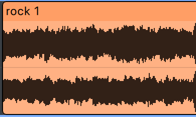

# Desktop DAW MVP Iteration 1 Specification

Status: Draft for implementation.

Date: 2026-10-07.

Scope baseline: [MVP.md](mvp-scope.md).

Build a desktop digital audio workstation (DAW) that can arrange and mix audio tracks with no fixed track-count limit. Provide a command-line interface (CLI) that inspects tracks, validates projects and exports the same mix without graphics or an audio device. This iteration covers the complete MVP; the two-track prototype is an intermediate milestone.

Use ASD-STE100 principles and Plain Language for specifications, technical documentation, and user instructions. Use consistent terms and explicit requirements. In this specification, **must** indicates a requirement. Implementation defaults below resolve routine details within the agreed scope.

## Scope and delivery

| Baseline ID | Required capability |
| --- | --- |
| MVP-01 | Import supported WAV, MP3 and AAC-LC sources and display waveforms. |
| MVP-02 | Add and delete tracks with no fixed track-count limit. Provide gain, pan/balance, mute, and solo. |
| MVP-03 | Move, trim, split, and delete clips without changing source files or allowing overlap on one track. |
| MVP-04 | Provide a timeline, left track list, top playback toolbar, zoom, and scrolling. |
| MVP-05 | Play, pause, stop, seek, and loop a selected range. |
| MVP-06 | Mix tracks with master gain, peak meters, and a clipping indicator. |
| MVP-07 | Use the selected output device (system default initially) and handle initialization errors and disconnection. |
| MVP-08 | Save and open folder-based projects with external source references. Preserve missing clips. |
| MVP-10 | Export stereo WAV, MP3 or AAC, including projects with missing sources. |
| MVP-11 | Use a selectable project processing rate; default 48 kHz. |
| MVP-12 | Apply short linear fades to clip boundaries. |
| MVP-13 | Validate and export projects through a separate headless executable. |

MVP-09 was retired in the original iteration. [Session history](../editing/undo-redo.md) now supersedes its undo/redo exclusion.

The iteration excludes recording, configurable snapping, time signatures, metronome, broader theme customization, configurable audio settings, disk audio caches, source inclusion, source manager, track groups, plugins, MIDI, instruments, automation, stem separation, and mobile delivery. Keep these features on the roadmap in MVP.md. Application themes and accent selection are included as described below.

## Shared architecture

Use a Cargo workspace with shared libraries and separate desktop and CLI executables. The names below are internal working names.

| Component | Responsibility | Dependency boundary |
| --- | --- | --- |
| daw-core | Project entities, IDs, sample-time types, editing commands, validation | No UI, graphics, device, or file-dialog dependencies |
| daw-engine | Transport, clip scheduling, reusable audio processors, mixing, render state | Depends on core; no file decoding or UI |
| daw-media | Decoder and encoder interfaces, WAV/MP3/AAC export, resampling, waveform generation | Supplies PCM assets to the engine |
| daw-project | Manifest serialization, path resolution, loading, safe saving | Uses core and media through explicit interfaces |
| daw-output | CPAL stream, device conversion, callback integration | Desktop device output only |
| daw-ui | Shared panel foundation, controls, timeline, application presentation | Uses shared application commands and state |
| daw-desktop | Desktop entry point and application coordination | Composes UI, output, and shared services |
| daw-cli | Track inspection, validation and offline export entry point | Uses shared services; excludes desktop dependencies |

A PCM asset contains decoded pulse-code modulation samples. Asset identity must remain separate from its source path and sample storage. Clips reference an asset ID and a range; editing must not copy the underlying samples.

Use composition for reusable processors and UI panels. Share project types and audio processing between playback and export. Do not create a universal base engine. Keep panel framing and reusable controls within the UI layer so the core remains usable without graphics.

Use one reusable toolbar component for the window header, playback toolbar, and Tracks header. Share the panel background, 8-point padding on all sides, 8-point horizontal control spacing, and 22-point control height. A single control row has a 38-point total height. Use the shared text and button theme. Keep section dividers outside the component. The caller supplies controls and layout, including the native macOS window-button clearance and the flexible spacer in the Tracks header.

On Windows, default to the standard native titlebar and caption buttons. Display the project title and unsaved marker through the native window title. Below the native titlebar, combine a borderless burger containing File, Edit, Clip, Track, and View menus, a vertical separator, and the view buttons in one toolbar. Place playback controls in the next row. Settings also offers a custom header as defined below. Windows handles caption actions, moving, and resizing. Close requests must use the existing unsaved-change and background-job guards. Linux uses the same burger/view toolbar below its native titlebar. Keep the macOS window presentation unchanged.

Use a shared row layout with vertical centering for all control rows and toolbars, including track controls, Master, the status bar, and dialog actions. Reserve the tallest item's height before placing the row's items, so later knobs or controls do not shift the center. Keep the existing row heights, spacing, and panel structure.

Use one reusable application dialog component for project naming, export options, export status, unsaved changes, export replacement, and errors. The component must share the title presentation, centered position, 8-point content padding and spacing, non-resizable sizing, wrapped message text, and button layout. Dialog titles must use the standard UI body font: 13-point Outfit. Use a default width of 320 points and a maximum width of 560 points. Button rows must wrap when needed. Each caller supplies its title, message, action labels, action values, and enabled state, then handles the selected action. Keep native file and folder pickers in `rfd`.

### Libraries and build rules

| Purpose | Technology |
| --- | --- |
| Language and build | Stable Rust, edition 2024, Cargo |
| UI and rendering | egui, eframe; Glow/OpenGL on Windows for native caption composition, wgpu on macOS/Linux |
| Command parsing | clap |
| Device output | cpal |
| Decoding | symphonia with WAV, PCM, MP3, AAC and ISO MP4 enabled |
| WAV writing | hound |
| MP3 writing | mp3lame-encoder with bundled LAME |
| Resampling | rubato |
| Callback commands | rtrb and standard atomics |
| Worker threads | Rust standard library threads and channels |
| Manifests | serde and serde_json |
| IDs | uuid |
| File dialogs | rfd; XDG Desktop Portal on Linux |
| macOS menu bar | AppKit through objc2 and objc2-app-kit, in the desktop adapter |
| Errors and diagnostics | thiserror, tracing, tracing-subscriber |

Select compatible released versions at implementation start. Commit Cargo.lock and pin the Rust toolchain used for builds. The CLI dependency graph must exclude egui, eframe, wgpu, rfd, and CPAL. Linux desktop builds require the relevant ALSA development libraries.

## Project model and storage

Each project has one folder:

```text
Project/
  project.json
  assets/
```

The MVP must reference external sources. It must not copy them into assets/. This directory is reserved for future project-owned files. Waveforms and decoded PCM are session data and are not stored in the manifest.

Use the initial JSON structure in MVP.md. The following fields form the MVP data contract:

| Object | Fields |
| --- | --- |
| Project | project_id, name, sample_rate_hz, tempo_bpm, master, assets, tracks, transport |
| Master | gain_db |
| Asset | id, name, source, source_metadata, decoded_frame_count |
| Source | kind, path, path_kind |
| Source metadata | sample_rate_hz, channels, sample_format, bits_per_sample |
| Track | id, name, gain_db, pan, muted, soloed, clips |
| Clip | id, asset_id, name, start_frame, source_offset_frame, length_frames, optional repeat |
| Clip repeat | length_frames, phase_frame |
| Transport | playhead_frame, loop |
| Loop | enabled, start_frame, end_frame |

schema_version is optional and ignored. Do not branch on its value or reject a file because of it. The format is experimental; migrations and compatibility with earlier experimental manifests are outside this iteration.

### Validation rules

- Require valid UUIDs and unique entity IDs. Track array order defines display order.
- Allow sample_rate_hz of 44100, 48000, 88200, 96000, 176400, or 192000 at project level. Persist buffer_size_frames as 32/64/128/256/512/1024/2048/4096; default 512 when absent. Original source sample rates can differ.
- Store project tempo in tempo_bpm as a positive finite number. Default new projects and older manifests without this field to 120.0 BPM. Use tempo for the musical ruler, grid, and playhead monitor in 4/4. Changing it moves clip starts to preserve their beat positions. Clip durations and source audio stay unchanged. Reject the change if it would make clips overlap on the same track or exceed timeline bounds.
- Store time values as nonnegative integer frames, using checked arithmetic. One frame contains one sample per channel. All clip offsets and lengths refer to decoded audio at the selected project rate.
- Require finite gain values and pan within [-1, 1]. Validate numeric types without coercing strings into numbers.
- Require source.kind to equal external. Accept relative or absolute path_kind values. Accept pcm_int and ieee_float source sample formats in the supported WAV combinations, plus mp3/aac with bits_per_sample equal to zero.
- Require each clip to reference an asset record. Missing asset records are invalid manifests; missing source files are warnings.
- Require positive clip lengths and checked timeline ends. Normal clips require source_offset_frame + length_frames to fit the asset's saved decoded_frame_count. Looped clips store an optional `repeat` with positive length_frames and phase_frame less than that length. Their source offset plus repeat length must fit saved decoded bounds; their visible clip length can be longer. Omitted or null repeat fields retain normal clip behavior. Omit unset repeats when saving and default an omitted phase to zero.
- Permit zero or more tracks with no fixed track-count limit in editing or project loading. Track capacity depends on available memory; playback capacity also depends on CPU performance and audio buffer settings.
- Use inclusive starts and exclusive ends. Touching clips are valid; overlapping clips on one track are invalid.
- Require an enabled loop to have end_frame greater than start_frame. Open projects stopped at their saved playhead position.
- Reject malformed JSON, missing required fields, invalid ranges, and unsupported structures with clear errors. Ignore unknown fields while the schema is experimental; their preservation on save is not guaranteed.

### Source paths and saving

Resolve relative source paths from the project folder, never from the process working directory. On save, use a relative path when the platform can express it; otherwise use an absolute path. On Save As, recalculate paths from the destination folder while preserving the referenced file.

The first Save and every Save As must open the shared application naming dialog. Pre-fill and select the current project name. Continue or Enter with a valid name opens the system folder picker for the parent location; create a new child folder using that name. Set the manifest name and current folder only after successful saving. Regular Save uses the current folder. Reject blank names, path separators, control characters, unsupported folder characters, reserved names, and overlong names. Never overwrite an existing destination folder in this flow. Cancel or Escape in the name dialog and cancellation of the system picker must leave the project unchanged and cancel any pending close/open/new action. Such actions may proceed only after a successful save. Failures must preserve current name, folder, sources, and unsaved state; remove only empty newly created directories on rollback. Save As must retain the original project and source files.

Write a temporary manifest in the destination folder. Replace the existing manifest only after the write completes successfully. On failure, preserve the previous manifest, show an error, and keep the project marked unsaved. Do not report a successful save before replacement succeeds.

Prompt Save, Discard, or Cancel before closing or replacing a project with unsaved changes. A failed Save must cancel that transition. Opening a new project must not replace the current project until structural validation succeeds.

### Missing and changed sources

Open projects with missing sources normally. Warn with the affected paths and show empty clips without waveforms. Preserve IDs, names, track placement, source offsets, and clip duration. These placeholders produce silence and remain editable. They occupy timeline ranges under the same overlap rules as other clips.

Check current metadata when opening available sources. If a source has changed and is shorter than the saved ranges, retain the arrangement, warn, and render unavailable portions as silence. Validate saved clip bounds against saved metadata before checking current file length; a changed file must not make an otherwise valid project impossible to open.

Unreadable, malformed, or unsupported existing audio files are processing errors. Do not silently treat those failures as missing files. Do not modify original source audio.

## Import and editing

Accept uncompressed WAV containing 16-bit or 24-bit integer PCM, or 32-bit IEEE float samples. Also accept MP3 and AAC-LC as defined by [audio import](../audio/import.md). Accept mono and stereo. Reject other encodings and files with more than two channels with a clear error.

Decode sources before playback. Convert their audio to 32-bit floating-point PCM at the selected project rate using Rubato when required. Preserve original channel metadata and source information. Generate waveform peak data on a worker thread. Commit the imported asset and clip only after decoding and placement validation succeed.

Menu imports use the selected track and playhead. If no track exists, create one for the import. File drags into the timeline show a translucent clip preview at the cursor position on the hovered track. Prepare duration and waveform on a worker; show a loading placeholder until ready and reuse prepared audio on drop. Drops in empty timeline space create a new track at the next track row. Preview and drop must use the same track and sample position, including zoom and scroll. Show red outlines for invalid sources or ranges. Preview all neighbor trims, removals, and middle splits when the duration is ready. Cancelled hovers and rejected drops must leave the project unchanged. Dragging over the track controls must target that row at frame zero, regardless of horizontal scroll. Ignore drops outside the track workspace and disable file drops during background operations or dialogs. File drops use the shared placement calculation to trim, remove, or split destination neighbors and publish them with the imported clip after preparation succeeds. Menu imports retain overlap rejection. Import can create a track regardless of the current track count. Keep the interface responsive during import; show progress or an active operation indicator.

Moves, drag duplication, paste, and file drops take priority over existing destination clips. Use `Project::placed_clips` and `Edit::OverwriteClips` to trim covered edges, remove fully covered clips, or retain both sides when a placement lands in the middle. Preserve source offsets, repeat phases, stretch ratios, names, and colors on the retained pieces. Keep the original ID on the left piece (or the sole surviving piece); assign new IDs to additional right pieces. Remove all moving originals before resolving the full group. Copies receive new IDs and keep their originals as destination neighbors, so a copy can trim, split, or remove its original. Preserve group timing and track gaps, and reject invalid incoming ranges atomically. Preview incoming clips and every affected neighbor without changing project data or playback. Commit moves and drag duplication only on mouse release, paste as one transaction, and file drops only after preparation succeeds. Cancelled gestures and failed imports retain the original arrangement. Keep grid snapping, Shift bypass, timeline clamps, and new-track previews.

| Operation | Behavior |
| --- | --- |
| Move | Change track and/or timeline start without changing source offset, length, or repeat base. Snap using either clip edge; clamp to valid timeline bounds. Trim covered neighbor edges, remove full coverage, and split surrounding clips through the shared placement transaction. |
| Trim start | Change start, source offset, and length together, within source bounds. For looped clips, shorten the visible range and advance phase instead of source offset. |
| Trim end | Change length within source bounds. Looped clips can shorten within their current visible range while retaining the base. |
| Loop clip | Resize a header edge using the current trimmed range as the first repeat base. Retain the base on later resizes, keep the opposite endpoint fixed, and shift phase on left resizes to preserve existing audio timing. Permit partial repeats above the base length; clamp to valid timeline bounds and a minimum of the base length. Clips already shortened below the base retain their current length as the minimum. |
| Split | Split strictly inside a clip. Preserve the left ID, create a right ID, and advance the right source offset for normal clips or phase for looped clips. Preserve the repeat base. Apply normal clip fades to both resulting clips. |
| Delete clip | Remove its arrangement record without deleting source files. |
| Delete track | Remove the track and its clips without deleting source files. |
| Drag duplication | Hold Option on macOS or Ctrl on Windows/Linux while dragging a clip header to copy instead of move. Use current modifiers for preview and release; Shift bypasses snapping. Preserve all copied metadata, assign a new ID, reuse source audio, select the copy, and sync playback. The original remains a destination neighbor and a fallback snap target. Show a copy cursor and leave the original visible during dragging. Preview trims, splits, and deletion for destination neighbors, including the original; commit them with the copy on release. Trim and loop edges retain their normal behavior. Do not change the clipboard. |
| Copy/paste | Copy the selected clips' current snapshots with Command+C on macOS or Ctrl+C on Windows/Linux. Paste with Command+V or Ctrl+V at the playhead on the selected track, creating a new ID while preserving its asset, name, trim, loop base/phase, and color override. Share source audio and make room by trimming, splitting, or deleting destination neighbors in the same transaction. |

Select multiple clips by Shift-click (also Command-click on macOS or Ctrl-click on Windows/Linux) to toggle membership, or by click-hold and rectangle dragging in empty timeline space. Rectangles select intersecting visible clips across tracks; Shift-drag toggles intersecting clips against the selection at the start of the drag: add unselected clips, remove selected clips, and keep clips outside the box unchanged. Recompute from that starting selection each frame, so clips leaving the box regain their previous state. Plain clip clicks replace the selection, while plain empty-space clicks clear it. Escape or focus loss cancels a rectangle and restores the prior selection. Clip selection is UI state and does not modify the project or loop range. Primary or secondary presses anywhere in a visible track panel select that track, including padding, borders, child controls, and meters. Keep child control behavior and existing clip selection intact. Paint the selected outline in the same frame. Ignore panel selection while disabled, unfocused, or behind another UI layer or dialog. Drag a track name to reorder the whole track. Preview insertion before or after the hovered row with an accent line across the panel and timeline. Hold near the viewport edges to scroll the list. Commit only on release within the track workspace. Escape, focus loss, disabled UI, dialogs, and outside drops cancel without changing project order. A same-position drop is a no-op. Preserve track/clip IDs, names, colors, control values, clip selection, and source references; keep the master pinned. Store order in the project track array and sync playback after a successful reorder. Key row widget identities by track ID so controls retain their state when rows move. Double-click track-name editing retains its existing behavior.

Timeline Escape clears both primary clip and clip membership plus any clip time range first, retaining track/Master selection. With no clip or clip-range selection, clear primary track, track membership and Master. These are UI-only changes: retain project data, loop endpoints, playhead, playback and undo history. Ignore modified/repeated Escape. Share pre-widget Escape observation and previous-text-focus retention with Instrument in `selection_shortcuts.rs`; preserve text editing, active gestures, jobs/dialogs, disabled UI and window-focus guards. Track actions reuse the same selection shortcut environment without changing their action-specific focus rules. Snapshot gesture/environment availability before frame-start cancellation so Escape cannot cancel a drag and also clear its selection in the same frame. Open popup menus dismiss before selection clearing. Idle Timeline range deselection has one owner in this shared handler; `portion.rs` retains gesture cancellation and Editor behavior.

A plain track-panel click selects one track. Shift-click, Command-click on macOS, or Ctrl-click on Windows/Linux adds or removes a track from the selection. Highlight all selected track panels without changing clip selection or project data. Press M to toggle mute and S to toggle solo on every selected track. In Timeline, these two actions accept focus in any pane or non-text control. Use `Context::text_edit_focused` to give text entry precedence. Reuse the shared edit shortcut environment, window-focus and gesture guards; keep dialog/job, text-draft, pointer-down, modifier and held-repeat guards. Other track and clip shortcuts retain their keyboard-focus guards. Dispatch only enabled track shortcuts, so relaxing Mute/Solo focus does not consume disabled Rename/Group shortcuts. Provide the same actions in a Track menu after Edit, using the native macOS menu bar and the first toolbar row on Windows/Linux. Put Add audio track first, followed by a separator, then Mute and Solo with M and S beside them, then a separator and Rename track, Duplicate track, and Delete track. Use Duplicate selected tracks and Delete selected tracks for a group. Both duplication menus share guarded `TrackAction::Duplicate` dispatch. Through one validated batch of `Edit::DuplicateTrack` commands, insert an empty copy immediately after each selected original in project order, with a new ID and identical name, color, gain, pan, mute, and solo settings. Select the copies with the first copy as primary, retain clip selection, mark the project modified, and sync playback. Do not duplicate clips or assets or change the originals. Duplication has no shortcut and requires a selected track. Put an icon-only Lucide Copy Plus button immediately to the right of Add audio track in the Tracks header, using the shared icon button, alignment, and spacing. Route it through the same guarded duplication action; disable it without selection and use the single/group label for its tooltip and accessibility name. Failure retains project and selection. The context menu lists Rename, Duplicate, then Delete; commit its action after panel painting on menu-item release. Deletion has no shortcut, requires a selected track, and shares guarded `TrackAction::Delete` dispatch with the context menu, including one validated batch, selection/control cleanup, and retained source files/assets. Add audio track appends a default empty audio track named Audio N, using its position in project order for N, and selects it through the same guarded action as the Tracks header Plus button. It needs no existing selection and has no keyboard shortcut. Disable Mute and Solo without a selected track. Enforce held-pointer rejection for M/S in shared action execution, including native key equivalents. Keep menu buttons enabled for press tracking and let release-time activation execute normally. Menu clicks and native callbacks must use the same guarded actions as the shortcuts; one native key press must not also trigger the UI shortcut. Ignore native key repeat. Each track reverses its own current state, including mixed selections; commit the full group through one validated batch and sync playback. Ignore key repeat and Command/Ctrl/Alt-modified M/S so standard shortcuts retain their behavior. Disable these actions during text editing, active pointer or monitor drags, file dragging, jobs, dialogs, disabled UI, and loss of window focus. Preserve track selection through saves and reordering, remove deleted IDs, and reset it on project replacement or closure. Clip selection, paste, moves, imports, and adding a track retain one primary track for their existing destination behavior. Master is excluded. Track-panel clicks must not trigger the timeline through its expanded pointer hit area. Choose the first remaining selected track in project order when removing the primary selection. Keep selection in UI state; do not add it to the project manifest.

Copy, paste, header moves, drag duplication, and deletion apply to all selected clips as one transaction. Batch edits must validate the final arrangement, so moves can pass through ranges previously occupied by other selected clips. An invalid member rejects the whole batch, including any tracks staged for paste. Preserve clip metadata, relative start times, and track index gaps. Paste puts the earliest copied start at the playhead and maps the top copied track to the selected track, adding default tracks if necessary. Moves and drag copies preserve group track spacing and clamp to available tracks and timeline bounds. Hovering in unused timeline space below the final track instead previews new destination rows, mapping the top selected track to the first new row and retaining group track gaps. Use each future track's default color, unless a clip has an override. Stage default tracks on release and commit them with the placements only if the whole transaction validates. Hovering, returning to existing tracks, and cancellation must not create tracks. Group snapping compares every clip edge by grid priority and then nearest destination boundary, ignoring moving originals but including originals during duplication. Show all previews with the same validity color; keep originals fully visible during duplication. Read copy and Shift modifiers throughout the gesture and on release. Select every new copy with a new ID and reused source audio. Trim and loop-edge drags affect only the dragged clip. Delete clears stale selection IDs. Clear the selection on project replacement or closure.

Provide Copy and Paste in an Edit menu alongside File, using the native macOS menu bar and the first toolbar row on Windows/Linux. Show platform shortcuts and route menu commands through the same guarded clip actions. Disable Copy without a selected clip and Paste without a current-project snapshot or a remaining track; disable both during text editing. Clip clipboard shortcuts must handle egui's native Copy/Paste events and command-modified key events without duplicating an action. Use an opaque system-clipboard token to identify the internal snapshot. External text must not trigger a clip paste. Focused text inputs retain standard copy/paste behavior. Block clip clipboard actions during background operations, confirmation/error dialogs, active drags, and loss of window focus. Copy must not change project data or its dirty state. Successful paste selects all new clips, marks the project modified, and syncs playback; invalid paste retains the project and clipboard. Repeated pastes use distinct IDs. The playhead and selection range remain unchanged. Clear the internal clip clipboard when opening, replacing, or closing a project, while preserving it during save and import in the current project. If the selected track is unavailable, use the copied clip's track or the first remaining track; report when no track remains.

Clip moves, file drops, trims, playhead positioning, and loop-selection creation, resizing, and movement snap within a 6-point radius. Prioritize visible bar lines, beat lines, and subdivisions, then source or clip boundaries. Clip moves and file drops compare both edges at each grid priority and use the nearest match at that priority without changing length. Use other clip boundaries on the destination track as fallback targets. Loading file previews snap only the known start edge, never the placeholder's artificial end. Once decoded, use the actual file duration. Import workers must calculate placement from the original pointer position and decoded duration, preserving tempo, zoom, and Shift settings at release. Do not snap an already snapped preview a second time. Drops over track controls still clamp to frame zero, including when scrolled. Playhead clicks and drags use the same grid priority, with project clip boundaries as fallback targets. Clip header looping prioritizes multiples of the saved trimmed base length, measured from the fixed opposite endpoint, before the grid. Grid resolution follows the ruler at the current tempo and zoom. Holding Shift bypasses snapping in previews and on release; changing Shift during a drag takes effect immediately. Bounds and minimum lengths take precedence over snapping. Movement of a loop selection preserves its length. Menu imports use the playhead position. Convert unsnapped pointer positions to the nearest valid integer frame. Reject invalid edits and retain the previous valid state. Make live edits visible to rendering at a block boundary without blocking the callback.

When drag duplication or group paste needs new destination tracks, create fresh audio or MIDI tracks through the standard constructors. Do not copy source track settings. Defaults are the standard numbered name and track color, 0 dB gain, centered pan, mute/solo off, and no effects. MIDI tracks have one empty instrument layer, with no inherited sources or modulation; they remain silent until configured. Existing destination tracks keep their settings. Preserve copied clip metadata and source assets, assign fresh clip IDs, and retain group timing and track gaps. Publish new tracks and copied clips atomically on release or paste. Preview, cancellation, and failed placement must leave the project unchanged. Ordinary moves into new tracks retain their existing instrument-transfer behavior. Explicit track duplication retains its settings-copy behavior.

## Audio rendering and transport

The engine must render stereo floating-point blocks at the selected project rate. Keep mono sources identifiable so their panning differs from stereo balance. Render silent timeline gaps and missing-source ranges as zeros before export dither.

Use the following render order: source range, clip fade, pan/balance, track gain and audibility, track summation, master gain, peak measurement, final output conversion.

### Mixing rules

- For mono, use equal-power panning. At center, send approximately 0.7071 times the source to each channel; at either extreme, send unity gain to that side and zero to the other.
- For stereo, retain both channels at unity gain at center. Attenuate the opposite channel toward zero at either extreme. Do not transfer its content across channels.
- If any track is soloed, render only soloed tracks, including tracks that are also muted. Otherwise, render unmuted tracks.
- Apply 5 ms linear fades at each clip boundary and repeat boundary. At 48 kHz, the nominal fade length is 240 frames. Use floor(sample_rate_hz / 200) frames, shortened to half the range duration for short ranges. For looped clips, use the lower of the outer clip fade and the fade at the current position within the repeat base. Playback and export must use the same source mapping and fades without duplicating decoded samples.
- Smooth live gain, pan/balance, mute, and solo transitions. Use 5 ms ramps as the initial implementation default; this adds no user setting.
- Preserve floating-point headroom inside the mixer. Measure clipping before final clamping. Clamp device output, integer WAV export, and MP3 encoder input to their valid ranges. Float WAV preserves headroom. Do not normalize or insert a limiter.
- Publish left/right master peak values and clipping status without blocking. Provide a visible way to clear the clipping indicator.

Use stable track order for summation. Export must use saved target control values, not a transient live smoothing state. Desktop and CLI export must use the same render and conversion code.

### Transport rules

Play starts at the current playhead and records that position as the playback start. Pause holds the current playhead; Play resumes without replacing the recorded start. Stop ends playback and returns to the recorded start, including while paused or after natural completion. Seek changes the playhead during playback, while paused, or while stopped. Seeking and live plan updates preserve the recorded start until Stop or a new playback after natural completion. Stop before any playback leaves the current position unchanged. The playback start is runtime state and is not stored in the manifest. Seeking, starting, pausing, stopping, and wrapping a loop must avoid unintended discontinuity clicks; use bounded transition handling within the fixed MVP fade policy. Pausing and stopping must hold the playhead even when it is outside an enabled loop.

With looping disabled, stop at the end of the last clip. With looping enabled, repeat the selected range using an exclusive end. Reject empty loop ranges. Disable playback when the project has no clips. If every source is missing but clips exist, playback can run as silence with warnings.

The engine's sample counter drives time and the displayed playhead. Rendering must continue independently of UI frame rate. Process a bounded number of control commands per callback. A full command queue must not block or silently lose an accepted edit; report or retry submission outside the callback.

### Output device and callback

Use CoreAudio on macOS, shared WASAPI on Windows, and ALSA on Linux through CPAL. On Linux, use the selected device (system default initially) and its configured PipeWire/PulseAudio bridge.

Use machine-local [audio device identities](../audio/devices.md) and the current project's saved audio quality. Require the project output sample format, prefer a stream at its processing rate and request its buffer size (initially 512 frames). Adapt hardware buffers to their supported range and retain the host-default retry for rejected fixed buffers. Unsupported output formats report an error without substituting another bit depth. Callback sizes can vary. If the device requires another sample rate, use preallocated output resampling without changing project timing or export rate.

The callback must not perform file I/O, decoding, allocation, blocking locks, logging, or final asset destruction. Create buffers and converters before starting the stream. Retire replaced assets on a control thread. Offline rendering can use worker-thread allocation and I/O.

On output initialization failure, show an error and keep editing and export available. On disconnection, stop playback safely and report the error. Do not switch devices automatically. A later playback attempt can reinitialize the selected device; System default resolves the current host default at that time.

## Desktop interface

Use the supplied Audacity 4 layout references. Provide a simple fixed layout with track controls on the left, timeline lanes on the right, and a toolbar above the timeline.

Use the supplied [visual style reference](../assets/style-reference.png) for appearance, while retaining this layout. In Dark, use neutral charcoal panels, thin borders, compact flat controls, a configurable selection/control accent (Purple 500 by default), and bundled Outfit. Use track/clip colors with contrasting waveforms. Keep these settings in a shared UI style module.

Provide File > Project Settings… on macOS, Windows, and Linux, in its own group before Close project (and before application Settings on Windows/Linux). Use the shared application dialog with a Project name field, pre-filled and selected, plus Sample rate, Output bit depth and Buffer size dropdowns. Align the fields after one shared label column and fill to the same right edge. Apply or Enter commits a trimmed nonblank name without control characters; Cancel or Escape discards it. Keep the committed project unchanged while typing or on invalid input. A changed name marks the project modified and updates the native/custom title and unsaved marker; a no-op retains the prior modified state. Regular Save writes the name to the existing manifest without moving or renaming the project folder. Disable background editing, file actions, clip/track actions, and playback controls while open. Disable entry during jobs, other dialogs, and active name/tempo/clip/track/ruler/monitor gestures. Keep application preferences separate from these project settings.

Project Settings also selects the processing sample rate (44.1, 48, 88.2, 96, 176.4, or 192 kHz) and buffer size (32, 64, 128, 256, 512, 1024, 2048, or 4096 samples). New projects copy concrete application quality defaults, initially 48 kHz, 32-bit float and 512 samples. Existing projects always use their saved quality. Older manifests without a buffer value use 512 and without an output format use F32. Changing defaults only affects future projects. Apply prepares audio on a worker and commits the name, rate, output format, buffer, and frame coordinates together after success. Rate changes preserve clip, source-offset, repeat, loop-selection, and playhead times to sample precision, retain stretch ratios, and rebuild waveforms and stretch buffers. Original files remain unchanged. Invalid ranges, empty clips, overflow, or processing errors retain the original session. A successful audio change stops playback; press Play to create the output with the new settings. Rate changes clear copied clips to avoid pasting old frame coordinates. Cancel discards all draft settings. The buffer duration shown is not total output latency. The device may use a supported buffer size or its default; its negotiated rate and requested buffer configuration appear in the status bar.

Provide Settings in the app-name menu on macOS and File on Windows/Linux, with Command+, or Ctrl+, respectively. Use the shared application dialog. Organize the dialog into expanded Appearance, Playback, MIDI, and Stem Separation sections in that order. Use bold body-text headings and standard separators between sections. Keep Titlebar, Theme, and Accent color together in Appearance; Seek cache in Playback; Split MIDI notes in MIDI; model selection, validation and platform availability in Stem Separation. Retain the common label column across sections and the shared Close action. Category headings do not change settings, persistence, model validation or project state. Align Titlebar, Theme, and Accent color dropdowns after one shared label column and fill to the same right edge; keep the accent swatch in the label column. Add a Theme dropdown with Dark (default), Light, and Mist. Light uses `#E9E9E9` for timeline backgrounds and `#F9F9F9` for panels, toolbars, menus, and dialogs, with dark text, visible borders, subdued grid lines, and readable warning/error colors. Mist uses the light base theme with `#E6E9EE` workspace backgrounds, `#EFF1F5` panels, `#D8DAE0` input/control fills, and `#DDE0E7` borders and dividers. Retain Light’s dark text and semantic colors. Apply the selected light palette to both egui styles and custom painting; switching back must restore the original Light palette. Persist Mist as `mist` in application settings. Use the context palette for custom painting and egui controls; retain typography, layout, track/clip colors, and the chosen accent when switching. Offer all 19 Material 500 colors in a dropdown, with a left-hand swatch and color name without the shade number. Apply selections immediately across controls and custom painting. Close retains the selection; Escape closes the popup before the dialog. Persist the theme and accent in desktop application storage separately from project manifests, restore it at launch, and retain it across project replacement. Settings must not mark the project modified. Guard menu/shortcut actions against jobs, active clip/track/loop drags, and other dialogs; disable background editing, file actions, and playback controls while Settings is open.

The detailed dark color descriptions below use the selected shared light palette when Light or Mist is selected.

Give the track section the same background as the toolbar. Extend it through the full workspace height and separate it from the darker timeline with a vertical border. Extend the timeline grid and playhead through the unused space below the tracks.

Use no outer workspace padding or gaps between sections. Track boxes fill the track column width. The toolbar meets the track section and timeline ruler at a single 1-point horizontal divider across the full window width. The ruler meets the track section at its left edge. Track rows and timeline lanes share the same laid-out vertical bounds. Draw each horizontal row separator once across the panel and lane through `ControlPanel::row_dividers`, including during vertical scrolling and at different display scales; do not position lane borders separately. Keep padding inside controls and track information blocks.

Extend the ruler's bottom divider across the full workspace width, including below the Tracks header. Show this single 1-point divider even when there are no tracks. Do not stack it with the first track's top border.

Selected tracks and clips share a 2-point accent outline with 2-point corner rounding, drawn inside their bounds. Draw the full selected track outline, including the first track's top edge. Keep the shared header divider neutral and the unselected track dividers 1 point thick.

Show one header label in 13-point Outfit: `[project name] - DAW`. Add ` *` after the project name when the project has unsaved changes. Examples: `Untitled - DAW` and `Untitled * - DAW`. Use the same font size throughout the label. Keep the native window title in sync with this text.

On macOS, offer a Titlebar dropdown in Settings with Custom (default) and Native. Save it with the application settings, restore it at launch, and apply changes immediately without recreating the window or modifying the project. Native shows the system titlebar with the project title and unsaved marker, omits the custom header row, and places the view toolbar between the titlebar and playback controls. Custom combines the first toolbar row with the native title bar. Keep the native close, minimize, and full-screen buttons visible and reserve space for them at the left. Allow window dragging from the combined title and unused first-row space. On Windows, offer Native (default) and Custom in the same Settings dropdown. Custom uses `[burger menu] [project name - DAW] | [view modes]`, retaining the unsaved marker. The burger contains File, Edit, Clip, Track, and View and dispatches the same guarded actions. Keep OS-drawn Windows Minimize, Maximize/Restore, and Close buttons at the top right. Delegate their hover, hit testing, and actions to DWM through the desktop frame adapter. Use the Glow/OpenGL renderer on Windows and leave the caption region unpainted in the app. Preserve the original top client coordinate when maximized so DWM hit testing stays aligned; offset the app header past the off-screen resize frame instead. Reserve their bounds at the current DPI, shorten long titles, and retain native dragging, double-click maximizing, the system menu, resizing, and guarded closing. Menus, view buttons, popups, and modal dialogs must not initiate window dragging. Native mode restores the standard Windows titlebar without replacing the window or project. Linux retains its standard native titlebar.

Separate the window header from the playback toolbar with a thin horizontal border across the full window width. Give the header uniform 8-point padding. Keep the playback row 38 points high with uniform 7-point padding around its 24-point buttons. Use 7-point horizontal spacing between playback controls, matching the Timeline toolbar. Do not add separators or dividers between playback toolbar items.

For the custom Windows header, extend the DWM frame through the 1-point divider and one physical pixel into the opaque playback row. Set the final frame height from the laid-out header bounds, including the maximized top inset and layout rounding at the current scale. Keep the native caption region unpainted above the divider. The frame boundary must not expose a dark row below the caption buttons or change the divider color across the window.

Use one transport toggle with the same Lucide Play icon while stopped, paused, or playing. Update its tooltip and accessibility name to Play or Pause with its state. Use Lucide Square for Stop. Horizontal zoom is anchored to the right edge of the playback toolbar. It uses Lucide's Move Horizontal icon to the left of a 56-point slider with a 4-point rail and a compact round handle. Do not show a numeric value or text label. Use a logarithmic range of 1 to 3000 pixels per second; dragging right increases zoom. Retain tooltips and an accessible slider name. Show transport buttons without visible text labels. Use the shared button style and bundle icons for offline use. Space toggles Play/Pause across all views and focused panes or controls. Focused text editors retain Space for typing. Handle the shortcut before widgets, consume it to prevent a second control action, and ignore held-key repeats. Command/Ctrl/Alt combinations retain their existing behavior. Keep window-focus, disabled-UI, dialog, and blocking-job guards. Catalog folders use Enter, not Space, to toggle expansion.

Use a Lucide Repeat icon button immediately after Stop to toggle looping, with no visible text label. Use the shared icon button size and style. Use the refined #AF8C3E background when looping is enabled. Give it a Loop tooltip and an accessible on/off state. Keep the loop range display in the toolbar and reject enabling an empty range.

- Align track controls with their lanes during vertical scrolling. Horizontal timeline scrolling must not move the track list.
- Place the horizontal scrollbar inside the bottom edge of the timeline viewport. Keep it there for all track counts and window sizes. Do not use a separate window-wide scrollbar panel. Align it with the timeline, not the track list. Size its thumb to the visible time range and update it when zoom changes. Do not show a numeric scroll input.
- Two-finger pinches over the timeline, ruler, or scrollbar scale horizontal timeline zoom using egui's zoom delta, including native trackpad pinch events. Multiply the existing zoom by the gesture factor, clamp to the slider's 1–3000 pixels-per-second range, and adjust horizontal scroll to keep the timeline point under the pointer fixed where bounds permit. Clamp the resulting scroll to the shared timeline extent. Apply zoom before scrolling, grid, ruler, clip, and preview painting. Ignore invalid factors, pinches outside the timeline, jobs, dialogs, active clip or loop-selection drags, and focus loss. Do not change project data, dirty state, font sizes, or global interface scale.
- Horizontal two-finger trackpad swipes over the timeline, ruler, or scrollbar update the same horizontal offset before painting. Use egui's processed horizontal scroll delta to preserve platform direction, smooth wheel input, and trackpad momentum. Clamp to the scrollbar's extent and current visible width. Consume only the horizontal component so diagonal swipes retain vertical track scrolling. Swipes over track controls, Master, or toolbars must not move the timeline. Disabled or unfocused workspaces ignore swipes. Scrolling must not modify project data.
- Secondary-click the empty area of Timeline's track list below existing track panels and above pinned Master to open a context menu with Add audio track and Add MIDI track. Include the same menu when the project has no tracks. Use shared guarded `TrackAction::Add` and `TrackAction::AddMidi` dispatch; append and select the new empty track only on menu-item release. Opening or dismissing the menu preserves project data and track/clip selections. Exclude the Tracks header, ruler, timeline lanes, and Master. Respect focus, disabled UI, text editing, active gestures, jobs, and dialogs. Beat tracks remain pending.
- Include an icon-only Add audio track button using Lucide's Plus icon. Keep the Tracks label on the left and the button on the right, with a flexible spacer between them. Use the playback toolbar's shared 8-point padding on all four sides, with a 22-point control row and 38-point total header height. Retain the Add audio track tooltip and accessible name. Keep the button enabled regardless of the track count. Use the track information blocks defined below. Secondary-click anywhere in a track panel, including child controls, padding, and meters, to open its context menu. Preserve the selected group if the clicked track is selected; otherwise select only that track. Show Delete track for one track and Delete selected tracks for a group. Remove tracks and their clips through one validated `Edit::Batch` only when the menu item is released. Retain source files and asset records. Prune deleted track/clip selections and numeric input state, mark the project modified, and sync playback. Dismissing the menu must not change project data. Guard menu opening and deletion during jobs, dialogs, disabled UI, and loss of focus; deletion also respects text editing and active drags.
- Use a 38-point ruler aligned with the Tracks header, with an upper 18-point bar/beat-label band and a lower 20-point tick band. Match the supplied [ruler reference](../assets/ruler-reference.png) and [selection reference](../assets/ruler-selection-reference.png): the toolbar background in the upper bar/beat-label band, the timeline background in the lower tick band, a thin horizontal border between bands, bar lines extending to the top of the ruler, beat lines ending at the bottom of the upper loop band, 8-point half-beat ticks and 5-point finer subdivision ticks when visible, and a muted purple highlight across the selected range in the upper band, with visible handles at both endpoints and a five-point edge hit area. Use a softer, darker highlight when Loop is disabled and the stronger highlight when it is enabled. Use 11-point Outfit for musical labels. Count bars and beats from 1 in 4/4 using project tempo. At normal zoom, label bar starts with bar numbers. At closer zoom, show bar.beat labels such as `2.3`. Use power-of-two tick spacing, with subdivisions down to one sixteenth of a beat as space permits. Draw stronger bar grid lines, lighter beat lines, and faint subdivision lines. Share tick positions between the ruler, track lanes, and unused timeline area. Keep tick density bounded and labels at least 80 points apart. Tempo changes update the scale immediately. Drag empty space in the upper band to create a loop range. Drag the left or right edge to resize, keeping at least one sample of duration. Drag the selection body to move both endpoints while preserving duration; clamp to frame zero and the maximum sample position. Clip painting to the ruler and draw handles only at actual visible endpoints, including when horizontally scrolled. Show resize and grab cursors for the selection. Only the lower band can position the playhead: click to seek or drag continuously, including dragging the visible marker. Draw the playhead marker and ruler line in the lower band. Keep each gesture's original role when the pointer crosses bands. Use current zoom and scroll for all pointer-to-frame conversions. Upper-band clicks do not seek. Preview and sync valid selection changes during dragging; mark modified on release. Focus loss or disabled controls restores the original selection and dirty state. Preserve the loop toggle and audio clip timing. Keep the playhead, clip names, and source waveforms visible. Distinguish missing-source placeholders visibly.
- Include the Play/Pause toggle and Stop button, seek interaction, loop selection/toggle, and horizontal zoom in the playback toolbar. Put master gain, stereo peak meters, and clipping status in the fixed Master block described below.
- The time monitor has separate vertical drag targets for hours, minutes, and seconds. Each target includes its suffix; seconds also includes the decimal portion. Up seeks forward and down seeks backward by one whole unit per point. Shift requires ten points per whole unit and accumulates partial motion. Carry and borrow between seconds, minutes, and hours. Preserve fractional seconds exactly in sample frames. Clamp at frame zero and saturate at the maximum sample position; reversing at a limit adjusts immediately. Retain the selected unit when the pointer moves across sections. Horizontal motion and stationary frames must not seek. Use the shared monitor drag handler and playback seek path. Disable dragging during background operations and clear drag state on release, focus loss, or new/open/close project actions.
- The toolbar bar.beat monitor has separate vertical drag targets for the bar and beat digits. Up moves forward and down moves backward. Move one whole bar or beat per point; Shift requires ten points per whole unit and accumulates partial motion. Beats carry and borrow across bars. Keep the selected drag unit when the pointer leaves its section. Seek using project tempo while preserving the position within the beat to sample precision. Clamp at frame zero and permit immediate forward motion after reaching it. Horizontal motion and stationary frames must not seek. Use the existing playback seek path. Disable dragging during background operations and clear drag state on release, focus loss, or project replacement.
- Place a tempo monitor after the two transport monitors, starting at `120bpm`. Share the time monitor's 13-point semibold Outfit, equal-width digit slots, default digit color, darker suffix and punctuation, 8-point inner padding, and vertical centering. Reserve at least three digit slots, right-align shorter numbers without adding zeros, and expand for longer or fractional values. Keep entered fractional tempos without rounding. Vertical dragging increases tempo upward and decreases it downward, using 1 BPM per point or 0.1 BPM with Shift. Apply incremental pointer motion, including Shift changes during the drag; stationary frames and horizontal motion must not change tempo. Round drag results to hundredths and clamp to a positive minimum of 0.01 BPM. Update the ruler, grid, and monitors immediately and mark the project modified only if the value changes. Double-click replaces the monitor with a centered single-line input of the same width and font, with its numeric value selected. Enter commits a positive finite BPM value; Escape cancels. Both restore the monitor. Focus loss cancels the draft and restores the monitor, as with track names. Invalid input retains the previous tempo, restores the monitor, and reports an error. Mark the project modified only for a changed committed tempo. Disable editing during background operations. Project replacement clears the draft. Save and restore the tempo with the project.
- Tempo changes rescale every clip start by old BPM divided by new BPM, rounded to the nearest sample frame, preserving its beat position. Keep clip lengths, source offsets, repeat bases/phases, stretch ratios, colors, and IDs. Typed entry and dragging use the same transactional project edit. Reject the whole change if any same-track clips overlap or a range exceeds timeline bounds; retain the last valid tempo, clips, dirty state, and playback plan. Scale both loop-selection endpoints by the same tempo ratio, including when Loop is disabled; round up to sample frames to retain their displayed beats as with ruler snapping. Reject endpoint overflow or a collapsed enabled loop as part of the same transaction. Keep the playhead frame unchanged.
- Display transport time as `00h00m00.00s` in a fixed-width field. Use bundled Outfit at 13 points. Use semibold weight (600) for all characters. Render digits in the default text color (`#C7C9CC`). Center each digit in an equal-width slot sized for the widest semibold digit. Render `h`, `m`, `s`, and `.` in a slightly darker gray (`#AAAEB3`), with normal character widths. Set the field width to eight digit slots plus the unit and punctuation widths and 8-point padding on each side. Use zero-padded hours, minutes, seconds, and hundredths. Time updates must not move adjacent controls or change digit alignment during playback.
- Add a bar.beat monitor beside the time monitor, starting at `0001.01`. Use four zero-padded bar digits and two beat digits, increasing the bar width if needed. Count from bar 1, beat 1 in 4/4 at the project tempo. Share the time monitor's 13-point semibold Outfit, equal-width digit slots, default digit color, darker punctuation, normal punctuation width, 8-point inner padding, and vertical centering. Update from the playhead during playback, seek, loop wrap, pause, and Stop. Keep the time monitor and sample-based clip timing.
- Put New project, Open, Save, Save as, Export, and Close project in a File menu. Use the native macOS menu bar; use the first toolbar row on Windows and Linux. Use separators between New/Open, Save/Save as, Export, and Close project, using the styling of the supplied [menu reference](../assets/file-menu-reference.png). Remove the individual file-action toolbar buttons. Show working shortcuts beside each action: Command on macOS or Ctrl on Windows/Linux, with N, O, S, Shift+S, Shift+E, and W respectively. Place Close project last. Closing must stop playback, release the current project and meter state, clear selections and timeline scroll, and return to an empty Untitled workspace without closing the app. For unsaved changes, Save must finish successfully before closing, Discard must close without saving, and Cancel must retain the project. Cancelling or failing a save must retain the project. Route native menu commands through the shared application actions. Preserve unsaved-project and overwrite prompts. Disable file actions during background operations or pending confirmation/error dialogs; disable Export for an empty timeline. Recording controls remain outside this iteration. Undo/redo now follows [session history](../editing/undo-redo.md).
- Show the selection range at the right edge of the bottom status bar, with a Selection label and start/end positions in the bar.beat monitor's format, such as `0002.01–0004.03`. Use the shared transport monitor style: semibold text, fixed-width digit slots, default digit color, and darker periods and dash. Use project tempo and 4/4, counting bars and beats from 1. Update it from the ruler selection and tempo changes. Give each endpoint separate bar and beat drag targets, using the same whole-unit motion, beat carry/borrow, accumulated Shift adjustment, and sample precision as the toolbar monitor. Clamp the start between frame zero and the end, and clamp the end at the start; keep at least one sample between endpoints when Loop is enabled. Preserve the loop toggle and playhead. Mark modified and sync playback only when a selection endpoint changes. Clear drag state on release, focus loss, project replacement, or disabled controls. Disable selection dragging during background operations. Keep the playback toolbar's time display for the playhead.
- Show progress for long operations and warnings/errors with affected files or actions. Warnings must not block export with missing sources.
- Reuse panel framing, spacing, styling, visibility, and controls. Panels must submit application commands instead of duplicating project data or accessing the callback.

### Timeline and Mixer views

- Add a Clip menu between Edit and Track on native macOS and in both Windows/Linux application-menu layouts. Use three groups with separators: Import clip/Add MIDI pattern; Split at playhead/Stem-separation; Edit clip/Disable clip/Delete clip. Keep Copy and Paste in Edit and remove Split from Edit. Remove Import WAV from File; keep the import shortcut on Clip > Import clip. Import clip shares `FileAction::Import`; Add MIDI pattern uses the selected MIDI track and playhead through the existing transactional pattern placement. Shared `ClipMenuAction` descriptors own order, groups, labels and optional shortcuts; native and egui menus share guarded dispatch. Clip context menus use only the last two groups with a separator, then retain MIDI-only selected-note controls in their own existing group. Native titles update Enable/Disable and singular/group deletion labels from current selection. Edit, mute and separation target the primary selected clip in the menu bar and the clicked clip in a context menu; split/delete use selected targets when the context target is selected, or only that target otherwise. Keep Timeline/Editor, target-kind, text/focus, gesture, job/dialog, and model validation guards. Stem-separation stays visible but disabled for MIDI clips and outside Timeline. Native key equivalents reject repeats and consume forwarded events once. Preserve the existing split shortcut and transactions, model-worker publication, source files and note controls.
- All macOS menu shortcut labels use ⌘ for Command, including context menus and disabled items. Use the shared `toolbars::menu_shortcut_text` helper for egui menus, without depending on unrelated modifier glyph availability. Size and align the Command fallback glyph with Outfit shortcut letters; preserve letter size and menu states. Retain Ctrl labels on Windows/Linux and existing key bindings on all platforms.

- Default to Timeline. Keep view state in the UI, separate from the project manifest. Switching must retain timeline scroll/zoom, clip and track selection, transport, and project values. Cancel text drafts; guard switching during jobs, dialogs, and editing gestures.
- Add a View menu after Track, with Timeline and Mixer items and a check beside the active view. Use the native macOS menu bar and the app menu bar on Windows/Linux. Menu items and view buttons share guarded `set_view_mode` dispatch, preserve project data, selections, timeline scroll/zoom, and cancel uncommitted drafts only when changing views. Selecting the active view keeps it active. Keep menu checks synchronized with button and menu changes.
- Use Timeline/Mixer buttons in the macOS custom titlebar immediately right of the project title. Native macOS uses a separate toolbar below the titlebar. Native Windows and Linux combine a borderless burger menu, a vertical divider, and Timeline/Mixer buttons in one toolbar below the system titlebar. The burger contains File, Edit, Clip, Track, and View menus. Keep the project title in the native titlebar. Custom Windows places view buttons after the title separator in its combined header. Keep the playback toolbar beneath these controls. Use the same view-button padding, font, corner radius, and height in every layout. Retain the selected accent-tinted background with high-contrast text; unselected views use secondary text and a transparent background. Hovered views use the same contrasting text as the selected view; unselected text returns to secondary when the pointer leaves. Hover/press must retain background colors and dimensions. Keep accessibility selection states and existing action guards.
- Mixer shows vertical audio strips in project order with regular centered 11-point track names in 24-point headers at the top and controls anchored toward the bottom. Use the same compact header and text size for Master and track-name editing; Timeline keeps its existing name size. Fill the complete name header using the inherited clip header palette from the track color, including its contrasting text. Keep these colors stable when selected and in both themes; individual clip overrides do not change the strip header. Keep thin 1-point neutral borders. Tracks and Master meet the playback toolbar without a gap and share one full-width top border; omit the separate toolbar separator in Mixer. Adjacent strips share one vertical divider; draw each internal divider once. Keep the exposed right edge of the last audio strip and the outer Master edge outlined. Strips and Master meet the status bar without a gap, sharing one bottom separator. Keep the selection outline on all four sides, with its right stroke reaching the next strip without a gap. Its bottom edge uses the same stroke width as the top and sides, paints fully inside the strip, and replaces the shared separator beneath selected strips without adding a gap. Use the shared theme, numeric fields, pan knobs, meters, button styles, selection outlines, name editing, track actions, and context menus. Preserve Shift/Command/Ctrl track selection and M/S shortcuts.
- Use the timeline knob component as the standard knob design throughout the UI and `faders.rs` as the standard gain fader component. Put a pan knob and centered numeric field above the gain field and vertical fader. Put stereo peak meters beside the fader and Mute/Solo at the bottom. Center the gain field above the complete fader column and a matching read-only peak field above the complete stereo meter column, on the same row. Include the scale labels and tick marks in column centering. The peak field shows the highest L/R peak since its last reset in dBFS, with one decimal place, −∞ for silence, and a plus sign above zero. Hold peaks through pause, Stop, view changes, and live plan updates. Clicking the field or either level bar resets the held peak to −∞ and clears the shared stereo clipping warning through the same reset operation; subsequent output can raise them again. Capture the maximum in output monitoring with atomics, preserving track identity and callback constraints. Reset holds on output/project replacement; do not persist monitoring state. Use the shared centered 36-point numeric field style. Keep meter rails and bottom controls aligned in tracks and Master; preserve existing gain commit/cancel rules and clipping controls. Faders cover exact silence (−∞) to +12 dB, with more travel near unity and a continuous low-level tail. Show labelled marks for +12, +9, +6, +3, 0, −3, −6, −10, −15, −20, −30, −40, and −∞, with 1 dB subdivisions above zero where spacing permits. Add smaller subdivisions where spacing permits, emphasize 0 dB, and reserve scale width within the strip. Share the gain/position mapping between the handle and ticks. Double-click resets to 0 dB. At smaller heights, retain marks but reduce labels/subdivisions to avoid collisions. Silence changes gain, not mute/solo, and persists through save/reopen and shared live/offline rendering. Shift-drag adjusts ten times more slowly. Apply Shift changes during the gesture without a value jump; idle frames and mouse release retain the current value. Gain fields share formatting/parsing in both views, displaying silence as −∞ and accepting −∞, -inf, or -infinity. Numeric track gain retains finite-value validation without clamping existing values on display; Master gain entry clamps to the fader range. Numeric fields commit on Enter/focus loss and cancel on Escape. All edits use the existing project and playback sync path.
- Track and Master stereo meters share one 24-point scale column in Mixer. Timeline shows only the meter bars, without labels, tick marks, or reserved scale width. Mixer strips are 120 points wide to contain the scale. Mark 0, −3, −6, −9, −12, −15, −18, −21, −24, −30, −35, −40, −45, −50, and −60 dBFS. Fill and ticks use the same linear dBFS mapping. Add 1 dB subdivisions above −30 and 5 dB below it when spacing is at least 3 points. At short heights, reduce labels to avoid overlap while retaining endpoints. Silence and peaks at or below −60 show no fill; peaks above zero saturate the display and retain actual peak tooltips and one shared stereo clipping flag. Scale labels do not change audio, project state, or click-to-clear behavior.
- Keep Master pinned at the right window edge outside the audio-strip horizontal scroll area, with gain and output meters but no pan, mute, or solo. Align its fader and meters with the tracks during window resizing. Keep names at the top and controls inside the strips.
- Hide timeline zoom in Mixer. Clear hidden timeline drop geometry so Mixer cannot use a stale file-drop destination. File drops and arrangement gestures remain in Timeline.

### Track information blocks

- Include Rename track in the Track menu after the Mute/Solo separator and before Duplicate, and first in the track context menu. Show ⌘R on macOS and Ctrl+R on Windows/Linux. Require exactly one selected audio track and share guarded `TrackAction::Rename` dispatch. Open the existing focused name draft with the current name selected; opening it must preserve clip/track selection and project data. Enter commits; Escape or focus loss cancels. Ignore repeat, extra modifiers, and shortcuts while another editor or gesture is active. The native macOS item uses the Command modifier and consumes any forwarded key event so one key press opens one draft.

- Show each track as a simple outlined block aligned with its timeline lane.
- Default to 42-point, one-row tracks with no vertical gaps between tracks. The shared Timeline/Editor playback toolbar toggle switches all tracks to 68-point, two-row headers and back. When expanded, place Mute and Solo at the left of the second row, with Pan then Gain at the right immediately before the meters; share this row with Editor track headers. One shared 1-point divider separates adjacent track blocks. Do not stack the bottom and top border strokes of neighboring blocks. Clips fill the lane height.
- In expanded headers, place the icon/name or Editor track dropdown in the 22-point first row and Mute/Solo then Pan/Gain in the 28-point second row, separated by four points. In collapsed headers, use one 28-point content row: icon, name/dropdown, Mute, Solo, Pan, Gain. Keep seven-point outer insets and meters at the right. Truncate long names within their available region. Reuse `track_rows::HeaderRows` and `mix_controls::header_row` for both views. Keep Instrument layer and Mixer layouts independent.
- Double-click empty track-header space, including blank space in the name field, to select every clip on that track and make that track the primary selection. Replace the previous clip selection; an empty track clears it. Keep the earliest clip as primary. Apply this in Timeline and Mixer without changing project data. Name text retains renaming; grip, mute, solo, and other controls retain their own actions. Ignore this gesture during jobs, dialogs, text editing, active drags, disabled UI, or loss of focus.
- Double-click a track name to replace its label with a left-aligned single-line input in the same name row. Use 13-point regular Outfit and the default text color. Focus the input and select the current name. Enter saves the draft and restores the label; Escape discards the draft and restores the original label. Focus loss cancels the draft and restores the original label. Mark the project modified only when a different name is committed. Clear the draft when its track is deleted or the project is replaced.
- Put two narrow vertical L/R level bars at the right edge of each track block, using the [meter design reference](../assets/vertical-meters-reference.png). Reuse the master monitor style. Each bar is 8 points wide in the 54-point expanded or 28-point collapsed inner block height, with 4 points between bars and endpoint space for scale labels. Left is first; Right is second. Use a dark background and fill levels from the bottom. Retain channel names in accessibility and tooltips without visible letter labels. Measure each channel after track gain, pan, clip fades, and mute/solo, before master gain. Show both channels in a red state when either channel peak exceeds 0 dBFS. Keep red markers at the top of both bars until the user clicks either channel to clear the shared stereo flag and held peak; clear it when the project closes. Show silence when stopped or when sources are missing. Monitoring must not change the audio or project data.
- Display gain in decibels (dB), with 0 dB as the initial value. Pan ranges from -1.0 (left) to 1.0 (right), with 0.0 as the initial center value. The same Pan field controls stereo balance according to the existing mixing rules.
- Commit numeric input on Enter or focus loss. Invalid input must leave the previous value unchanged and show clear feedback. Escape cancels an uncommitted input change.
- Use the same outlined design for Mute and Solo as the toolbar buttons. Label them `M` and `S`. Use the shared 22 × 22-point square toggle with 11-point Outfit labels in Timeline and Mixer, Mute and Solo tooltips, and full accessible names with on/off states. Show enabled states with the shared purple selection style. Permit both buttons to be enabled; solo overrides mute.
- Use one reusable knob component for track gain, track pan, and master gain, inspired by the [knob reference](../assets/knob-reference.png). Use 28-point controls with dark faces, purple value arcs, light pointers, and the shared border and text colors. Put a fixed 0 dB mark at twelve o'clock on gain knobs; put a center mark there on pan knobs. Gain dragging covers exact silence (−∞) to +12 dB, reusing the fader’s piecewise scale and amplitude tail with 0 dB at the midpoint of the sweep; numeric track gain entry retains its existing finite-value validation. Pan ranges from -1 to +1. Drag up or right to increase; hold Shift for fine adjustment. Arrow keys change gain by 0.1 dB above −60 dB and step through the amplitude tail below it so they can enter and leave exact silence; pan steps by 0.01. Double-click resets to 0 dB or center. Keep numeric entry for precise values. Keep track deletion in the context menu.
- Implement the block as a reusable UI component shared by all tracks.

- Put an unframed 16-point Lucide Grip at the far left of each audio track name row, vertically centered in a 22-point hit target. Place the left-aligned name directly after the grip, with the control row and meter rail retaining their positions. Provide a Reorder track accessibility label, a drag tooltip, and grab/grabbing cursors. Dragging the grip must use the same preview, auto-scroll, release, and cancellation behavior as name dragging.

### Track row toggle

Use the supplied `collapse-vertical.svg` mask while expanded and `expand-vertical.svg` while collapsed. Tint both through the shared icon image-button path and use the standard 24-point hit area. Place the button immediately left of Fit all clips in the Timeline and Editor playback toolbars. Tooltips and accessibility names describe the action: “Collapse tracks to one row” and “Expand tracks to two rows”.

Keep one shared `track_rows_collapsed` flag in `DawUi`, default true. Retain it across view/track switches for the app session; do not save it in the project or create history/dirty entries. Block toggles during text editing, track rename, active gestures, jobs/dialogs, disabled UI and focus loss. Apply the selected height to Timeline rows (including offscreen placeholders and nested group rows), the Editor header and overview strip, view minimum heights, lane/drop bounds, and previews for new tracks. Preserve horizontal zoom/scroll, clip selection, IDs and audio. Both layouts retain name editing/reorder, group disclosure, mute/solo, shared Pan/Gain interactions and meter resets. Master remains 42 points. Mixer and Instrument have no row toggle.

### Master block

- Show Timeline Master as a 42-point outlined block fixed at the bottom of the track column, above the status bar. Use one 28-point content row inside the existing seven-point outer insets. Keep the icon and 13-point regular Outfit name at the left; place the shared 22-point header gain knob in its 28-point slot at the right, immediately before the L/R meters with the shared six-point gap. Center the label and knob on the same row. Fit both meter rails to the 28-point inner height and retain their right-edge alignment with track meters. Keep numeric gain entry in Mixer; Timeline Master has no numeric field. Track headers switch between two-row 68-point and one-row 42-point layouts; Mixer Master retains its strip layout.
- Use only the status bar's thin divider between Master and the status bar. Do not draw a second bottom border on Master or add a gap.
- Keep Master visible during track scrolling, timeline scrolling, and window resizing. Reserve space so audio track controls do not overlap it. Keep audio tracks and their timeline lanes aligned during vertical scrolling.
- Provide master gain and L/R output meters with red clipping markers and click-to-clear behavior. Do not add a separate clipping text row. Master gain spans exact silence (−∞) to +12 dB; its knob covers the same silence-to-+12 dB range and preserves silence on idle display. Show meters at zero before output starts.
- Master has no Mute or Solo buttons. It uses the existing master gain and output monitoring; it has no Pan control in this change.
- In Mixer, use the same numeric input component for track gain, track pan, and Master gain: 36-point width, 11-point Outfit, centered text in the default text color, and the shared input background, border, and padding. Use the shared numeric font for fields, held peak readouts, and gain fader labels: enlarge the infinity fallback and align it with the minus sign while retaining digit sizes and line heights. Master gain commits with Enter or focus loss and cancels an uncommitted edit with Escape. Clamp Master numeric gain at +12 dB and the finite silence value, accept the shared −∞ input aliases, and reject other non-finite input. Store silence as `SILENT_GAIN_DB`, which renders as exact zero and remains valid JSON without changing the manifest schema.
- Master is the final mix output. It is separate from the audio tracks and cannot hold clips, be deleted, or receive imported audio.

### Clip appearance and interaction



Use the supplied reference for a simple clip block:

- Draw a solid colored rectangle with a thin dark outline and slightly rounded corners. Retain the clip reference's structure; use muted blue fill, a darker header, and light waveforms from the visual style reference.
- Place the clip name at the left of a distinct 22-point header strip, vertically centered with 7-point left padding. Use 11-point Outfit. Clip long names to the available width.
- Fill the body with the waveform. Show one waveform for mono and two stacked waveforms for stereo, with left above right. Use subtle channel backgrounds and a separator between stereo channels.
- Clip the name and waveform drawing to the clip bounds. Timeline zoom changes the visible waveform detail without changing audio.
- Use the middle of the header to drag the clip. While moving, dim the original clip and show a translucent preview with the same name and waveform on the destination track. Use the accent outline for valid placement and a red outline for an invalid range. Preview all destination neighbor trims, removals, and middle splits. Keep the preview clipped to the scrolling timeline viewport. Share position and destination calculations between preview and drop; account for zoom and scroll. Clamp moves at frame zero, so dragging left past the timeline start keeps both preview and drop at bar 1, beat 1. Commit only on release; retain the original clip if the placement is invalid.
- Use the left and right edges below the header to trim with the same dimmed original and translucent name/waveform preview. Preview and release must share the proposed start, source offset, length, and repeat data. For normal clips, the left edge keeps the original right endpoint fixed and clamps to source offset zero, timeline frame zero, and a minimum one-sample duration. The right edge keeps the start and source offset fixed and clamps to the saved decoded source length, maximum timeline frame, and a minimum one-sample duration. Looped clips can trim inward within their visible range while retaining the repeat base. Left trims advance repeat phase instead of source offset. Preview masks must restore the grid and the same row-owned separators used by normal lane painting before drawing preview clips; preserve separator alignment and clipping when an edge moves inward.
- Apply ordinary waveform-edge trims to the full clip selection. Snap the dragged edge once and use that frame delta for all clips. Reject shortening at or beyond any selected clip's length. Clamp expansion independently to each clip's source and timeline bounds, without capping other clips at the dragged clip's limit. Preserve the opposite endpoint, source mapping, IDs, stretch data, and selection. Preview all affected clips and resolve overlaps with selected or unselected clips by trimming their covered edges or removing fully covered clips as one transaction. Shift bypasses snapping. Cancellation and fully clamped no-op releases leave project data unchanged. Header looping also applies to the selected group; modifier stretching also applies to the selected group.
- Start a waveform drag on the dividing line between two contiguous clips to move their shared boundary: trim one and extend the other, keeping the pair's outer endpoints fixed. Clamp movement to both clips' available source audio and remove either clip when fully covered. Starting more than 3 logical points inside either clip keeps ordinary trimming. The gesture is chosen at the initial press and does not change when the cursor crosses the line. Snap to the grid and source boundaries; Shift bypasses snapping. Preview both clips and commit only on release; Escape or focus loss cancels. If both are selected, treat them as one boundary pair. Other selected clips use the same requested delta with ordinary trim limits; reject the full edit if any of those clips would become empty. Header looping and modifier stretching retain their existing behavior. Use `Project::trimmed_boundary` and `Edit::TrimBoundary` for the shared calculation and atomic transaction. Limit the dividing-line hit area to 6 logical points wide, centered on the boundary.
- Hold Option on macOS or Ctrl on Windows/Linux at either header or waveform edge to stretch all selected clips without changing pitch. Snap the dragged edge to the grid once and apply its duration ratio to each clip, rounded to sample frames. Keep each opposite endpoint fixed. Clamp the common ratio so all clips stay within timeline bounds and between 1/8 and 8 times their original source duration, including existing stretch ratios. Scale source offsets and repeat bases/phases; retain IDs, selection, source references, and colors. Preview every result and validate the full group atomically. Resolve overlaps by trimming the covered edge of selected or unselected neighbors and removing fully covered clips. Earlier selected clips take priority on right-edge drags; later clips take priority on left-edge drags. Use the shared `Project::stretched_clips` calculation and `Edit::StretchClips` transaction. Previews include neighbor trims and removals. Shift bypasses snapping. Escape, focus loss, and unchanged releases retain the original project. On release, prepare all required Rubber Band R3/Finer buffers on one worker and publish all stretches, neighbor trims, and deletions together only after success. Keep project data and playback unchanged during dragging and processing. Prune deleted selection IDs after publication. Processing failure preserves the project and prepared audio. Playback, waveforms, and export share the prepared buffers; original sources stay intact.
- Header-edge looping applies the same snapped frame delta to all selected clips across tracks. Each clip retains its own trimmed or saved repeat base and phase. Clamp the common delta so every clip stays within timeline bounds and its minimum loop length. Snap against the dragged clip's repeat-base multiples before the grid; Shift bypasses snapping. Preview all results and validate final group geometry through the shared project model. Resolve any overlap by trimming selected or unselected neighbors and removing fully covered clips, as one transaction. Preserve selection, IDs, source references, stretch data, and color overrides. Cancellation and no-op releases leave the project unchanged.
- Use either header edge to loop the current trimmed range. Store the current length as the repeat base on the first resize and retain that base afterward. Left resizes keep the right endpoint and existing audio timing fixed; right resizes keep the start and phase fixed. Permit partial repeats above the base length, clamp at timeline frame zero, maximum timeline frame, and a minimum of the base length. For clips already shortened below the base by a split or body trim, use the current length as the minimum so an inward drag cannot force an extension. Show the repeated waveform and subtle repeat boundaries in the preview and committed clip. Read only samples within the repeat base; use cached peaks for complete source blocks and inspect partial boundaries exactly. When a pixel covers several repeats, inspect the base once.
- Keep trims and loop resizes on the original track. Show all affected ranges, trimming overlapping neighbor edges and removing fully covered neighbors only on release. A clamped release with no range change must not mark the project modified. Retain the original during dragging or cancellation, including loss of window focus or disabled controls. Determine move, trim, or loop behavior from the initial press position. Indicate selection with a visible outline and provide cursor feedback for dragging, trimming, and looping.
- Trim extensions and header looping resolve collisions within the same track. Resize all selected candidates first, then process right-edge resizes in ascending original timeline order and left-edge resizes in descending order. Earlier clips win right-edge collisions; later clips win left-edge collisions. Trim the covered edge of each intersecting neighbor, including selected clips. Remove clips whose resulting ranges are fully covered. Preserve the remaining source sample mapping, including repeat phases and stretched coordinates. Retain IDs, source references, and color overrides for survivors, and prune deleted selection IDs. Use the shared project resize calculation for previews and commits. Show all affected ranges and deletions during dragging, with no changes to project data or playback. Commit the whole result only on mouse release; Escape or focus loss cancels. Reject invalid ranges atomically. Menu imports retain overlap rejection. Moves, drag duplication, paste, and file drops trim, remove, or split destination neighbors using the shared placement calculation. Modifier stretching also resolves collisions through the shared resize calculation and publishes only after worker preparation succeeds.
- Restore the original trimmed source range when a boundary resize returns to one base-length copy: clear the repeat flag without advancing source offset, regardless of phase. Opposite-edge resizes must also exit looping at the base length. For contiguous partial ranges, where visible length is less than the base and no greater than repeat length minus phase, advance source offset by phase and clear the repeat flag while preserving sample mapping. Restore previously saved base-length or contiguous partial loop ranges before body trimming, so both edges can extend into the original source bounds. Preserve repeat data for other ranges that wrap. Preview and commit must share this restoration and retain source references, colors, and timeline placement.
- Missing-source clips retain the same shape, name, and timeline extent. Leave the waveform area empty and show a missing-source label.
- Keep this appearance in a reusable clip component used by every track lane. Do not add per-clip toolbars or embedded audio settings in this iteration.

## Export and command line

Export from frame zero to the greatest clip end, including leading silence and missing-source placeholders. Ignore the transport loop. Reject a project with no clips. Render offline using a snapshot of the project so later desktop edits do not change an export already in progress.

Export options must open before the native destination chooser. Offer WAV codecs: 16-bit PCM, 24-bit PCM (default), and 32-bit IEEE float. Offer MP3 with MPEG Layer III (LAME) and CBR 128, 192 (default), 256, or 320 kbps. Offer AAC-LC/ADTS with the same target bitrate choices and default; follow [AAC export](../audio/aac-export.md) for streaming conversion and padding limits. Use stereo at the project rate for WAV; MP3 uses 44.1 or 48 kHz and converts project rates above 48 kHz to 48 kHz. Show the output rate in both export dialogs. Retain the last accepted settings during the app session; cancel must not modify the project. Disable background editing while export options or replacement confirmation are open. Once export starts, show a shared Export status dialog with frame-based rendering/encoding progress, a finalization stage, destination, settings, warnings, completion notices, and errors. Keep progress below 100% until encoding finishes and the completed file is published. Keep the report visible until Close or Escape after success/failure; do not dismiss a running export. Scroll long paths and diagnostics. Block editing, playback shortcuts, clip actions, and file actions while the report is open. Route export failures, including worker disconnection, to this report instead of a separate error window.

Apply triangular probability density function (TPDF) dither without noise shaping once before integer WAV quantization. Round to the nearest integer and saturate to the codec's valid range. Float WAV retains headroom without dither or clamping. MP3 clamps its normalized input and writes duration, encoder delay, and padding metadata for gapless decoding. Use a deterministic seed and a reproducible random sequence. Do not include variable timestamps in WAV output. Repeated exports and desktop/CLI exports of the same project must produce identical files on the same build and platform.

Warn before export when sources are missing, but proceed using silence. Warn when the master signal clips or float WAV retains levels above 0 dBFS. These conditions do not cause export failure. Existing unsupported sources and write/processing errors do cause failure. Write to a temporary output and publish the completed audio file only on success.

The executable name daw-cli is an internal working name:

```text
daw-cli tracks [<track-name>] [--project <folder>]
daw-cli validate --project <folder>
daw-cli render --project <folder> --output <file.wav|file.mp3|file.aac> [--overwrite]
  [--format wav|mp3|aac] [--codec pcm16|pcm24|float32] [--bitrate 128|192|256|320]
```

| Condition | CLI behavior |
| --- | --- |
| Valid project | validate returns 0. |
| Track inspection | Return 0, including an empty list. Unknown track name returns 1. |
| Missing sources or source shortened | Report warnings to standard error; validation and completed export return 0. |
| Invalid manifest, unsupported audio, or processing failure | Report an error to standard error and return 1. |
| Invalid command arguments | Return 2. |
| Output already exists | Fail unless --overwrite is present. Desktop export requires an overwrite confirmation instead. |

Infer format from the output extension when `--format` is absent. Reject a known extension that conflicts with the format. `--codec` applies to WAV; `--bitrate` applies to MP3 and AAC.

`tracks` defaults to the current directory. List every saved audio, MIDI and group track in project order, including collapsed descendants. Master is not a track. An optional exact, case-sensitive name returns all matches in that order, with stable IDs. Quote/escape names for safe terminal output. Report saved mixer settings, hierarchy, clip/effect counts, instrument layer counts, and clip IDs/asset IDs/frame ranges and seconds; clip ends remain exclusive. These settings do not compute effective audibility.

Metadata inspection belongs in the shared project crate. Reuse the validated manifest loader and in-memory legacy stretch revision normalization used by session opening. Do not decode media, prepare buffers, rewrite manifests or initialize devices for `tracks`. Missing/damaged media must not prevent metadata inspection; malformed/invalid manifests fail. Retain full media checks in `validate` and `render`. Consolidate user command documentation under `docs/cli/`.

Validation must inspect the manifest and referenced audio, not only JSON syntax. Headless commands must not initialize graphics, dialogs, or audio devices. CLI output must identify missing sources and affected clips. Never overwrite a source file or project manifest as an export destination.

## Verification and acceptance

| Test ID | Verification | Pass condition |
| --- | --- | --- |
| AT-01 | Import each supported sample format in mono and stereo, including a source that requires resampling | Correct source metadata, duration, decoded audio at the selected project rate, and waveform; unsupported formats produce clear errors. |
| AT-02 | Create at least eight tracks; save, reopen, play, and export the project in desktop and CLI | All tracks are retained and mixed. Add audio track stays enabled. |
| AT-03 | Move, trim, split, and delete; attempt overlap and test touching boundaries | Source files remain unchanged; valid edits work; moves, drag duplication, paste, and file drops trim, remove, or split destination neighbors atomically; trim, loop, and stretch extensions trim or remove neighbors atomically after release; stretching publishes after worker preparation succeeds. |
| AT-04 | Verify mono pan, stereo balance, mute/solo combinations, gains, fades, and clipping | Results match the mixing rules; solo overrides mute. |
| AT-05 | Start from a nonzero playhead, pause/resume, seek, loop, edit while playing, and stop | Pause holds position; Stop restores the original playback start through seeks and edits; the icon follows Play/Pause state; empty projects cannot play; no unintended clicks or callback blocking. |
| AT-06 | Save/reopen, Save As, cancel an unsaved prompt, and simulate save failure | Project state and source identity survive; failure preserves the previous file and unsaved state. |
| AT-07 | Remove a source, shorten a source, and save/reopen/export | Warnings appear; placeholders and ranges remain; missing audio becomes silence; export succeeds. |
| AT-08 | Repeat exports; compare desktop and CLI output; test overwrite and empty export | Matching WAV bytes on the same build/platform; overwrite policy and empty-project errors work. |
| AT-09 | Build CLI alone and run without a display or audio device | Dependency graph excludes desktop libraries; validation/export succeed. |
| AT-10 | Disconnect the output device and simulate initialization failure | Playback stops safely; editing/export remain usable; clear error appears. |
| AT-11 | Inspect layout and operation on all validation platforms | Track list, lanes, toolbar, waveforms, ruler, playhead, meters, and file dialogs work. |
| AT-12 | Run the reference playback workload | Meet the duration, responsiveness, memory-environment, and dropout criteria below. |

### Validation environments

| OS | Reference hardware |
| --- | --- |
| macOS 27 | MacBook Air M5 and MacBook Pro M4 Pro |
| Windows 11 | AMD Ryzen 7600X desktop |
| Manjaro Linux with GNOME | AMD Ryzen 7600X desktop |

The system memory minimum is 8 GB. Record actual RAM, OS build, audio device, driver/backend, negotiated sample rate, and callback sizes. For Manjaro, record relevant package and GNOME versions. Testing on a machine with more RAM alone does not demonstrate the 8 GB requirement; include an 8 GB environment or document a controlled memory test.

Load four five-minute stereo sources: 20 minutes of decoded audio. At 48 kHz and 32-bit float, source PCM occupies approximately 460.8 MB before other memory. Play all tracks together in a loop for 30 minutes while scrolling, zooming, moving clips, and adjusting gain.

Require no unintended audible gaps or clicks and zero reported output underruns where exposed. Record when underrun counters are unavailable; an absent counter is not evidence of zero underruns. Measure play/seek response and require no more than 50 ms from command submission to audible change on the reference output setup. Buffer duration alone does not establish this latency.

Run cargo fmt, cargo clippy, and cargo test. Use meaningful automated tests for project constraints, mixing, transport, conversion, persistence, and export parity. Combine those checks with the real-device validation above. This specification defines tests; it does not report completed tests.

## Implementation milestones

1. Shared core and persistence: define entities, validators, commands, and the experimental manifest. Build CLI without desktop dependencies.
2. Media and renderer: decode/resample WAV, implement processors and offline rendering, and complete initial CLI validation/export.
3. Two-track prototype: add output, shared panels, waveforms, transport, clip movement, and desktop export. Verify desktop/CLI parity.
4. Complete track editing: implement trims, splits, loop interaction, missing-source handling, safe saves, and errors.
5. Validate the full MVP: run AT-01 through AT-12 on the reference platforms and record results.

The iteration is complete when all applicable acceptance tests pass. Roadmap features do not block completion.

## MIDI patterns and oscillator extension — 2026-10-11

Instrument, Effects, and Editor share a track dropdown in the playback toolbar. Instrument accepts MIDI tracks only; Effects accepts audio and MIDI tracks. Instrument owns sources and layer envelopes, while Effects owns track effects and provides the workspace defined below; effect units and processing remain pending. Editor track changes select the earliest clip or clear clip selection for an empty track, without changing project content. All source, effect, and modulator units use the same `PanelStyle::unit` base panel. Its full-width header uses the active view-mode button background when on and the panel border color with muted text when off, the unit name, centered text with the mixer strip’s contrast rule, and the mixer strip’s shared compact height and font size. Share one 1-point divider between the playback toolbar and Instrument or Effects, without a gap or stacked top borders. The body uses the theme’s neutral panel background, shared thin border, and standard padding. Individual units supply controls within this shell. Each layer’s source panel is titled Oscillator and omits the enable checkbox, voice-mode text, and pattern-edit button. Stack Waveform, Pitch, and Gain as compact rows of aligned standard knobs without parameter-name labels. Retain parameter names and current values in tooltips and accessibility information. Waveform shows small Sine, Saw, Square, and Triangle diagrams around its knob and highlights the active shape. Its full-circle selector wraps continuously in both directions through drag or arrow-key input. Reserve space for these diagrams while keeping the knobs aligned. Pitch steps by whole semitones and retains its limits. Show reference marks at every multiple of 12 semitones, with a longer, brighter zero mark and a small current pitch value above it. Label the pitch endpoints “−48” and “+48” below their marks. Gain knobs support optional reference ticks at −∞, −40, −30, −20, −15, −10, −6, −3, 0, +3, +6, +9, and +12 dB. Enable them in Oscillator, with a stronger unity tick, the current gain in dB above it (−∞ for silence), and −∞/+12 endpoint labels. Do not show a separate waveform name or pitch/gain value boxes. Every knob type derives from the shared `Knob`/`KnobSpec` base for painting, fractional drag accumulation, Shift sensitivity, arrow-key steps, bounds or cyclic wrapping, choice diagrams, double-click reset, focus guards, and accessibility. The gain and pan knobs in Timeline and Mixer use that same base.

The first working extension is defined in [MIDI patterns and oscillators](../instruments/midi-patterns.md). It includes typed MIDI tracks, immutable embedded pattern assets, the MIDI piano roll in Editor, oscillator controls in Instrument, sequential polyphonic voices per track, persistence, and shared playback/export. The full [Units MVP](modular-audio-units.md#accepted-units-mvp-scope), direct waveform editing, and Beat implementation remain separate follow-up work. Editor now displays the selected audio clip waveform through the shared clip painter.

The accepted [source-container architecture](modular-audio-units.md#one-source-container-per-track) defines one processing root per track: clip playback for Audio, an instrument containing reusable source units for MIDI, and a beat instrument containing lanes for Beat. Each root exposes one output bus before track effects and gain/pan. The Oscillator module implements a list of sources with a summed output. Full graph containers and internal routing remain follow-up work.

The Oscillator module has one container per source, with centered vertical knobs and a bottom control row. That row contains an 18-point circular Lucide Power toggle followed by an 11-point “Osc N” label with a 8-point gap. Center the pair in its strip. Use primary text for active labels and secondary text for muted labels. Retain the source number in its tooltip and accessibility name. On uses the view controls’ accent-tinted fill with a 1-point border and icon in the current accent color. Off uses the secondary text color, matching the dim label, for both icon and border. It controls only that source and retains its settings. Save mute state and default missing fields to unmuted. Muted sources advance with zero output in playback and export. Paint a 1-point theme-aware separator blended halfway between the panel and border colors between every adjacent strip, including before Add, below the panel-border contrast, spanning the full strip body from below the unit header to the bottom border. Give oscillator strips a fixed 90-point width, including padding, regardless of source count. Give every strip the same height and shared internal padding on all four sides, without extra outer padding or gaps. The add strip is a container with equal internal padding and an 18-point circular Plus button centered on both axes. Reuse the Power button’s shared circle, border, inactive colors, icon scale, and hover feedback. Both visible controls have the same 18-point outer diameter, including their border. The whole add strip is one button: highlight its background on hover/focus and activate Add on release anywhere in the strip, including padding. Use one interaction response so a click adds only one source. Provide tooltips and accessible names/state for these controls. Add a default source on button release. Right-click a column or knob to remove that source through its context menu. Removing all sources hides that layer’s Oscillator panel; the component catalog can add it again. Other layers continue to sound. Scroll horizontally when needed. Each oscillator has independent settings and per-note runtime state; sum outputs without normalization before track processing. Save the source list and load legacy single-oscillator state as a one-item list.

Acceptance checks cover source isolation after copying and editing, note move/resize release and cancellation, wrong-type placement rollback, independent overlapping notes and note-offs, tempo/rate conversion, save/reopen/Save As, mixed WAV/MP3/AAC export, block-size independence, and allocation-free note/transport/renderer processing. Record native-device and platform checks separately.

MIDI interaction refinement: create new one-beat patterns by double-clicking empty MIDI lane space in Timeline or the Editor track strip, retaining the current view. MIDI track/pattern creation, MIDI paste, and MIDI track duplication use the same guarded actions in both views. Editor shares the project ruler, playhead, loop selection, and playback-toolbar zoom control with Timeline while retaining its own horizontal transform. Double-click a note to delete it without changing clips that share the previous source.

Pattern body edges resize the source in both Timeline and the Editor track strip using automatic zoom-based subdivisions and Shift bypass. Ignore the existing source length as an expansion limit. Header edges loop; modifier edges stretch in both views. Left-edge resizing moves the clip start, adjusts source ticks to retain note project timing, and clamps at project zero; both edges remove outside notes and shorten crossing notes. Source, clip bounds, and overlap changes preview together and commit on release; Escape/focus loss cancels. Copies retain their previous source. Editor includes a synchronized track strip below the ruler and all patterns on the selected track in one piano roll. Borders distinguish contiguous patterns. Notes reflect trim offsets, stretch, and repeat positions; selecting or editing another pattern retains the viewport.

The oscillator control is named Pitch, with the existing one-semitone steps and −48/+48 limits. Keep the persisted `transpose` field compatible with existing projects. During live gain, pitch, or mute changes, retain oscillator phase, held notes, envelope progress, and any existing output transition. Ramp amplitude and frequency over 5 ms; retarget rapid changes from the current value without callback allocation. Waveform, oscillator-count, and pattern changes still prepare replacement source state.

Envelope is implemented under D31 as a separate shared-base unit immediately to the right of Oscillator. Match total height and header/control/footer alignment; use one full-height, 1-point divider between panels in the same color as their outer borders. Attack, Decay, Sustain, and Release use 90-point padded strips with full-height separators and bottom labels. Timed stages expose time, a stepped curve-shape knob with diagrams, and curve amount; Sustain exposes level and keeps the other two rows empty. All knobs use the shared base. Linear disables amount without discarding it. Follow the [Envelope unit](../instruments/midi-patterns.md#envelope-unit) ranges, defaults, migration, parameter-edit, seek, and boundary rules. Persist settings per layer, process independent envelopes per note and layer, and preserve allocation-free playback/export agreement.

MIDI patterns now support simultaneous pitches in playback and export. Plain empty-space dragging selects intersecting notes across the selected track’s patterns without changing project data. Empty clicks clear note selection. Command-drag on macOS or Ctrl-drag on Windows/Linux in empty space creates a note covering the gesture's ordered range, previews same-pitch overlap trimming/splitting/removal, and commits the source on release. Latch drawing/selection mode at the initial press. Escape/focus loss cancels and restores the previous note selection. Delete/Backspace removes selected notes atomically while preserving unselected source users. Other pitches and other source users stay intact. Prepare independent voice slots, including release tails, before audio processing; callbacks must not allocate.

MIDI note-body drags move the selected group. Option on macOS and Ctrl on Windows/Linux duplicate that group while retaining its originals, note lengths, and velocities. Copy IDs stay stable through previews. The modifier can change during the drag; release decides move versus copy. Use a common project-time and pitch delta across source patterns, with one-tick rounding for different stretch ratios, and clamp it at all note bounds to preserve spacing. Keep source edits scoped to each selected clip; repeated occurrences refer to one source note per clip. Preview all patterns and commit one batch on release. Escape/focus loss restores the previous sources and selection. No-op drags create no copies and retain source IDs. Dragging an edge of a selected note resizes the selected group by one project-time delta, with each opposite edge fixed. Clamp that delta at every source boundary and one-tick minimum note length. Keep IDs, pitch, velocity, and unselected notes unchanged. Dragging an unselected note edge resizes only that note. Copy modifiers do not duplicate edge resizes. Group resizing retains Shift bypass, source isolation, preview/cancellation, no-op source IDs, and one batch on release.

Shift-click toggles note selection across patterns without clearing the group. Shift-drag in empty piano-roll space toggles each intersecting source note once per clip against the selection at the initial press, retaining notes outside the box. Capture the box’s Shift mode at the initial press. Empty Shift-clicks retain selection; ordinary empty clicks clear it. Repeated Shift-clicks toggle without deleting notes. Selection must not change sources or modified state. Cancellation restores the previous selection. Shift continues to bypass snapping for note movement, edge resizing, and drawing.

### Shared MIDI grid snapping

Timeline and MIDI editing share project-grid snapping and Shift bypass. Pattern edges and note draw/move/resize gestures snap their absolute project position within six logical points, with bars, beats, then visible subdivisions as priorities. Clamp to applicable bounds before snapping; between distant grid lines movement is free. Convert to source ticks for stretch, trim, and repeat timing. A click-created note uses one visible project subdivision. Preserve release-only commits, cancellation, group spacing, and zero-displacement edits.

Timeline and Editor MIDI clip actions follow the [shared parity contract](../instruments/midi-patterns.md#timeline-and-editor-parity-contract): selection, moves, modifier drag duplication, copy/paste, source trims, looping, stretching, and context-menu dispatch reuse common handlers. Both views edit the same project and share clipboard/clip selection. Keep independent zoom/scroll and separate piano-roll note gestures. Editor horizontal moves retain track assignments; Timeline also supports vertical track placement. Paired view tests must verify committed results and cancellation for these actions, including immutable source isolation and fixed note project timing on left extension.


## Instrument layers — 2026-10-12

New MIDI tracks start with the shared Tracks-style toolbar: a left-aligned Layers title, neutral panel background, and the standard Plus button on the right to add a layer. Keep the toolbar visible above the scrolling layers. Start with one empty Layer 1 row; omit the Add layer footer. All expanded layers use the full shared unit-panel height, including empty, source-only, and envelope-only rows. Double-click an installed unit header to collapse it into a full-height strip with a regular panel body and a power-only header cap, 26 points wide including its border, with the same centered 11-point title rotated bottom-to-top. Double-click the strip to expand; a single click does not toggle. Retain header context menus and all instrument parameters/audio processing. Collapse is saved per layer and unit in the project as `oscillator_collapsed` and `envelope_collapsed`. Changing it marks the project modified through the shared instrument edit. Save/reopen and Save As restore it; row moves, view/track switches, and unit removal/re-addition retain it. Older projects with missing flags start expanded. Collapse does not change audio processing. Labels and the full-width component drop area fill this height. Adding/removing units and horizontal scrolling must not resize a layer. The Layers header and layer labels in Instrument share the Tracks panel’s 250-point width, with the Plus inside that column. The left column uses the panel background through the unused space below its rows. The header space to its right and unused unit space use the theme’s workspace background (dark in the dark theme); installed units use the panel background. Add missing sources and either envelope through the component catalog. The existing Oscillator module groups that layer’s sources and retains its Plus strip. The envelope can be added before a source. Add layer appends an empty row with a new stable ID. Each layer header shares the Tracks layout and `mix_controls.rs`: Audio Waveform icon/name and M/S above gain/pan knobs with numeric inputs. Reserve the full name column even for short names, and align M/S and collapse as one group at the right. Use the same 6-point gap between all three buttons and the same 7-point outer inset as the layer header. Defaults are mute/solo off, 0 dB gain, and centered pan; older saved layers use these defaults. Toggles commit on release, knobs use the standard gain/pan behavior, and numeric drafts commit on Enter/focus loss or cancel on Escape; invalid values leave settings unchanged. Solo is scoped to layers in that instrument and follows the shared track rule: solo takes precedence over mute. Apply layer gain and center-normalized equal-power pan after its envelope, sum layers in stereo, then apply existing track gain/pan. Live mix changes ramp over 5 ms while preserving notes, phases, and envelopes; mute/excluded layers keep processing. Idle voices take new controls immediately. Save mix settings with layer identity and validate gain/pan through the atomic instrument edit. Each row scrolls its units horizontally; the layer area scrolls vertically beneath the fixed toolbar. Missing components have no cards, text, buttons, reserved widths, or separators. Installed components sit directly beside the layer column and one another. Separate the layer column, installed unit panels, and rows with shared 1-point panel-border dividers, without stacked strokes. Reuse all existing unit panels, knob controls, dimensions, and source controls.

Expanded layers keep the shared 244-point unit-panel height, including empty layers. A standard icon button to the right of M/S, with the same width as Add layer, uses Lucide Arrow Up From Line to collapse the layer and Arrow Down From Line to expand it. Collapsed layers use the shared Tracks row height (68 points): keep the layer header’s two control rows, and show only installed unit headers and their footer rows. Hide all unit knob rows; retain source Power/“Osc N” pairs, envelope stage labels, and Oscillator Plus. Preserve unit widths, enable state, parameters, and each unit’s independent horizontal collapse flag. When both the layer and unit are collapsed, use the first three letters of the unit name followed by three periods (“Osc...”, “Env...”, or “Amp...”) as the vertical strip title; otherwise use the full title. Empty layers retain this height and their full-width catalog drop area. Missing components have no placeholder cards, buttons, or reserved width. Adding units or scrolling horizontally does not change the chosen height. Save the layer’s `collapsed` flag in the project; missing fields default to expanded, including legacy instruments. Toggle on release through the shared instrument edit and mark the project modified. Retain this state through save/reopen, Save As, reorder, and view/track switches without changing playback or export. Disable the button during layer rename/reorder, disabled editing, or focus loss; exclude its press origin from background reorder gestures.

All layers receive the same MIDI notes. Each note owns independent oscillator and envelope state per layer. Sum sources within the layer, apply its envelope, and sum layer outputs into the single track instrument bus before velocity and track processing. Empty layers render silence. Layers without an installed envelope use the legacy 5 ms note gate. Keep compatible live control edits phase-continuous and allocation-free. Prepare topology changes before atomic publication.

Each layer header uses the shared Tracks `icons::header_icon` slot with Audio Waveform artwork and a left-aligned, regular-size name. Drag the icon, name, or unused layer-header space through one shared handler to reorder. Exclude mixing controls and the active name editor. Preview the insertion point and scroll near viewport edges; commit only on release. Escape, focus loss, disabled editing, and outside drops cancel without a change. Double-click the name to open its editor with the text selected. Enter saves a trimmed, nonempty name; Escape/focus loss and track/view/project changes cancel. Empty or unchanged names and no-op drops stay clean. Reordering preserves IDs and all layer settings. Naming and ordering are presentation metadata; stable-ID DSP order preserves live notes and deterministic output. Missing names in older version-2 manifests default to Layer N in their original order.

Every installed unit has a 10-point circular on/off control at the left of its header, with no visible label or icon. On headers use the active view-mode button background through shared theme helpers; off headers use the panel’s main border color with muted secondary text in expanded and collapsed states. A collapsed unit keeps the regular panel background for its body and shows only the power control in its 24-point header cap; center the vertical title below that cap with regular panel text when on and muted secondary text when off. The circle uses the full accent color when on; off is hollow with the muted secondary text color. Its hit area is 22 points. In a collapsed strip it remains at the top. Power clicks toggle on release and never collapse or expand the unit, including double-clicks; header double-clicks outside the power control retain collapse behavior. Disabled or unfocused controls do not toggle. The shared `PanelStyle::unit` owns this control and exposes its response for tooltips/accessibility and interaction checks. Unit enable state and collapsed state are saved separately in the project. Older projects default units to enabled and expanded. Oscillator off silences its layer sources without changing their individual settings. Envelope off fades its modulation contribution to neutral; Amplitude off bypasses its gain and modulation through the existing 5 ms note gate. Live source toggles ramp output over 5 ms. Envelope contribution and Amplitude bypass changes fade over 5 ms, retaining held notes, oscillator phase, and envelope progress without callback allocation. Off units remain editable and retain settings when removed/re-added. Playback and export share these states and processing rules.

Right-click a layer label to remove the layer; disable removal of the final layer. Right-click an Envelope header to remove it while retaining its settings for adding it again. Add/remove actions commit on release through core validation. Instrument version 3 saves ordered stable-ID layers, generic envelopes with stable identities and note modes, an optional Amplitude stage, and explicit modulation connections. Migrate older flat and oscillator-list instruments into Layer 1 with their settings and sound intact. Playback, export, save/reopen, and Save As use the same model. LFOs, samplers, effects, additional envelope targets, and graph connections remain pending.


## Instrument and Effects views — 2026-10-12

Rename Units to Instrument in the shared view enum, view buttons, and native/toolbar menus. Add Effects immediately after Instrument. The ordered view names are Timeline, Instrument, Effects, Editor, and Mixer. Instrument configures MIDI sources and layer envelopes only. Rename its 250-point left-column header to Layers; keep its Plus and existing layer interactions. Its track dropdown lists MIDI tracks only. With an unsupported current selection or no MIDI tracks, show the MIDI selection prompt without effect or audio-source controls. Effects has its own view and accepts audio/MIDI tracks through the shared selector. Keep instrument units out of Effects. Serial track EQ is now implemented as specified below; additional units remain pending. The Effects workspace defined below supersedes the unavailable-processing bar and message. View/track switches alone do not change project data or the modified state. Processing-track switches preserve clip selection; Editor retains its active-clip behavior. Share action guards and view enumeration across all menus and titlebars. The earlier combined Units scope is superseded. Beat-lane source/modulation placement needs a separate design; do not add it to the MIDI-only Instrument view.

## Effects workspace — 2026-10-13

- Place a 250-point effects catalog at the upper left, spanning from the playback toolbar down to the effects lane. Reuse `ControlPanel` from Tracks and Layers for the panel background, Effects title toolbar, header divider, and continuous right border. The catalog lists available effects; double-clicking an entry appends one instance to the selected audio/MIDI track. Plain click selects one entry; Shift-click toggles membership. With library keyboard focus, Up/Down selects the next entry without wrapping, and Shift+Up/Down extends or shrinks the selection range from its anchor. Enter adds all selected entries in library order, once per press; Escape or a primary click in empty catalog space clears library selection, including blank header space. Library and installed-unit selections use separate UI state. Moving focus between panes clears selection in the pane that lost focus; window focus loss, dialogs, and view switches also clear it. Selection changes do not modify project data. Respect selected-track, focus, text editing, job/dialog, and drag guards. Drag a selected entry to insert the selected group in library order into the effects lane; dragging an unselected entry selects it. Share the installed-unit reorder insertion line and edge scrolling. Commit fresh instances only on release inside the lane; Escape, focus loss, blocked editing, track/view switches, chain changes, or outside drops cancel. Support empty lanes and fast move/release gestures.
- Place the shared Editor ruler and selected-track strip at the top right. Reuse `track_overview.rs`, the 38-point ruler, and the strip at the shared 68-point Timeline row height rather than copying their painting or input code. Show the selected audio or MIDI track's clips and its name. The ruler, strip, and horizontal scrollbar share their timeline origin.
- Reuse playhead seek, loop editing, clip selection/move/duplication/trim/loop/stretch/context menus, clipboard actions, and empty MIDI-lane pattern creation. Retain existing guards, staged previews, cancellation, and release-only commits. Effects horizontal moves preserve track assignments.
- Show horizontal zoom and the shared audio/MIDI track selector in the playback toolbar. Effects and Editor share overview zoom/scroll, independently of Timeline. Extend the shared timeline grid and playhead through the area below the track strip to the scrollbar. Pinch and horizontal scrolling in Effects act over its ruler and grid; the empty catalog and lower strip do not change the viewport.
- Pin the track effects lane across the full window width at the bottom, below both the catalog and timeline. Use the shared expanded unit height (244 points) and a panel-border line at the top. Let the status panel own the single thin separator below the lane; add no gap or duplicate bottom stroke. Retain the workspace background and place the timeline scrollbar immediately above the strip and extend the timeline grid down to the scrollbar; clamp the strip height to available space in short windows. Remove the previous full-width Effects bar and unavailable-processing message. With no selected track, show the selection prompt in the track strip and retain the ruler, catalog, and empty effects area.
- Processing-track changes preserve clip selection; Effects displays the selected processing track, while Editor retains its active-clip scope. View/track switches alone do not change project data or the modified state.
- Implement the EQ separately. Its accepted layout has Low/Mid/High strips, gain/frequency/Q rows, and an on/off button plus label at each strip's bottom. Compact mode retains these footer controls. This preparation adds no EQ controls or DSP.

## Three-band EQ — 2026-10-13

Follow the [EQ specification](../effects/equalizer.md). Reuse the unit shell, base knobs, 90-point strips, and shared Power/label footer pairs. Show Gain/Frequency/Q above Low/High footers and only Gain above the Mid footer. Mid is a middle shelf using Low/High frequency boundaries and Q slopes; compact mode retains headers and footers. Save instance IDs, settings, enable states, and both presentation modes. Process serial effects after clip/instrument output and before track gain/pan in playback and export. Validate changes through the shared core, preserve state in compatible live updates, smooth controls over 5 ms, and keep callback operations allocation-free. All three bands off must produce exact silence after that transition; whole-unit off still bypasses processing. Older projects retain empty chains. Preserve unavailable effect state and bypass it with a warning.

## Drive — 2026-10-13

Follow the [Drive specification](../effects/drive.md). Show two equal strips labeled Drive and Color, with Volume/Gain/Tone and Shape/Strength/Frequency respectively. Include four color shapes and a 250 Hz–2 kHz Color frequency range with 750 Hz default. Color runs before soft clipping, Tone and Volume afterward. Color Off leaves saturation active; zero Strength leaves neutral voicing. Header off bypasses the whole unit. Reuse shared controls, effects catalog insertion/removal, saved settings/presentation, validation, callback-safe parameter ramps, and playback/export processing. Keep independent instance and stereo state. Compact mode retains the header and strip labels. Preserve existing EQ behavior and legacy/future manifest handling.

## Effect unit selection and chain reordering — 2026-10-13

Single-click an installed effect unit to select it. Shift-click toggles its selection. With lane keyboard focus, Delete/Backspace removes all selected installed effects in one `Edit::SetEffects` transaction and clears their selection. Preserve surviving chain order, IDs/settings, compact state, and track/clip selection. Retain pane focus after deletion so held-key repeats cannot delete clips. Ignore repeat-only presses and Ctrl/Command/Alt modifiers; allow Shift to remain held after group selection. Guard outside/text focus, window loss, disabled UI, modal/jobs, and active pointer/drag gestures. A primary click in the empty effects lane clears all unit selections. Selected units reuse the selected Tracks border. Selection is UI-only, independent of track/clip and catalog selection, and does not mark the project modified. It retains stable IDs through reordering; removed IDs are pruned and project replacement clears it. Clear selection when the lane loses focus, including window/view changes and clicks in another pane. Keep focus while using controls within the lane and while its drag is active. Drag an effect header to move the selected units within its track chain. Dragging an already selected instance retains the selection; dragging an unselected instance selects it. Show an insertion line and scroll at the lane edges. Commit the order only on release inside the lane; Escape, focus loss, a blocked editing environment, or an outside drop cancels. Preserve stable IDs, settings, enable/collapse states, and compatible DSP history. Same-position drops leave the project clean. Power and knob gestures retain their behavior, and header double-click still collapses the unit. Move selected units as a group in their existing chain order, even when selection clicks occurred in another order or units were separated. Leave unselected units in their existing order.

## Shape-selection control standard — 2026-10-13

All shape-selection knobs use shared diagram controls, showing the shapes they represent around the knob and highlighting the active choice with the accent color. Keep names in tooltips and accessibility. Follow the [unit control standard](modular-audio-units.md#shape-selection-control-standard--2026-10-13). Two-option mode controls use bounded two-way knobs with upper-left and upper-right labels. Highlight the selected label with the accent color and dim the other choice. Draw a neutral arc between the choices, with no markers or accent value arc.

## Auto-filter — 2026-10-13

Follow the [Auto-filter specification](../effects/auto-filter.md). Use Cutoff Shape/Frequency/Resonance, one LFO strip with two columns for Wave/Rate mode/Rate and Strength/Sync phase/Stereo phase, and Out Level/Dry-Wet. Both phase controls span −180° to +180°. Use equal spacing between the two LFO control columns and at both outer edges. Omit an internal divider; center one standard Power/LFO footer in the strip. LFO off leaves the static filter active. Reuse the effect shell, catalog, selection/reordering, saved presentation, standard knobs, project validation, and serial playback/export path. Show filter-response diagrams for Shape and waveform diagrams for Wave. Rate mode uses a bounded two-way knob labeled Hz at the upper left and Note at the upper right. Use a bounded rate knob with minimum/maximum labels and no wrap in either mode. Order all 27 note choices from slowest to fastest, preserving saved duration IDs. Show reference markers only at the nine straight note choices, omitting dotted/triplet marks while retaining all 27 selectable choices. Show a marker at every whole octave of Strength without changing Strength adjustment. Lock Hz and note LFO phase to transport position, retain both rate settings, and keep stereo/filter histories and compatible live transitions allocation-free.

## OTT effect — 2026-10-13

Add [OTT](../effects/ott.md) to the shared Effects catalog and track chain. Low/Mid/High each use one two-column strip with equal inner/outer spacing, no internal divider, and one centered power/name footer. Three rows contain Freq/Depth, Input/Output, and Attack/Release; Mid Freq is empty. Out contains Level, Dry/Wet, and bounded Peak/RMS. Use 250 Hz and 2.5 kHz crossover defaults, fixed soft knees, per-band Depth, linked stereo detection, and signed boost/reduction meters. Band off bypasses compression while retaining audio and band gains; header off bypasses all processing. Preserve the existing library/installed selection, drag preview/order, collapse/compact state, removal, and focus rules.

The independent `daw-ott` processor uses private FunDSP fourth-order crossovers and RMS detectors. Phase-match Low to the upper split and dry to the recombined bands. Shared validation rejects crossed crossovers and invalid settings as one transaction. Retain runtime history by instance ID across compatible edits/reordering, reset on seek/Stop, and keep callback processing/all meter updates allocation-free and nonblocking. Save/open, Save As, duplicates, future-version preservation, rate changes, live playback, offline export, and block partitioning must use the same settings and processor. See the linked specification for exact curve parameters, smoothing, bounds, and limits.

## Effects in Timeline — 2026-10-14

Timeline now shows the shared 250-point Effects catalog to the left of its 250-point Tracks panel. Keep its multi-track ruler, grid, clip lanes, track scrolling/reordering, and pinned Master in the upper workspace. Put the timeline scrollbar immediately above the full-window-width effects lane; the grid extends to the scrollbar and Master ends at the lane's top. Keep one thin separator between the lane and status bar. Retain the existing Effects view and its selected-track overview.

Both views edit the same selected track's effect instances and saved compact/collapse settings. Share all catalog keyboard/multi-selection/drag actions, unit controls, selection, group reorder preview/edge scrolling, removal, Delete/Backspace, and focus/gesture guards. Track-panel clicks must switch the lane's target during the same frame and clear old-track pane selections. Keep Timeline input disabled during an effect drag; cancel effect gestures on view/track changes, window loss, unavailable edits, and Escape. Timeline clip/file-drop/reorder geometry must use the shifted viewport; the catalog, effect lane, and Master are outside media-drop destinations. This is a UI composition change and does not change the project schema or audio processing.

## Timeline Library toolbar — 2026-10-14

Add a 38-point vertical toolbar to Timeline's far left, spanning from the playback toolbar to the status bar and sitting left of both the effects catalog and lane. Its first control is a centered, borderless 24×24-point Lucide Library button with a 16-point icon and seven-point inset. Catalog visibility defaults on and remains UI state across view changes; it does not change project content, dirty state, saved unit presentation, zoom, or scroll. On uses the active view's background; off is transparent. Hover and press draw the shared translucent neutral gray overlay (RGB 128, alpha 40) only while off. While on, retain the active background without an overlay. Do not shrink the icon with the button.

Hiding the catalog gives its 250-point width back to Timeline; lane visibility uses a separate toggle. Clear catalog selection and disable its shortcuts while hidden. Retain the separate Effects view with its catalog always visible and no vertical toolbar. Reuse existing disabled/editing/gesture guards, including active effect drags, and keep button tooltip, keyboard focus, and accessibility state.


## Timeline effects-lane toggle — 2026-10-14

Add a borderless Lucide Gallery Horizontal button at the bottom of the Timeline toolbar, centered horizontally with a seven-point bottom inset. Match the Library button's 24×24-point size, 16-point icon, selected fill, transparent off state, hover overlay, accessibility, keyboard activation, and editing/gesture guards. Keep it anchored to the toolbar bottom when the window resizes.

The button independently toggles the effects lane, initially on. Store visibility in UI state across view changes; do not change the project, installed effects, processing, compact settings, or dirty state. Hiding the lane gives its height back to the timeline and visible catalog, with Master and the scrollbar pinned above the status bar. Clear unit selection and pending gestures, remove hidden-lane shortcuts/drop targets, and keep catalog double-click/Enter addition available. Restoring the lane shows the same track-owned chain and saved presentation. The separate Effects view always shows both catalog and lane.


Timeline Tracks and Master meet the effects catalog, or the toolbar when the catalog is hidden, without a gap. The adjacent catalog/toolbar owns one continuous 1-point vertical separator. Track rows and Master must not add duplicate left borders. Keep selected-track outlines and the existing row and Master top separators.


## Transport button styling — 2026-10-14

Play/Pause, Stop, and Loop reuse the borderless Timeline toggle design: 24×24-point buttons, centered 16×16-point Lucide icons, transparent inactive background, and the same translucent gray hover overlay in both themes. Play/Pause uses the supplied #338555 fill while playing; Loop uses the refined #AF8C3E fill while enabled, including when playback is paused. Apply both supplied fills directly in both themes. Their active foreground matches the other toolbar toggles. Keep these semantic colors independent of the configured accent. Use the standard active toolbar foreground for both icons. Keep the Play icon in both states and switch its tooltip/accessibility name to Pause while playing. Preserve Stop, tooltips/accessibility, disabled guards, keyboard activation, Space transport behavior, and empty-loop rejection. Keep the playback toolbar at 38 points high with 7-point padding and horizontal control spacing, so the Play button aligns with the Timeline Library button.


Timeline's first effect unit meets the vertical toolbar with one shared thin separator and no gap. The toolbar owns that divider; omit the first unit's duplicate left border. Retain other unit borders, selection outlines, controls, and expanded/compact/collapsed geometry. Keep the standalone Effects view's first unit border.


## View mode hover — 2026-10-14

Unselected view mode and borderless toolbar buttons use the shared muted neutral hover/press overlay: RGB 128 with alpha 40. Use one shared theme color in both dark and light modes. Keep the overlay behind the label; selected view and toolbar buttons retain their active fill without an overlay during hover and press. Preserve idle/hover text colors, borderless framing, dimensions, rounded corners, titlebar placement, keyboard actions, tooltips, and disabled/view-switch guards. Hover alone must not switch views or modify the project.


## Remove the dedicated Effects view — 2026-10-14

The available views are Timeline, Instrument, Editor, and Mixer, in that order. Remove Effects from the view enum, buttons, egui menu, native menus, and view-specific layout. This supersedes earlier requirements to retain the separate Effects view. Timeline keeps its effects catalog and lane, independent visibility toggles, audio/MIDI track target, unit controls, keyboard/multi-selection/add/drop, group reorder/removal/Delete, focus/gesture guards, and saved presentation. The selected-track overview and its independent zoom/scroll belong only to Editor. View changes preserve effects/project data and clear pane selections and pending gestures under the existing guards. No project or DSP migration is required.

Loop's enabled background uses #AF8C3E, a slightly lighter and softer gold derived from the supplied swatch. Use this fill directly in both themes and retain the standard active toolbar foreground and shared hover behavior.


The final supplied Play swatch replaces the earlier green choices with #338555 in sRGB. Both Play and Loop use the same active foreground as the Library/lane toggles in each theme. Retain their exact supplied backgrounds rather than deriving their foreground from those background colors.


During playback, Stop uses the supplied #C54E58 sRGB background with the same active foreground as the other toolbar buttons. When playback is paused/stopped its background is transparent. Preserve its Square icon, Stop action, availability, tooltip, accessible button role, and common hover behavior. The final active transport fills are Play #338555, Stop #C54E58, and Loop #AF8C3E.


Loop's final #AF8C3E fill slightly lightens and softens the supplied gold to match the green Play and red Stop backgrounds. Keep the same active toolbar foreground.

## Loop range colors — 2026-10-14

Timeline and Editor use the same loop-range colors. When Loop is enabled, both range handles match the Loop button background (`#AF8C3E`); the range background uses `#D0AC3C`, a lighter shade of the supplied gold (`#C09C2E` in sRGB). Raise HSL lightness by six percentage points while retaining hue and saturation, rather than blending the handle color toward white. Use contrasting text for selected ruler labels while looping. When Loop is disabled, the range background matches `theme::TOOLBAR_HOVER_FILL`, and both handles match the toolbar buttons’ inactive, unhovered icon color. Share the semantic gold in `theme::LOOP_COLOR` and resolve the range fill/handles through `theme::ruler_loop_colors`. These colors do not follow the configured accent. Preserve handle geometry, clipping, selection, seeking, snapping, and playback behavior.

## Click the loop range to toggle looping — 2026-10-14

In Timeline and Editor, a primary click on an existing loop-range body or either handle toggles Loop on release through the same action as the toolbar button. Preserve the range endpoints and playhead, mark the change as modified, and sync playback. Retain the standard click/drag threshold so small pointer motion can still count as a click. A real drag, including one with unchanged snapped bounds or no horizontal displacement, must not toggle looping. Empty upper-band clicks do not toggle or change the range; empty-space drags still create it. Lower-band clicks/drags still seek. Retain nonempty-range validation, input guards, and focus/disabled cancellation. Update the ruler tooltip with the click action.

## Light transport icons in light mode — 2026-10-14

Keep Play, Stop, and Loop icons white on their active colored backgrounds in both light and dark modes, independent of the configured accent. This supersedes using the theme-dependent active foreground for these three transport buttons. Preserve inactive and disabled styling, hover behavior, dimensions, fills, and transport actions.

## Master effects lane — 2026-10-14

Master owns an independent serial chain and compact state. Select Master in Timeline or Mixer to show its chain in Timeline’s existing effects lane; selecting an audio/MIDI track restores its own chain. Master works in empty projects. Selection clears track/catalog/unit selections and pending effect gestures while retaining clip selection and project data. Use the shared selection outline and existing input guards. Reuse catalog keyboard/multi-selection/add/drop, unit controls, compact/collapse presentation, group reorder/Delete, and visibility/focus behavior.

Save `master.effects` and `master.effects_compact`, with empty/false legacy defaults. Validate settings and unique nonnil instance IDs across Master and tracks through transactional `Edit::SetMasterEffects`. Shared runtime order is track effects → track gain/pan → stereo sum → Master effects → Master gain → output meters. Playback, export, and random-access render helpers must agree. Prepare runtime units/meters outside the callback; preserve compatible histories by stable IDs across updates; seek/stop reset while loops retain history. Unknown Master effects bypass with their state retained and a load warning. Preserve existing export duration and latency policy.

## Numbered view shortcuts — 2026-10-14

Command+1 selects Timeline, Command+2 Instrument, Command+3 Editor, and Command+4 Mixer on macOS. Windows/Linux use Ctrl with the same numbers. Centralize the bindings in `ViewMode::shortcut`, show them beside each egui View menu item with the shared shortcut text/font helper, and register the Command key equivalents in the native macOS View menu. Retain the single active-view checkmark.

Dispatch through the existing `set_view_mode` and `view_switch_enabled` guards. Accept exact modifiers, ignore key repeats, and guard jobs, dialogs, active gestures, disabled UI, and window focus. Preserve project data, track/clip selection, viewport state, and existing cancellation of uncommitted drafts when switching. Native menus own their key equivalents; suppress forwarded duplicate presses.

## Instrument effects toolbar, catalog, and lane — 2026-10-14

Instrument uses Timeline’s existing left toolbar: a 38-point rail spanning playback to status, with 24×24 Library and Gallery Horizontal buttons and 16-point icons. Timeline Clip settings has a separate right rail and inspector above the effects lane; see [Clip settings](../editing/clip-settings.md). The catalog opens left of Layers; the lane opens below the instrument workspace, spanning from the rail to the right edge. Preserve the shared on/off/hover design and thin dividers. Effects catalog and effects-lane visibility flags are shared across Timeline and Instrument; toggles remain independent and do not modify project content. Hiding the catalog returns its width; hiding the lane returns its height. Retain the single playback/workspace and lane/status separators.

Timeline’s left rail now contains Effects and Chords only. Compose the timeline’s right settings rail in `timeline_workspace.rs`: reserve its shared 38-point width outside the inner canvas and terminate it at the top of the effects lane. Its File Headphone toggle opens a separate 250-point inspector immediately to its left. Reuse the existing shared Clip settings fields, fixed header and body scrolling. The inspector coexists with left catalogs. Only the canvas loses this width; keep Track/Master geometry, independent viewport state, rulers, scrollbars and all hit/drop bounds consistent. Hiding the effects lane extends the right rail to status. Reuse the shared border/toggle style and input guards; toggles do not edit project data.

Editor and Mixer also use the shared full-height left rail and `effects_workspace` shell. Editor has Effects catalog and Chords catalog toggles at the top and Effects lane at the bottom; omit Clip settings and Instrument components buttons. Retain Editor’s existing track/options column and shared clip field lifecycle. Mixer has only Effects catalog and Effects lane toggles. Its selected track/group or Master targets the same saved chain; Editor targets its displayed track, including when clip selection differs from track selection. Re-resolve target changes before painting/committing the lane. Reuse catalog registration, unit controls, focus, keyboard, drag/reorder, saved compact state, worker publication and guards.

Editor and Mixer effects catalogs/lanes start closed and retain independent UI-only visibility across view switches. Timeline/Instrument keep their existing shared visibility. Editor’s Chords visibility is independent of Timeline. Catalog tabs remain mutually exclusive within each view. Keep rail buttons outside content scrolling and use the shared toggle appearance and modal/focus/gesture guards. Reclaim hidden panel space and clear hidden lane geometry/selection. Reserve the existing minimum usable Editor/Mixer content heights before clamping the effects lane in short windows. Disable the playback panel’s built-in separator in every view. The shell paints one full-width playback/workspace border after all rail/catalog/content fills and reserves one point before child content in every view, including at non-integer display scale. The status panel owns the bottom separator. Mixer strips do not duplicate those lines.

Editor’s Chords catalog reuses the existing browser, selection, audition and add actions. Resolve its MIDI target from the displayed Editor track. Chord drops onto the overview use its own zoom/scroll and snapping, not Timeline’s clock. Preserve release-only atomic edits and cancellation. Mixer has no Chords catalog.

All application scrollbars use Timeline's themed surface-color palette for idle, hover, and drag states, including the effects lane and Instrument layer lanes. Keep their existing floating/fading behavior, geometry, and scroll interactions. Set this default in `theme.rs` for both light and dark modes.

Pin a 38-point toolbar to the effects lane's right edge in every view. Reserve its width outside horizontal unit scrolling and drag/drop targets. Place a borderless 24×24-point button with a 16-point Arrow Down From Line icon at its top, with a seven-point inset, to collapse effects. When compact, use Arrow Up From Line to expand effects. It controls the saved chain compact flag. Remove the previous compact button from the catalog header; keep that header title-only. Keep it available with the catalog hidden, for track and Master targets. Commit on release through the existing effects edit, with the same input guards, focus rules, tooltip, and accessibility name. Use the shared panel background and one thin left divider. Hiding the lane also hides this toolbar.

Reuse the existing effects workspace and lane handlers. Instrument targets its selected MIDI track’s saved effects, sharing add/drop, keyboard/multiple selection, unit controls, compact/collapse, group reorder/Delete, focus cleanup, and input guards. Preserve the MIDI selector and source/envelope/layer controls, including scrolling and layer reordering in the resized upper viewport. With audio, Master, or no track selected, keep the MIDI selection prompt and disable effect addition. Clear stale Timeline lane/drop geometry while Instrument renders. This supersedes the earlier Timeline-only effects placement without creating a separate Effects view or changing DSP/project schema.

## Experimental Timestretch backend — 2026-10-14

Follow the [functional specification](../audio/timestretch.md) and [acceptance plan](../acceptance/timestretch.md) for the independently developed BSD-2-Clause `timestretch` crate at `crates/timestretch`. Preserve original-source processing, rational frame rounding, linked stereo, workers, failure rollback, and existing stretch-edit semantics. The DAW adapter adds a saved engine/revision choice and cache identity; selector labels are Rubber Band (mapping to R3) and Integrated (experimental). The independent `timestretch-cli` tool and scripts compare Timestretch with Rubber Band R2 and R3, without depending on DAW crates, projects, configuration, or runtime. Rubber Band R3 remains the evaluation default. The acceptance plan remains the target; the validation record identifies tested coverage and remaining gates.

## Limiter — 2026-10-14

Implement the [Limiter design](../effects/limiter.md) as a portable effect available in the shared catalog for audio/MIDI tracks and Master. Use two standard unit strips: Limit (Input, Release, Lookahead) and Out (Ceiling, Mode, Routing), plus a thin gain-reduction rail below the header. Mode is Peak/True Peak; Routing is linked L/R or independent M/S followed by linked L/R protection. Reuse bounded two-way knobs, unit power/collapse, compact rows, library selection/add/drop, installed selection/reorder/Delete, focus guards, and saved chain edits.

Persist version-1 settings, validate all finite ranges, and preserve unknown future versions as missing effects. Default Input 0 dB, Release 100 ms, Lookahead 1 ms, Ceiling −1 dB, Peak mode, L/R routing. Fixed per-instance latency is the maximum 10 ms buffer plus 32 reconstruction frames, including bypass. Report latency through the unit API and shared renderer; align shorter tracks, account for Master, and prime/read ahead without shifting clip timing or export length. Preserve compatible state on live edits and avoid callback allocation, I/O, locks, or waits. Seek/Stop reset; Pause retains the compensated pipeline; loops wrap future source positions while retaining effect history. This supersedes the earlier zero-latency-only scope.

## Instrument component catalog — 2026-10-15

Instrument exposes Oscillator, Envelope, and Amplitude in a catalog toggled by a standard Piano button below the Effects catalog button. The catalogs occupy the same sidebar and opening one closes the other. Reuse the shared catalog widget, selection/focus handling, and ControlPanel shell. Use the existing plain/Shift-click, bounded Up/Down, Shift ranges, Enter-without-repeat, Escape, and empty-space rules. Double-click adds a component; Enter adds selected components in catalog order to the selected instrument layer through one `Edit::SetInstrument`. Layer target selection is UI-only, uses the shared selection border, and survives rename, reorder, and view changes by stable ID. Default to the first layer and recover there after target removal; project replacement clears selection. Oscillator appends one default source. Envelope restores the first removed instance or appends an independent instance. Amplitude installs once and retains its settings when removed and re-added. Envelope instances start unconnected; restored legacy amplitude connections retain their sound. Unchanged requests stay clean. Block additions during modal work, text editing, drags, disabled/unfocused UI, or without a valid MIDI layer. Add missing components through the catalog; populated Oscillator panels retain their Plus strip. Full interaction details are in [MIDI patterns](../instruments/midi-patterns.md#instrument-component-catalog).

Instrument catalog drag/drop reuses the Effects library's press-time group capture, movement threshold, focus restoration, and edge scrolling. Drag selected types in catalog order or an unselected type alone. Preview the hovered layer across its label/body, including collapsed/empty layers, with the shared selection outline and vertical edge scrolling. Add components and select that layer on release only; use one `Edit::SetInstrument` and preserve retained component settings and Amplitude no-op rules. Fast motion plus release in one frame must work. Escape, focus loss, disabled/modal UI, hidden catalog, track/view/project changes, instrument changes, and outside/header/blank-space drops cancel without edits. Block unrelated file/view/catalog/track actions and layer/effect controls while armed. Keep catalog selection/focus through the drag; create no component instances before a valid release.


## Generic Envelope, Amplitude, and modulation — 2026-10-15

Replace the role-specific envelope components with generic Envelope instances and a separate Amplitude audio stage. Each layer permits multiple independent envelopes and one optional Amplitude. Use the shared ADSR/unit controls, stable identities, retained removal/re-addition state, and Per note/Retrigger/Legato modes. Amplitude, Auto-filter, and Drive share destination-owned modulation strips and a 10-point icon-free header dot with a 22-point click target. Reuse unit-enable painting in the secondary theme color: expanded is filled, collapsed is hollow, with a circular hover/focus halo. Toggle strips on the right while retaining regular controls. Assigned parameter knobs reuse the shared status dot, source/amount tooltip, click-to-open action, possible-range arc, and live processed-value dots. Keep base pointers/readouts unchanged; include the internal LFO and stereo values on Auto-filter Frequency and the highest active voice gain on Amplitude. Use prepared callback telemetry without allocation or a simulated UI envelope clock. New connections are unassigned at zero amount; expansion visibility is saved per unit in the project as `modulation_open`, defaulting missing fields to closed. Preserve legacy instruments with the version-3 migration to explicit amplitude connections.

Implement typed, same-instrument connections with finite bounds, neutral disabled/missing-source behavior, shared last-note release, source fan-out, parameter smoothing, and allocation-free callback retargeting. Keep track effects shared; Auto-filter and Drive accept only shared envelopes from their MIDI track. Full graph editing, audio sidechains, cross-track sources, per-note-to-shared aggregation, and modulation of further units remain outside this step. See [Envelope components](../instruments/midi-patterns.md#envelope-components) for exact controls, defaults, timing, bounds, persistence, and compatibility. Validate migration, route rejection/rollback, overlapping notes, release tails, UI gestures, live/export parity, seek/loop behavior, and callback allocation.

Drive extends these shared modulation controls to Volume, Gain, Tone, Color strength, and Color frequency. It accepts shared envelopes from its own MIDI track and retains version-1 compatibility with empty connections and closed modulation controls as defaults. See [Drive modulation](../effects/drive.md#envelope-modulation) for parameter bounds, smoothing, and saved state.


## Shared modulation protocol acceptance — 2026-10-15

Follow [the shared contract](../modulation/contract.md). Envelope must publish through the same source interface available to other portable units. Amplitude, Auto-filter, and Drive must consume typed parameters through one route resolver, with common scope checks and additive smoothing. Source discovery and validation must use generic identity/capability metadata. Preserve project JSON, neutral audio, ADSR/release behavior, smoothing, live/export parity, compatible state, and allocation-free callbacks. Test a second independent source implementation, signed fan-out, unsupported targets, local/shared scope, invalid values, and saved identity compatibility. Test the standard entry point against each existing portable destination API at every project rate.


## Stop and return-to-origin button — 2026-10-15

Keep two steps: square Stop returns to the playback start, including after pause/resume, seek, or compatible plan replacement. Once that return is consumed, show Lucide Chevron First with Return to origin as its tooltip and accessible name. Clicking it seeks to timeline frame zero. Disable it when fully stopped at zero; disabled clicks must not seek or mark the project modified. A stopped project positioned away from zero without a playback run also offers Return to origin. While a playback-start return is pending, retain Stop even when paused. Use renderer-owned state published with output transport status, preserve the 24-point hit area and 16-point icon, and keep active Stop colors and both-theme behavior. All four views share the control. Origin navigation must work without opening an audio device.


## LFO component acceptance — 2026-10-16

Follow [LFO component](../instruments/lfo.md) for controls, defaults, timing, persistence, and scope. Add independent shared sources through the existing catalog keyboard/double-click/drag actions and shared unit shell. Publish through the common source contract and resolve all three destinations through the existing typed entry point. Validate dynamic range, contour/continuous amplitude composition, note-release ownership, all six processing rates, all shapes/polarities/note durations, smoothing, overlapping and adjacent notes, trim/stretch/repeat timing, deterministic seek/loop, playback/export/block parity, compatible live changes, callback allocation, saved identity/defaults, and both-theme control geometry. Preserve the internal Auto-filter LFO by extracting shared waveform/clock/control primitives without changing its saved behavior. Per-note LFOs and new graph routing are deferred.


## Instrument Main bus acceptance — 2026-10-16

Follow [Instrument Main bus](../instruments/main.md). Verify bottom pinning independently of vertical layer scrolling, compact/expanded heights, horizontal component scrolling, shared gain/pan controls, catalog keyboard/double-click/drop behavior, unsupported-component no-ops, shared-only Envelope modes, generic source discovery and same-instrument validation, and retained presentation/identities. Verify post-layer/pre-effect audio ordering, all processing rates, neutral legacy audio, shared-source fan-out and release ownership, playback/export equivalence, and compatible live edits without callback allocation. Save/reopen, Save As, duplication, sample-rate changes, and regular layer reordering must preserve Main settings and references. Main cannot be removed or reordered.


## Per-oscillator pitch modulation acceptance — 2026-10-16

Follow [Oscillator pitch modulation](../modulation/oscillator-pitch.md). Each oscillator has a stable UUID and a separate Pitch target through the shared modulation interface and controls. Accept voice-local Envelopes and shared Envelope/LFO sources, including Main. Use signed fractional semitone amounts bounded to ±48 per route, a summed smoothed offset bounded to ±96, shared route and offset smoothing, and safe Nyquist behavior. Preserve base settings and live source phase on compatible edits; source removal must remove only that target's routes. Save routing and open state with deterministic legacy ID migration and reject invalid references atomically.

Validate measured fractional pitch and neutral equivalence at all processing rates, signed cancellation, target isolation, independent overlapping-note contours, Main-source fan-out, live/export/block/random-access/loop parity, pause/stop behavior, compatible identity-based retargeting, callback allocation, save/reopen/Save As, track duplication, and sample-rate changes. Exercise the shared target picker, expansion dot, and parameter markers in both themes. Keep existing destination behavior and project compatibility.

## Destination-matched modulation knob acceptance — 2026-10-16

Every modulation amount strip derives its control from the same shared definition as its destination knob. Match reference marks, stepping, pointer sensitivity, Shift slowdown, reset interaction, disabled guards, fonts, and theme styling. Preserve existing signed amount units/ranges and neutral zero rather than replacing octaves with Hz or envelope depth with dB. Adapt logarithmic and gain scales through the shared base knob; show truthful amount-unit readouts and endpoints. Leave idle saved fractional amounts unchanged. Test monotonic round trips at both bounds, native-domain keyboard/mouse equivalence, shared gestures, and existing unit-panel behavior. See [amount knob mappings](../modulation/contract.md#destination-matched-amount-knobs).

## Installed component moves and unit drag copies — 2026-10-16

Follow [component editing](../editing/components.md). Installed Instrument headers must move components between compatible layer rows; individual oscillator strips must transfer their own source and pitch routes. The platform copy modifier must create independent copies with fresh component/route/target IDs, without changing existing source assignments. Whole Oscillator transfers must merge sources, preserving destination module state when populated. Provider moves must remap all consumers atomically, including track effects and legacy ID collisions. Main must reject audio components and Per note envelopes; occupied Amplitude stages must reject drops. Installed effect drags must copy the selected group in chain order when the modifier is held, retaining originals and selecting copies. Reuse existing gesture, target, insertion, scrolling, cancellation, project validation, and renderer-publication paths. Preview and cancellation must not edit the project or create copies. Check both themes, row heights, collapsed units, fast release, dynamic modifiers, control isolation, identity/reference validity, save/reopen/Save As, and rendering/export parity.

Oscillator sources and modulation connections must also support insertion-based strip reordering. Keep stable source/route IDs, pitch targets, source assignments, and settings. Use the shared modulation strip gesture for all four destinations. Preserve control gestures and save the new order. No-op, outside, cancelled, stale, hidden-owner, and disabled gestures must stay clean. Check reordering and persistence together with moves and copies.

Instrument Layer/Main selection outlines must meet all four row edges without an inset and paint after neutral row/column borders and row fills. Within selected rows, the selection stroke takes precedence over the neutral column edge. Retain one shared neutral divider elsewhere. Main owns one separator on the preceding layer's bottom pixel; Main component shells omit separate top/bottom edges. The adjacent effects lane or status panel owns Main's bottom separator. Paint the fixed Layers header divider after scroll content so it remains visible while scrolling.

Timeline track/Master outlines must use the same final, flush selection paint as Instrument Layer/Main after neutral column and row dividers. Where a shared separator replaces a unit's top edge, extend its header fill into the reserved frame edge without moving controls or changing unit height.

## LFO Depth and Rate modulation acceptance — 2026-10-16

Follow [LFO modulation](../instruments/lfo.md#depth-and-rate-modulation). Add Depth (0–100%, default 100%) and expose Depth/Rate as shared modulation inputs through the same portable destination interface, UI strips, indicators, amount definitions, smoothing, enable ramps, and route retargeting used by other destinations. Save routes and open state with backward-compatible defaults. Depth Amount spans ±100%; Rate Amount spans ±6 octaves in both rate modes. Apply destination bounds without editing base values or the selected note duration.

Prepare an acyclic provider-first order, publish each source once per sample, and reuse cached outputs. Reject self/cyclic, missing, and voice-local references atomically; inactive/retained connections also count toward cycle checks. Preserve routes and presentation through save/reopen, Save As, rate changes, component moves/copies, and provider identity remapping. Keep runtime sampling, telemetry, seek/reset, and compatible retargeting allocation-free.

Test integrated frequency sweeps, bounds, neutral equivalence, source scope, ordering independent of layout, cycle rollback, control expansion without hiding normal controls, marker gestures, shared strip interaction, legacy defaults, and saved malformed fields. Verify uninterrupted live/export/block/random-range parity and repeatable loop/reset behavior. Direct seeks reset accumulated Rate modulation phase at the destination; this history limit must remain documented and must not alter unmodulated seek behavior.


## Envelope note-relative timing acceptance — 2026-10-16

Follow [Envelope timing](../instruments/midi-patterns.md#envelope-unit). Put the Timing knob above the Mode dropdown in the first body column, before ADSR; remove the header Mode selector. Keep unit height and shared control styling. Time retains millisecond Attack/Decay; Note uses independent 0–100% fractions of the triggering note. Release always uses milliseconds. Retain separate values across timing switches and save/reopen, with missing fields preserving existing Time audio. Reject malformed timing and non-finite/out-of-range fractions atomically.

Check multiple note lengths and all project rates, exact stage endpoints, zero stages, early note-off, independent overlapping voices, shared Retrigger/Legato triggering lengths, live progress retention, stretch/trim/repeat reconstruction, live/export/block parity, callback allocation, and both-theme first-column layout, Timing keyboard input, and Mode dropdown selection. Shared-only destinations must exclude Per note. Existing modulation routing and LFO controls remain unchanged. Unknown live-note lengths use retained millisecond values. Legato uses its first triggering note's length, not the full overlapping phrase.


## Multiple Macro strips acceptance — 2026-10-16

Follow [Macro](../instruments/macro.md). Add one component containing multiple 90-point strips, each with one Value knob, Power, and a renameable label defaulting to Macro N, plus the existing full-height Plus strip. Use the shared unit shell, compact presentation, modulation toggle, typed targeted route editor, and assignment/live indicators. Target each Macro UUID independently. Catalog additions and re-additions, Main placement, removal/restoration, whole-component moves/merges/copies, and project-owned presentation must use existing actions and transactions.

Value spans 0–100%, default 0%, with one-percentage-point steps. Incoming shared routes use signed ±100% amounts and the common offset smoother. Base changes and source/route power use shared 5 ms ramps. Publish unipolar Continuous outputs once per sample and fan out to Oscillator, Amplitude, Auto-filter, Drive, LFO, and Macro. Reject voice-local inputs and feedback cycles across targeted Macro/LFO nodes, including inactive retained edges. Changing strip order must not change target identity or processing order. Off and unconnected providers must preserve neutral audio and cannot extend notes.

Verify all-rate portable bounds/ramping, signed and nonfinite inputs, target isolation, mixed dependency ordering, atomic invalid edits, saved legacy defaults and malformed input, live/export/block/random-range parity, callback allocation and telemetry, both-theme panel geometry and power/Plus controls, catalog addition, save/reopen/Save As, duplication, rate changes, and component transfers. Document seek/history limits and unverified native/platform checks.

## Component selection and unit ordering — 2026-10-17

Single-click an installed instrument component to show the shared effect-unit outline. Keep component selection separate from layer/catalog selection and saved project data. Clear it on empty-lane clicks and pane focus loss; keep control gestures and keyboard focus. Clip outlines to their lane and paint after adjacent fills/dividers.

Drag component headers, including collapsed strips, to reorder units within regular layers or Main. Pin audio sources first. Reuse effects' insertion-line preview and drag primitives for same-lane and cross-lane placement, including empty Main. Respect existing source/Macro merge rules and destination eligibility. Save presentation order by stable unit identity in `unit-core`, with legacy defaults and transactional invalid-index rejection. Preserve hidden-unit positions, source/provider vectors, DSP topology, held notes, and callback allocation guarantees. No-op drops and cancelled previews stay clean. Verify both themes, row heights, collapsed units, pointer selection/focus, edge scrolling, fast release, transfers/copies, malformed order, save/reopen/Save As/duplication/rate changes, and sample-exact live/export continuity.

## Component group selection and transfer — 2026-10-17

Shift-click must toggle selected components within one lane. A plain click replaces selection; changing lanes starts a new selection. Dragging a selected header must move the group in existing display order, while an unselected header moves only itself. The platform copy modifier must duplicate the complete group and select the result. Reuse effect selection/capture, insertion/no-op, outline, and drag primitives. Keep audio sources first, including mixed groups, and retain source/Macro merges. Reject the whole drop if any component is incompatible with Main or an occupied Amplitude stage. Prepare IDs, remapping, validation, and one Batch edit in core through existing transfer functions. Publish only on release. Preserve cancellation, clean no-ops, saved layouts, save/reopen/duplication/rate changes, and existing move/copy identity rules. Same-lane presentation reorders must retain provider vectors, held notes, and zero callback allocations. Component selections spanning lanes and cross-track transfers remain outside this change.

## Selected component removal — 2026-10-17

With component-lane focus, Delete/Backspace must remove every selected unit through one `Edit::SetInstrument`, including Main, compact rows, and collapsed units. Reuse effects' deletion handler and focus guards. Preserve surviving units and track/clip state. Keep lane focus after removal; consume held-key repeats and empty-selection deletion presses so they cannot delete clips. Text editors keep their deletion keys. Extra Alt/Ctrl/Command modifiers, active pointer/drag gestures, jobs/dialogs, disabled UI, and pane/window focus loss block removal. Retain removed provider/stage settings, routes, IDs, and saved positions for restoration; remove Oscillator sources and targeted pitch routes together. Reject invalid groups before changing any member. See [component removal](../editing/components.md#removing-selected-component-units).

## Three-band EQ output monitors — 2026-10-17

Follow [Three-band EQ](../effects/equalizer.md). Add one read-only horizontal level rail below the header in each Low, Mid, and High strip. Reuse the Limiter rail geometry/painting, shared −60 to 0 dBFS scale, and prepared three-band meter wiring. Keep strip widths, unit height, knob positions, and footer alignment. Hide monitors in compact lanes and horizontally collapsed units. Show empty rails without active playback. Use accent fill for levels and the theme error color above 0 dBFS; tooltips and accessibility retain actual readings above the display range.

Measure the final EQ output with independent two-pole low-pass/high-pass analysis filters at Q = 1/√2, following the smoothed outer frequency boundaries. Cascade high-pass and low-pass analysis for Mid. Sort crossed boundaries; equal boundaries have no middle interval. Combine stereo peaks with immediate attack and a 300 ms exponential release. Show actual output changes from band gains/cuts. Whole-unit bypass clears all three readings and suspends analysis until re-enabled. Monitoring must leave audio sample-exact, add no latency or saved fields, and run only while enabled with an attached handle. Prepare handles outside the callback; preserve identity and compatible history across updates. Reset on Stop/seek and retain history across Pause after the existing output fade.

Verify frequency isolation, gain/cut/bypass behavior, stereo linking, boundary changes, equal/crossed boundaries, peak release, silence, reset, and finite monitor values at every project rate. Check unchanged audio and zero callback allocations during processing, compatible replacement, retargeting, and transport changes. Cover track/Master handle isolation, retention/removal, both themes, compact/collapsed visibility, clipping/headroom, read-only interaction, and existing Limiter/OTT behavior. Native device timing and platform appearance need separate checks.

## Three-band EQ modulation — 2026-10-17

Follow [EQ modulation](../effects/equalizer.md#modulation--2026-10-17) and the [shared modulation contract](../modulation/contract.md). Add seven typed shared targets: Low/Mid/High Gain (±24 dB amounts, final −24 to +24 dB), Low/High Frequency (±6-octave amounts, final 20 Hz–20 kHz), and Low/High Q (±10 Q amounts, final 0.1–10). Keep Mid's inherited boundaries/Q and ignored legacy controls. Accept shared Envelope, LFO, and Macro providers from the same MIDI instrument, including Main. Reject per-note/foreign providers and assigned instrument sources on audio tracks or Master atomically, including inactive routes.

Reuse destination-owned connections, the shared header dot and reserved interaction area, Source/Destination/Amount strips, Plus/Power/removal/reorder controls, amount adapters, and parameter indicators. Keep normal controls and live band-level rails visible when modulation opens. Preserve compact/collapsed geometry, band cuts, bypass, selection/drag guards, base readouts, and project-dirty rules. Capture actual processed values through the common prepared snapshot path; do not evaluate providers in the UI. Sum correlated routes before bounds, smooth offsets with the common 1 ms smoother, and retain existing 5 ms base/source/route/bypass ramps.

Preserve EQ version 1 with optional empty `modulations` and false `modulation_open` defaults. Validate supported parameters, finite bounds, unique non-nil route IDs, and source scope through the destination contract and core. Retain settings and identities through save/reopen, Save As, reorder, duplication, processing-rate changes, and provider transfers. Effect copies receive fresh route IDs. Compatible updates retain route and filter history without callback allocations; Stop/seek reset and Pause/loop behavior remain shared. Zero routes, signed cancellation, and inactive sources preserve neutral audio. No new modulation source, audio sidechain, cross-track route, or latency is added.

Verify every target, signed contributions/cancellation, source fan-out, per-note exclusion, final bounds, nonfinite standalone input, smoothing, bypass/cuts, reset, and neutral equivalence at every project rate. Check all three provider types, overlapping notes, live/export/block/random-range/loop parity, compatible presentation/route updates, callback allocation, invalid-edit rollback, migration and persistence, seven-value telemetry and stable handles, and both-theme controls, compact/collapsed visibility, marker actions, native amount gestures, and existing effect behavior. Record native device/platform checks separately from automated checks.

## Compressor modulation — 2026-10-17

Follow [Compressor modulation](../effects/compressor.md#modulation--2026-10-17) and the [shared modulation contract](../modulation/contract.md). Expose seven typed shared targets: Threshold (±60 dB offsets, final −60–0 dBFS), Ratio (±19 additive numerator units, final 1:1–20:1), Attack/Release (±6 octaves of duration, final 0.1–200/10–2000 ms), Knee (±24 dB offsets, final 0–24 dB), Level (±24 dB offsets, capped at +12 dB with exact base silence), and Dry/Wet (±1 offsets, final 0–1). Keep Peak/RMS and unit power discrete and gain reduction read-only. Accept shared Envelope, LFO, and Macro providers from the same MIDI instrument, including Main; reject per-note/foreign providers and assigned instrument sources on audio tracks or Master atomically.

Reuse destination-owned routes, common resolution/source fan-out, the 1 ms offset smoother, 5 ms route/source/base/bypass ramps, header dot and interaction guards, Source/Destination/Amount strips, connection Power/Plus/removal/reorder, native amount adapters, and parameter indicators. Sum contributions before bounds. Ratio adds offsets after conversion from the retained base slope ramp; timing offsets add in log-time space. Leave base values unchanged. Keep the regular controls/meter visible when modulation opens, and retain compact/collapsed geometry and project-dirty rules. Read actual processed values through the existing seven-value snapshot; do not simulate modulation in the UI. Preserve stereo linking, detector/reduction history, soft-knee behavior, Dry/Wet/Level order, meter meaning, dry bypass, silence, and zero-route audio.

Retain Compressor version 1 with optional empty `modulations` and false `modulation_open` defaults. Validate parameter support, finite amount bounds, unique non-nil route IDs, absent repeated-target IDs, and source scope through the shared destination contract and core. Preserve settings/references through save/reopen, Save As, effect reorder, track duplication, processing-rate changes, and provider transfers. Effect copies receive fresh route IDs. Compatible replacements retain base/route ramps and detector history without callback allocation; keep shared seek/Stop reset and Pause/loop behavior. No new source output, sidechain, cross-track routing, lookahead, or latency is added.

Verify every target, signed contributions/cancellation, neutral/per-note exclusion, smoothing, bounds, timing response, nonfinite standalone input, base silence, reset, bypass, and gain-reduction monitoring at all processing rates. Extend existing effect matrices for all three provider types, overlapping notes, live/export/block/random-range/loop parity, compatible presentation/route changes, callback allocation, invalid-edit rollback, migration, persistence, seven-value telemetry, handle identity, and both-theme controls/markers/amount gestures/compact/collapse. Keep native device/platform checks separate from automated checks.

## Sampler source — 2026-10-17

Follow [Sampler](../instruments/sampler.md). Register it once in the Instrument components catalog for regular MIDI layers. Permit one Oscillator component or one Sampler component per layer, preserving multiple strips inside Oscillator. Keep the source pinned first and reject Main/source conflicts in catalog preview, addition, moves/copies, and core validation. Provide explicit source replacement; retain layer identity, mixing, modulators, and Amplitude. Reuse unit selection, group editing, removal, insertion, cancellation, and collapse. Copies receive fresh sampler IDs and share immutable audio.

Accept a supported WAV file or the visible range of an audio clip. A timeline clip drag can open Instrument by hovering its view button and then assign the Sampler on release, without moving the original. Retain the clip's source offset, repeat phase/base, and existing stretch mapping; exclude track mixing/effects. Show the name in the clip header, using the shared header painter. Reuse mono/stereo waveform peaks, the loop ruler's range-bar painting/hit geometry, and the standard musical grid/ruler painters. Show bar/beat labels and zoom-dependent subdivisions, with grid lines across both waveform channels. Use local frame zero and project tempo/rate. Off uses original timing; Time/Bars scale the full preview by the selected region output/input ratio, so a one-bar target spans one bar across that region. Adapt to mode, duration, tempo, and committed selection changes. Map snapping through the same ratio back to input frames; retain Shift bypass and arrangement scroll/zoom independence. Keep sample selection separate from project looping, positive and within the input, in integer local frames. Preview resize/move/new-range gestures, use shared snapping and Shift bypass, commit only on release, and cancel on Escape/focus loss/disabled editing. Replacement initially selects the full input. Publish prepared settings/audio atomically; errors or cancellation retain the original sample and playback.

Place Gain in the first row of one standard 90-point strip, including shared padding, a full-height shared divider from the waveform section, and a centered Sample label in the bottom footer row. Align knobs and footer with existing unit strips. Use the existing marked −∞ to +12 dB Gain knob, default 0 dB, with 5 ms gain/power ramps. Reserve the two remaining control rows to retain the shared footer position. Replace the stretch-mode knob with a standard Off/Time (ms)/Bars dropdown in the duration group. The closed selector shows Off/ms/bars. Off uses original duration; Time uses a positive finite millisecond target; Bars stores positive whole four-beat bars and follows project tempo. Its input has a minimum of 1 and stable 1-bar drag steps, including with Shift. Keep the duration group visible in expanded units for every mode. Off shows a disabled original-duration readout in milliseconds (0 before loading); Time/Bars permit numeric editing. With no pending value edit, opening/cancelling the dropdown or selecting its current mode must stay clean. Commit mode changes through the existing instrument edit and worker preparation, retaining the current project/audio on failure. Switching to Time preserves current duration. Switching to Bars rounds current duration to the nearest whole bar, with a minimum of 1. First load uses the same initialization; saved fractional-bar prototype values round on load. Selection changes retain an explicit target. Round output length to the nearest frame and require a positive length with a 1/8–8 output/selected-input ratio. Reuse the saved stretch backend/revision on workers; add no pitch processing.

Trigger is a standard 76-point One-shot/Gate dropdown beside root note and duration, default One-shot. Reuse the duration dropdown helper. Opening, cancelling, or selecting the current choice stays clean. A changed choice uses the existing instrument edit without rebuilding prepared audio. One-shot advances the source after MIDI note-off; Gate follows the note gate and Amplitude release. Trigger changes apply to new notes; existing notes retain their trigger behavior. Source end and existing clip/loop/transport boundaries stop playback. Existing Amplitude modulation can shape either mode. Keep velocity, independent voices, stereo channels, layer/Main mixing, track effects, and live/export rendering shared. Apply Amplitude once per voice/layer to both channels. Source boundary fades are 5 ms. Publish actual active sample position through prepared atomics; do not simulate it in the UI. Keep normal source, note, and gain behavior unchanged in legacy oscillator layers.

Join root note and sharp in one input group with a shared outline and internal divider, retaining text/drag and toggle interactions. Match the group outer height, including its border, to the standard 22-point duration input in display and text-entry states. Use the shared 11-point numeric font for root note, sharp, duration value, and unit label. Split Duration into one joined group with a centered numeric drag/text field and an Off/ms/bars mode dropdown, sharing an outline and divider. Keep its outer width fixed at 120 points with a 60-point mode segment for all supported values and text entry. Scale only unusually long duration values below 11 points to fit the numeric segment. Keep the dropdown visible during value editing; it owns mode selection. Place the root-note group, duration group, and Trigger dropdown on one horizontal row under the preview, with 4-point gaps and the same 22-point outer height. Omit the visible Root note and Duration labels; retain tooltips, accessible names, and duration mode names. Root note is a drag/numeric input containing a natural letter and octave, plus a separate sharp toggle. Reuse the standard drag input with the shared piano-roll note formatter/parser. Drag through MIDI notes in semitone steps (10 points per step; Shift slows adjustment tenfold), with the sharp toggle following accidental crossings. Preview during the drag and commit on release; Escape, focus loss, or disabled editing cancels it. Click to enter text. Cover the piano roll's MIDI 0–127 range, named C−1–G9, default C4. Disable E/B sharps and out-of-range combinations such as G9 sharp. Enter/focus loss commits valid text; invalid input or Escape retains the previous value. Save the resulting MIDI note as the unshifted root. Prepare note offsets across the full MIDI 0–127 range through the selected offline engine. See the [offline pitch contract](../instruments/sampler.md#offline-note-pitch--2026-10-18). Retain tooltips and accessible names for both dropdowns.

Keep instrument version 3 with an optional absent sampler default and sampler settings version 1. Save input references/mapping, selection, Gain, mode/duration, trigger, root note, power, and collapse. Preserve them through save/reopen, Save As, layer reorder, moves/copies, track duplication, and checked processing-rate changes. Missing external audio retains saved data and renders silence; shortened files supply silent unavailable ranges. Prepare buffers/voice capacity and retire owners outside the callback. Compatible Gain/power/presentation updates retain positions and ramps; content/root replacement uses the existing renderer transition and note-age reconstruction. Processing, telemetry, transport, and compatible updates must not allocate, lock, or perform file I/O in the callback.

Verify stereo playback, One-shot/Gate, root-relative pitch across the full MIDI range, fades, silence, bounds, all processing rates, invalid-edit rollback, source conflicts/transfers, legacy defaults, note/sharp naming, storage/rate changes, retained clip mapping, live/export/block/random-range parity, callback allocations, compatible updates, cancellation, actual telemetry, and both-theme catalog/controls/compact/collapse geometry. Include duration/mode/region-dependent grid/ruler alignment and snapping across rates/tempos/themes, joined root/sharp geometry and interactions, horizontal inputs without visible labels, filename placement, standard strip width/divider/knob alignment/centered bottom label, duration dropdown selection/no-op/cancellation/Off behavior, Trigger dropdown selection/no-op/cancellation and row alignment, whole-bar stepping/minimum/migration, root-note drag/accidental crossings/bounds/cancellation, and trigger changes during held/released notes. Run existing oscillator, component, import, and stretch regressions. Record native pointer/device/platform checks separately. Internal looping, slicing, multisampling, reverse, automatic pitch/tempo detection, and live pitch modulation remain deferred.


## Sampler Gain modulation — 2026-10-17

Follow [Sampler Gain modulation](../instruments/sampler.md#gain-modulation--2026-10-17) and the [shared modulation contract](../modulation/contract.md). Add Gain as the sole Sampler destination through the shared settings/DSP traits, typed `SamplerGain` input, source discovery, route validation/resolution, scope checks, and additive smoother. Permit local Per note Envelopes and shared Envelope/LFO/Macro sources in the same instrument, including Main. Do not add a Sampler-specific source lookup, routing loop, smoother, or note scheduler.

Store signed Gain amounts in dB, bounded to ±24 dB per connection, with neutral zero. Sum routes before the shared 1 ms smoother and clamp the smoothed offset to ±96 dB. Multiply the existing ramped base gain by `10^(offset / 20)` and cap final gain at +12 dB. Preserve exact base silence, unit power behavior, 5 ms base/source/route ramps, neutral sample-exact audio, and linked stereo gain. Apply gain before existing boundary fades, velocity, Amplitude, and layer/Main mixing. Gain modulation cannot revive or extend a voice or change One-shot/Gate semantics. Pitch, duration, root note, Trigger, and selection remain outside this modulation scope.

Reuse the destination-owned connection strips, secondary-color header dot, Source/Destination selectors, Gain-derived amount adapter, route Power/removal/Plus/reordering, assignment marker, tooltips, possible-range arc, and click-to-open behavior. Retain base pointers/readouts and regular/compact/collapsed geometry. Publish actual lowest/highest active voice gain in dB, excluding velocity, boundary fades, Amplitude, and summing. Keep position in Sampler snapshot slot 0, use slots 1/2 for gain extrema, and mark unavailable readings NaN. Prepare handles before callback use and do not estimate DSP in the UI.

Default missing `modulations` to empty and `modulation_open` to false without changing Sampler version 1 or instrument version 3. Reject unsupported/targeted routes, duplicate/nil route IDs, invalid/nonfinite amounts, and foreign/missing providers atomically. Preserve routes and visibility through save/reopen, Save As, processing-rate changes, and track duplication. Component copies use fresh route IDs; provider moves remap every Sampler consumer. Removing/replacing Sampler removes its connections. Compatible edits retain positions, voice state, smoothed offsets, and route history without rebuilding sample audio. Prepare route vectors off the callback and reuse allocation-free retargeting.

Verify both local/shared scopes, source fan-out, neutral equivalence, signed cancellation, smoothing, final bounds, exact silence/power, reset, legacy defaults, malformed saved data, atomic failures, component/provider transfers, storage/rate changes, and processed snapshots. Cover overlapping notes, all six processing rates, One-shot/Gate, live/export/block/random-access parity, compatible route/presentation changes, and callback allocation. Both-theme egui checks must cover shared controls, Per note source selection, saved visibility, marker behavior, matched amount mappings, and compact/collapsed layout. Record native/device/platform limits separately.


## Limiter modulation — 2026-10-17

Follow [Limiter modulation](../effects/limiter.md#modulation--2026-10-17) and the [shared modulation contract](../modulation/contract.md). Add Input, Release, Lookahead, and Ceiling through the common settings/DSP destination traits and `ModulationParameter::LIMITER`. Accept shared Envelope/LFO/Macro sources in the same MIDI instrument, including Main. Reject Per note, foreign, and missing sources; assigned routes on audio tracks or Master are invalid. Mode/Routing remain discrete. Gain reduction accepts no modulation; clicking its rail resets only the held peak through the shared meter code.

Store Input/Ceiling amounts in signed dB, bounded to ±24 dB; Release in octaves, bounded to ±6; Lookahead in milliseconds, bounded to ±10 ms. Zero is neutral. Sum routes before the shared 1 ms smoother; retain common 5 ms source/route ramps and existing independent base ramps. Apply dB offsets to ramped input/ceiling gains, octave offsets to ramped release duration, and millisecond offsets to ramped lookahead. Bound final Input to −24…+24 dB, Release to 1…2000 ms, Lookahead to 0…10 ms, and Ceiling to −24…0 dB. Limit exponential inputs to ±96 before conversion. Neutral modulation must preserve legacy audio sample-exactly.

Reuse the shared header dot, connection strips, source/destination selectors, destination-matched signed amount controls, route power/removal/Plus/reorder, assignment markers, tooltips, range arcs, and actual processed-value dots. Retain base pointers/readouts, two-strip dimensions, footer alignment, and gain-reduction rail width. Preserve compact/collapsed layouts. Publish Input dB, Release ms, Lookahead ms, and Ceiling dB through prepared atomic snapshots in slots 0–3; unused slots are NaN. Do not estimate a source clock in the UI.

Retain fixed maximum-lookahead-plus-32-frame latency, dry bypass, tree/delay buffers, L/R linking, M/S branches, final sample guard, reconstruction guard, transport alignment/preroll, and reduction meaning. Modulation cannot resize buffers or change latency. Compatible edits retain detector/guard/delay/route histories and ramps by stable identity without callback allocation. Reset clears offset history and resets routes to current targets. Keep ceiling changes subject to existing settling and reconstruction-history limits, including modulation; True Peak remains an estimate without certification or an exact analog bound. Record independent reconstruction limits separately from sample-peak protection and parity with fixed settings.

Keep settings version 1, with empty `modulations` and closed `modulation_open` defaults for older projects. Reject unsupported/targeted routes, invalid or duplicate IDs, nonfinite/out-of-range amounts, and invalid source scope as one transaction. Preserve fields through save/reopen, Save As, rate changes, track duplication, effect moves/copies, and provider moves; copied effect routes receive fresh IDs through the shared path.

Check all four typed inputs, source scope/fan-out, neutral equivalence, signed cancellation, smoothing, bounds, nonfinite offsets/input, exact delayed bypass, reset, and fixed latency at all project rates. Reuse core/model/storage and renderer matrices for shared providers, live/export/block/random-access/loop parity, route reordering/amount/power edits, processed telemetry, and callback allocation. Verify Peak/True Peak and L/R/M/S protection and document existing reconstruction limits. Both-theme egui checks cover shared header/connection actions, all four marker controls, amount mappings/keyboard/Shift/reset/disabled behavior, saved visibility, regular strips/meter width, and compact/collapsed layout. Record native/device/platform checks separately.


## OTT modulation — 2026-10-17

Expose both crossovers; Low/Mid/High Depth, Input, Output, Attack, and Release; Level; and Dry/Wet through the shared source/destination API in Shared scope. Accept same-instrument shared Envelope/LFO/Macro sources, including Main. Reject Per note/foreign providers and assigned audio/Master routes. Keep Peak/RMS and power discrete. Gain-change rails accept no modulation; clicking one resets that band's held reduction and boost peaks through the shared meter code. Follow [OTT's parameter, crossover, and telemetry contract](../effects/ott.md#modulation--2026-10-17).

Reuse metadata/discovery, cached publication, typed inputs, route validation/resolution and ramps, the common additive smoother, connection strips, destination-derived Amount knobs, indicators, prepared snapshots, and stable-ID retargeting. Apply bounds in portable OTT. Preserve source/base settings, exact neutral audio and silence, linked stereo, phase matching, fixed compression curves, gain-change semantics, bypass, transport, latency, and compatible crossover/detector/envelope/ramp history. Constrain active crossover modulation after smoothing with Low bounded first and High raised to retain a 1 Hz gap.

Version-1 missing modulation fields load empty/closed; malformed fields, unsupported parameters/targets, invalid IDs/amounts, and missing or incompatible source references fail atomically. Save/reopen, Save As, track duplication, effect copies/reorder, provider moves, and all processing rates retain compatible settings and routes. Callback processing, snapshots, reset, and replacement remain allocation-free. All 19 native values publish in the shared full snapshot; existing destinations and five-reading accessors retain prefix compatibility with unavailable slots padded by NaN.

Acceptance covers every parameter, signed cancellation, source scope/fan-out, native Amount scales/steps/Shift/reset, smoothing and final bounds, simultaneous crossing sweeps, base-ramp interactions, reset, exact silence/bypass, stereo, actual gain-change readings, live/export/block/random-access/loop parity, route updates and history retention, callback allocations, serialization/defaults/nulls/rollback, storage/rate changes, provider reference remapping, fresh copy route IDs, both-theme UI controls/markers, and compact/collapsed geometry. Record executed checks separately in [validation](../validation/README.md).

## Effect meter bypass behavior — 2026-10-17

All effect-unit level, gain-change, and gain-reduction meters follow the [shared lifecycle](modular-audio-units.md#effect-meter-lifecycle). Whole-unit off clears every reading and suppresses publication until re-enabled. Disabled panels show empty rails and zero numeric readings even if a queued renderer has stale nonzero values. EQ analysis resets and stops; audio processing, detector history, smoothing, transport, and latency keep their existing contracts. Individual band switches retain their documented behavior.

Verify enabled and initially disabled units, immediate clearing, no writes while bypassed, repeated off/on transitions, retained handles through compatible updates, resumption, and track/Master isolation for EQ, Compressor, Limiter, and OTT. Cover scalar and three-band storage, both themes, queued nonzero UI readings, compact/collapsed geometry, unchanged audio, and allocation-free callback processing and retargeting. Keep native appearance and device checks separate from automated tests.

## Direction Mixer — 2026-10-18

Follow [Direction Mixer](../effects/direction-mixer.md) for stereo and M/S input interpretation, direction/width equations, ranges/defaults, one-strip layout, shared modulation targets, route/source scope, and zero-latency bypass. Use Imaging in the categorized Effects catalog while preserving existing entry indices. Verify portable DSP at every rate, track/Master decoding, live/export/block/seek/loop parity, allocation-free replacement, common snapshots, model/storage/source-remapping rules, both-theme controls and connections, and unchanged existing effects. Keep executed results in [validation history](../validation/README.md).


## Stereo Spread — 2026-10-18

Follow [Stereo Spread](../effects/stereo-spread.md) for the three-strip control layout, signed intensities and zero defaults, logarithmic frequency bounds, integer Order, independent spectral matrix, fixed banks, smooth transitions, shared modulation/snapshots, persistence, and callback constraints. Verify all project rates, mono fold-down and alternating channel emphasis, signed/base/modulated behavior, out-of-range attenuation, shared/local scope, rapid updates, track/Master/live/export/random-access/loop parity, storage/remapping, native amount controls, both themes, and catalog/selection guards. Record completed checks and reference/native limits in [validation history](../validation/README.md).


## Bitcrusher — 2026-10-18

Follow [Bitcrusher](../effects/bitcrusher.md) for the Crush/Output layout, 1–24-bit Resolution and 1–40× Downsampling in whole steps, Drive/Level/DryWet ranges and defaults, independent quantization/sample-hold DSP, shared modulation, snapshots, persistence, and callback constraints. Verify all rates/depths/ratios, channel timing, silence/headroom/bypass, whole-step modulation, shared/local scope, track/Master/live/export/block/seek/loop parity, history/allocation guarantees, storage/remapping, native amount controls, both themes, and shared catalog guards. Record executed checks and remaining native limits in [validation history](../validation/README.md).

## Regular Save without workspace flashing — 2026-10-18

Regular Save to an existing project folder, with no pending close/new/open confirmation, must write a session snapshot on a worker without disabling or replacing the live workspace. Keep layout, opacity, focus, selections, controls, and transport stable; show progress only in the existing status bar. Retain the atomic manifest writer. File menu actions and project/preferences dialogs remain guarded during the save; ordinary editing, navigation, and playback retain their normal guards. First Save, Save As, and save-before-continuation keep their existing blocking job and confirmation behavior.

`crates/ui/src/regular_save.rs` owns the independent save receiver and the snapshot's project identity/change revision. Completion must not publish the saved session over current edits, prepared audio, or transport. Clear dirty state only when both identity and revision still match. All committed edits, metadata changes, explicit seeks, and worker-published modified sessions advance the revision; selection and automatic playback position updates do not. Failures/disconnects retain the current project and dirty state and use the existing error path. Continue polling/repainting while a save runs. Keep window-close protection active until the write completes. No callback, project schema, or shared save API changes are required.

Validate identical workspace paint before/during a held save in all four views and both themes, retained selection/focus, active editing versus guarded file actions, real disk snapshot isolation, later edits/seeks and worker-prepared edits, clean repeated saves, failure/disconnect, stale project results, and existing named-save/save-before-close cancellation/failure tests. Native display and device behavior remain separate validation.

## Static Filter effect

[Filter](../effects/filter.md) adds the Auto-filter Cutoff/Out controls as a separate versioned effect with no internal LFO. Use its shared portable processor in both effects, with shared catalog, routing, layer/track/Master hosts, controls and persistence.

## Ruler label contrast

The shared ruler painter colors label glyphs by their painted background. Outside the selection, use the theme text color; inside an enabled loop, use contrast against its fill. Disabled selections retain their existing theme-specific text. Clip a label that spans an edge into the corresponding color regions. Use pixel geometry, including the label inset, rather than tick-beat membership: integer frame rounding can place the end just past a tick while its label is outside the fill. Apply this contract to Timeline, Editor and sample previews through the shared painter.
