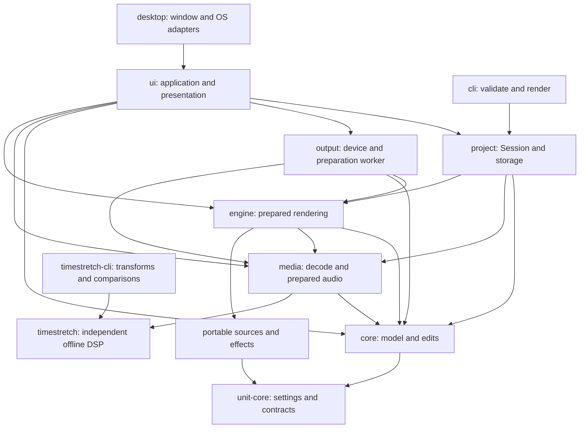
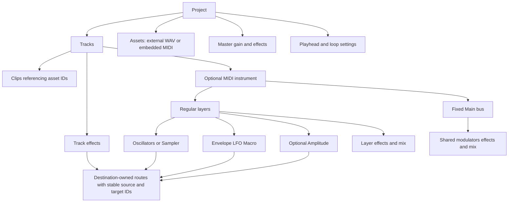

# Architecture map

[Review index](README.md) · Baseline `2dbb347`

## Dependency direction

Arrows mean “depends on”; they do not show audio direction. The [inventory](inventory.md) lists direct workspace dependencies rather than hiding them behind this grouped view.

The normal workspace dependency graph is acyclic. Portable unit implementations have no project, UI or device dependencies. Auto-filter additionally reuses the LFO crate. The CLI reaches the rendering/media stack through Project without depending on UI or Output. Engine imports Media's prepared-audio types; this also couples its build graph to Media's offline codecs and native stretch dependency. That is a packaging boundary, not callback I/O.

The independent `timestretch` package depends on RustFFT, not Rubber Band. Media and the optional reference tooling call the separately licensed native backend. This review inspected only repository-owned wrappers and the independent engine, not Rubber Band implementation source.

## Data ownership

| State | Owner and lifetime | Saved? | Transfer rule |
| --- | --- | --- | --- |
| Project, tracks, clips, assets, transport settings | [Core `Project`](../../../crates/core/src/lib.rs); current value in Session | Yes | Clone candidate, apply transaction, validate, then replace |
| Unit settings, versions, IDs, routes | [Unit core](../../../crates/unit-core/src/lib.rs), nested in Project | Yes | Stable IDs for moves; fresh IDs for copies; route remapping in Core |
| MIDI pattern content | Asset embedded in Project | Yes | Pattern edits create a new asset and change only the edited clip's reference |
| Original PCM and peaks | [Media `AudioData`](../../../crates/media/src/lib.rs), `Arc` storage | No | Session, plans, workers and history share immutable buffers |
| Stretch and Sampler banks | [Session](../../../crates/project/src/lib.rs) and [Sampler preparation](../../../crates/project/src/sampler.rs) | No | Publish complete maps together with the project that uses them |
| Immutable rendering input | [Engine `RenderPlan`](../../../crates/engine/src/lib.rs) | No | Model/maps cloned on control path; PCM remains shared |
| Mutable DSP, schedules, delays, voices | Engine `Renderer` | No | Construct on control/worker; callback owns active instance; worker owns checkpoints |
| Device stream, converter, commands, retirement | [Output `AudioOutput`/`Callback`](../../../crates/output/src/lib.rs) | No | Bounded queues and atomics; final old renderer destruction outside callback |
| Undo/redo/saved checkpoint | [Project `SessionHistory`](../../../crates/project/src/history.rs) | No | Session snapshots, 100 undo entries, grouped pointer edits |
| Selection, focus, viewport, drafts, drag previews | [UI `DawUi`](../../../crates/ui/src/lib.rs) and focused modules | Usually no | UI state, scoped by project/track/layer/unit IDs; canceled on invalidation |
| Collapse, modulation-open flags, component presentation order | Project-owned unit/layer settings | Yes | Visual changes currently use normal model/edit infrastructure |
| Theme, accent, titlebar preference | [App settings](../../../crates/ui/src/settings.rs), eframe storage | Separately | Immediate application; no project dirty flag |
| Live meters and performance counters | Output/UnitMeter atomics; UI reads snapshots | No | Stable-ID handles; disabled units mask stale readings |

Model and audio publication occur at different times. A successful edit can already be visible and undoable while the old renderer is still audible. Renderer revisions protect activation order; this is deliberate staged publication, not one global transaction across the filesystem, UI and device.

## Saved model and format boundary

The experimental manifest has no top-level schema-version field. Unit/engine settings carry their own versions/revisions, and Serde defaults plus custom deserializers migrate supported legacy shapes. Instrument version 3 carries layers and Main; legacy source/envelope representations migrate in Unit core. Unknown effect type IDs retain their JSON payload as `EffectSettings::Missing` and bypass with a warning. Known invalid settings fail validation; “unknown effect retained” is not permission to accept an invalid known processor.

Project settings support 44.1/48/88.2/96/176.4/192 kHz and power-of-two buffers from 32 to 4096 frames; defaults are 48 kHz/512. Project folders contain `project.json` and an `assets` directory, but imported recordings remain external references. MIDI content is embedded; prepared audio, undo history and DSP state are not serialized. Before a stable format or incompatible migration, add an explicit format-version/recovery policy rather than relying only on accumulated defaults.

## Threads and queues

| Execution context | Work | Communication and bounds |
| --- | --- | --- |
| Native UI thread | OS menu/input, egui, model edits, history, `Session::plan`, output polling/draining | No blocking receive in ordinary polling. Initial output creation and file-dialog calls can block this thread. |
| UI general job | Open, import, blocking save/Save As, stretch, export, settings, Sampler preparation | `run_job` starts a thread and stores one result receiver. UI guards allow one current blocking job. Dropped/canceled jobs can still run until their work observes cancellation. |
| Regular Save worker | Write an immutable save snapshot while editing continues | Separate result channel plus project/change/navigation revisions |
| Two file-preview workers | Decode, rate-convert and build peaks for hovered files | Bounded 64-request queue, owner cancellation, result channel per hover |
| Audio preparation worker | Latest plan/transport, DSP construction, replay, checkpoints, catch-up | One pending request and one ready result; Mutex/Condvar only outside callback; revision cancels stale work |
| Device callback | Bounded commands, processing, optional device conversion, peaks/status | 32-command queue; at most 8 commands per callback update; 64-owner retirement queue |
| CLI thread | Project load, validation, offline render/encoding | Synchronous by design; no window or audio device |

Read-only atomics do not make multi-field status transactional. Output's transport read path uses bounded reads; it must not wait for a callback publication. Performance snapshots are diagnostic samples, not a synchronized event log.

Sources: [UI job and frame orchestration](../../../crates/ui/src/lib.rs), [regular save](../../../crates/ui/src/regular_save.rs), [preview queue](../../../crates/ui/src/file_drop.rs), [audio worker](../../../crates/output/src/preparation.rs), [callback/queues](../../../crates/output/src/lib.rs).

## Clocks and identities

| Domain | Representation | Conversion/constraint |
| --- | --- | --- |
| Arrangement | Integer project sample frames; clip end exclusive | Source mapping, clipping and overlap rules live in Core |
| MIDI content | Integer note ticks | Tempo/rate map ticks to frames; clip trim/repeat/stretch then map audible positions |
| Source playback | Source offset plus local clip time | Repeats use saved base/phase; stretched coordinates refer to prepared output |
| Note lifecycle | Note age, gate, release age, triggering duration | Host schedules; Envelope/Amplitude own contour and gate processing |
| Live activation | Monotonic generated project-sample count | Separate from playhead, which can seek/wrap; schedules prepared renderer activation |
| Device | Device sample rate and callback frame count | Preallocated conversion when project/device rates differ |
| UI | Logical points, input frames and wall-clock repaint deadlines | View-specific zoom/scroll; input converted to project coordinates before edit |

Names and list indices are presentation, not identity. UUIDs connect tracks, assets, clips, layers, oscillators, providers, targets and routes. Prepared lookup tables accelerate identity resolution. Component display order is separate from modulation execution order and serial effect order.

## Extension seams

1. **New component:** add portable settings/contracts and DSP; integrate host construction and lifecycle; register catalog availability once; supply a shared-shell panel; add validation, copies/remapping, snapshots and persistence coverage.
2. **New effect:** add portable processor and versioned settings; extend the closed `EffectSettings`/`RuntimeEffect` dispatch; register catalog entry; use existing panels/modulation/drag paths; integrate latency and monitoring. Current registration does not automate all of these steps ([F12](findings.md#f12-host-integration-still-has-separate-type-switches)).
3. **New source format:** extend Media preparation and diagnostics; keep Session's immutable prepared buffers and engine scheduling contracts. Do not decode in the callback.
4. **New frontend:** use Core/Project/Engine. UI currently owns application action orchestration; a second interactive frontend would need either shared action services or its own orchestration.
5. **New output backend:** keep device configuration/conversion in Output or a peer adapter; retain bounded publication and retirement.

Keep composition and typed contracts. A universal plugin/graph interface or a new job framework is not required to address the immediate findings.
