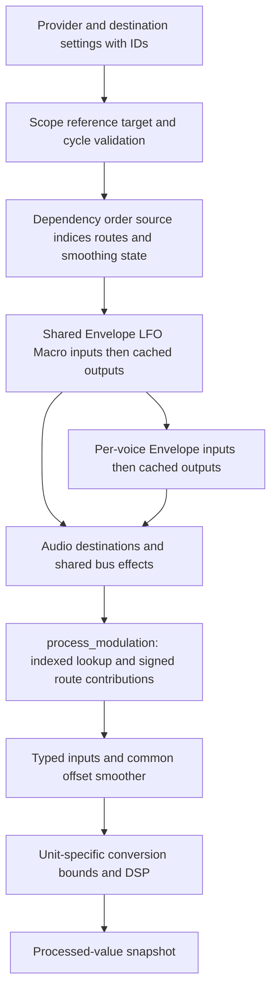

# Audio and modulation pipelines

[Review index](README.md) · Baseline `2dbb347`

## Render preparation

| Stage | Input → output | Owner/context |
| --- | --- | --- |
| Snapshot | Current Project + prepared maps → `RenderPlan` | [Session::plan](../../../crates/project/src/lib.rs), control thread |
| Arrangement indexing | Clip ranges/assets → sorted ranges, bound buffers, arrangement end, identity tables | [Renderer::new](../../../crates/engine/src/lib.rs), [schedule](../../../crates/engine/src/schedule.rs), worker/control |
| Instrument preparation | Patterns/settings → note events, voice slots, restart indices, providers/routes, Sampler references | [MidiTrackRuntime::with_audio](../../../crates/engine/src/midi.rs), worker |
| Effects | Saved chains → concrete portable processors, prepared routes, stable-ID matching tables | [EffectChain::chain](../../../crates/engine/src/effects.rs), worker |
| Mix/latency | Track/layer solo, gains, pans, chain delays → coefficients and alignment buffers | [latency](../../../crates/engine/src/latency.rs), [layer_effects](../../../crates/engine/src/layer_effects.rs), worker |
| Transport preparation | Desired position/mode → reconstructed notes/DSP and latency pre-roll | [TransportCache](../../../crates/engine/src/transport_cache.rs), [output worker](../../../crates/output/src/preparation.rs) |
| Meter binding | Prepared unbound DSP → stable output handles | Output worker, after replay/catch-up |
| Publication | Ready renderer/revision → bounded queue → active callback renderer | Output control/UI drain and callback |

Do not mutate `Renderer.plan.project` in place: the prepared indices, coefficients and schedules would no longer describe it. The public structure permits this technically; immutability is an integration invariant.

## Signal path

```mermaid
flowchart LR
  WAV[Audio clip: source mapping and fade] --> TF[Track effects]
  Notes[MIDI clip and note events] --> Voice[Per-note sources]
  Voice --> Amp[Per-note Amplitude and velocity]
  Amp --> SumV[Sum voices per layer]
  SumV --> LF[Layer effects]
  LF --> LA[Layer latency alignment]
  LA --> LG[Layer gain pan and audibility]
  LG --> SumL[Sum layers]
  SumL --> MF[Instrument Main effects]
  MF --> MG[Main gain and pan]
  MG --> TF
  TF --> TA[Track latency alignment]
  TA --> TG[Track gain pan and audibility]
  TG --> MT[Post-fader track meters]
  MT --> SumT[Sum tracks]
  SumT --> MasterFX[Master effects]
  MasterFX --> MasterGain[Master gain]
  MasterGain --> Out[Transport transition and output monitoring]
  Out --> Convert[Optional device conversion and sample-format clamp]
  Convert --> Device[CPAL device]
```

All regular layers receive the track's notes. Main is a shared bus outside the layer list; it does not own audio generators. Layer effects run once per layer bus, not once per voice. Track and Master chains are also bus processors. The no-layer-effects path retains an optimized legacy voice sum; it has the same intended routing, but different mixing code.

Audio tracks bind immutable original or prepared-stretch PCM. A range cursor retains the current clip or gap, using binary search at discontinuities. `Clip::source_frame` handles offsets and repeat phase. Missing samples produce silence. Boundary fades use project-rate timing. Stereo balance and mono equal-power pan are distinct paths. Layer gain/pan, track gain/pan, solo precedence and Master gain are applied at their respective buses.

The live and export paths share units, schedules and effect chains, but [`Renderer::next_sample` and `offline_frame`](../../../crates/engine/src/lib.rs) contain separate mix loops. Live processing additionally advances control ramps, transport transitions, loops and peak monitoring. Export uses committed targets and sequential history. Shared DSP does not mean one identical top-level function ([F11](findings.md#f11-live-and-offline-mix-loops-can-drift)).

## Notes, voices and source stages

1. Prepare clip events from immutable patterns. Keep note IDs and map ticks through tempo, clip offsets, stretch and repeats.
2. Allocate voice slots and release capacity before publication. Prepare per-slot starts and shared-note prefix state for restart lookup.
3. On a continuous frame, dispatch due note-off/on events. On a discontinuity, find the applicable clip and latest assigned note per slot, reconstruct note age/gate/release and Sampler position.
4. Advance shared providers once, then local per-voice providers in dependency order.
5. For each active voice/layer, process source destinations, sum oscillators or read the prepared Sampler, apply Amplitude and velocity, and retain transition state.
6. Sum layer contributions, apply buses, and publish processed-value extrema through prepared identities.
7. Idle voices bypass unnecessary layer/control traversal. Shared continuous providers continue. Mute/solo and power do not indiscriminately destroy histories.

| Unit | Processing stages | State/limit |
| --- | --- | --- |
| [Oscillator](../../../crates/oscillator/src/lib.rs) | Note pitch + base transpose + smoothed targeted pitch → waveform oscillator → smoothed gain/power | Stable oscillator UUID; pitch/gain destinations; compatible updates retain phase |
| [Sampler](../../../crates/sampler/src/lib.rs) | Select prebuilt note-pitch buffer → local playback position → One-shot/Gate lifetime → boundary and gain/power ramps | No decoding/stretching at note-on; prepared immutable bank; Gain destination |
| [Envelope](../../../crates/envelope/src/lib.rs) | Note event/duration → Time/Note timing → ADSR stage/curve → modulated stage controls → contour publication | Per note or shared Retrigger/Legato; modulated timing can require historical replay |
| [LFO](../../../crates/lfo/src/lib.rs) | Transport/note origin → base rate + integrated rate offset → waveform/phase/analytic smoothing → polarity/depth → continuous publication | Shared; continues beyond note-off; discontinuity resets accumulated rate-offset phase unless host replay supplies history |
| [Macro](../../../crates/macro/src/lib.rs) | Base knob ramp + shared input offset → bounds → continuous output per stable strip ID | One module, multiple named/powered strips; routes can target individual strips |
| [Amplitude](../../../crates/amplitude/src/lib.rs) | Base level + resolved contour/continuous control → note-gate/release handling → per-voice audio gain | Shared input composition preserves neutral contribution and note lifetime; bypass uses the note gate |

## Modulation pipeline

The shared [protocol](../../../crates/unit-core/src/modulation/protocol.rs), [graph](../../../crates/unit-core/src/modulation/graph.rs), [index](../../../crates/unit-core/src/modulation/index.rs), and [runtime](../../../crates/unit-core/src/modulation/runtime.rs) own the contract. Host [SharedControls](../../../crates/engine/src/modulation.rs) and [ProviderControl](../../../crates/engine/src/continuous_modulation.rs) construct concrete units and supply clocks/events. A destination reads cached values; it never recursively samples its source.

Per-note consumers can use local/shared sources. Shared providers and bus effects use shared sources only. Main providers are available within their instrument. Master and audio-track effects cannot refer to arbitrary instrument providers. All assigned provider edges count for cycle validation, including disabled and zero-amount routes. Source pickers apply the same scope/cycle rules as saved-reference validation.

The source index has a generation tied to publication order. Values can change without rebuilding it. Routes cache validated slots, retain local precedence, sum typed contributions and preserve ramp state by stable identity. Route/source power uses shared contribution ramps; destinations use common offset smoothing where specified. Empty routes still feed neutral inputs and advance the destination's smoothing back to neutral. Parameter meaning, signed units and final bounds remain in the destination contract. See the [full contract](../../modulation/contract.md) for Amplitude's contour/continuous composition and parameter tables.

## Effect processing stages

All effects enter through `process_modulation`, retain their own DSP bounds/history, and use the same saved chains, controls, drag handlers and bypass lifecycle. This table maps algorithm blocks, not a claim of a mathematical audit of each implementation.

| Effect/source | Ordered DSP blocks | Dominant scaling or state |
| --- | --- | --- |
| [3-band EQ](../../../crates/equalizer/src/lib.rs) | Smoothed effective bands → cached configuration → Low → Mid shelf/cut branches → High → band audibility and bypass → output band monitors | Filter history; unchanged configuration is cached, audio still runs |
| [Drive](../../../crates/drive/src/lib.rs) | Color filter branches → weighted color → normalized soft clip → tone filter → level/power mix | Multiple filter branches, nonlinear arithmetic |
| [Saturator](../../../crates/saturator/src/lib.rs) | Drive → fixed 4× FIR interpolation → shape/clip → FIR decimation → clip guard → level and aligned dry/wet/bypass | 129-tap filters; 32 project-frame latency; mirrored histories |
| [Bitcrusher](../../../crates/bitcrusher/src/lib.rs) | Drive → stepped resolution and shared stereo sample-hold clock → level/dry-wet/bypass | Per-channel held values; no sample-rate converter |
| [Auto-filter](../../../crates/auto-filter/src/lib.rs) | Project-clock internal LFO + external offsets → cutoff/Q → filter response mix → level/dry-wet/bypass | Per-sample filter and modulation state; clock-sensitive |
| [Compressor](../../../crates/compressor/src/lib.rs) | Linked Peak/RMS detection → knee/ratio gain target → attack/release → gain/level → wet/bypass | Detector and gain envelope; reduction meter |
| [OTT](../../../crates/ott/src/lib.rs) | Phase-matched three-band splits → per-band input/detector/up-down gain/output → sum → level/wet/bypass | Crossover banks, three dynamics paths; signed gain monitors |
| [Limiter](../../../crates/limiter/src/lib.rs) | Input gain → fixed delay and peak range query → L/R or M/S gain envelopes → final linked guard/true-peak stage → aligned bypass | Fixed rate-dependent latency; delay/peak-tree storage; coefficient cache |
| [Direction Mixer](../../../crates/direction-mixer/src/lib.rs) | Optional M/S input decode → direction/spread matrix → power blend | Small matrix; input interpretation stays discrete |
| [Stereo Spread](../../../crates/stereo-spread/src/lib.rs) | Filter bank → frequency-dependent signed intensity → complementary stereo distribution → order transition/power blend | Filter count grows with Order; prepared alternate bank during transitions |
| Missing effect | Retain settings/identity; no processor | Bypass plus load warning |

Disabled does not universally mean zero CPU. Filters, delay paths and transitions may keep running to retain state and fixed latency. UnitMeter clears and suppresses disabled readings without changing that audio lifecycle.

## Latency

`latency::chain_frames` sums Limiter and Saturator latency. Each layer delays by the difference from the longest regular layer. Main latency is added after the layer sum. Track alignment includes instrument plus track-chain latency; Master latency is added after track alignment. Worker pre-roll fills the alignment state. Loop-aware frame helpers map delayed clocks through a loop.

**Known omission:** `EffectChain::sample` adjusts the clock for following effects only after Limiter. Saturator's 32-frame delay is counted in alignment but not this clock update. Main also uses saturating subtraction rather than the common loop-aware helper. See [F01](findings.md#f01-effect-clock-latency-is-incomplete). Audio delay compensation and modulation-clock compensation must be tested separately.

## Transport and plan activation

| Operation | Stages and visible behavior |
| --- | --- |
| Initial Play | UI constructs stream/initial runtime, starts worker request, prepares requested transport, queues ready renderer, callback applies fade. Device creation is still synchronous. |
| Pause/resume | Revision-checked immediate command retains active history. Pending preparation has a distinct PausePending command so current audio can stop promptly. |
| Stop/origin | Prepare stopped state at original playback start; subsequent origin action seeks frame zero. Transport state supplies button availability. |
| Seek | Update desired frame/revision → worker cache/replay → pre-roll → queue → activation. Existing audio continues. While both intent and active transport play, displayed playhead follows active audio. |
| Compatible edit | Prepare new renderer → callback verifies identity/latency compatibility → inherit/swap state and retarget ramps → retire old owner. |
| Incompatible edit | Callback captures active transport + monotonic sample clock → UI drain returns replacement to worker → exact reconstruction → catch up with `next_sample` → scheduled activation. |
| Missed activation deadline | Keep old audio; return replacement for a fresh anchor; double delivery lead up to one second. No callback replay. |
| Loop/end | Apply loop mapping and boundary transition; without Loop, stop at arrangement end. Notes and latency feed clocks use shared scheduling helpers. |

Catch-up starts with 100 ms delivery lead and publishes only with at least half that lead remaining. Revisions reject superseded results. A full command queue retains ready state for retry; a full retirement queue postpones replacement. Backpressure preserves ownership and running audio but can increase latency. If reconstruction cannot outrun playback, activation can keep being postponed.

TransportCache holds at most 64 checkpoints spaced 250 ms apart, before latency priming. It is active for the Envelope-history path. It replays through the complete renderer from the nearest preceding checkpoint. PCM is shared; all mutable DSP state is independent and meter handles are detached. A new plan allocation invalidates the cache. Live/paused versus stopped loop semantics also invalidate checkpoints. Idle warming covers up to eight seconds ahead in a loop or four seconds without one, capped at loop/project end.

This does not guarantee identical pre-seek effect/LFO history for every configuration. Without the Envelope-history predicate, ordinary transport preparation resets processors, reconstructs applicable note state and primes latency rather than replaying the whole past. Offline export processes from frame zero. See [F15](findings.md#f15-transport-history-semantics-are-not-uniform).

## Device and telemetry stages

[`AudioOutput::new`](../../../crates/output/src/lib.rs) chooses the default CPAL device, prefers project rate where supported, requests the saved buffer size clamped to supported limits, and retries with the device default buffer on construction failure. Callback buffers may differ from project blocks.

The callback drains a bounded number of commands, generates project samples, runs preallocated Rubato conversion if rates differ, maps stereo to the device format/channels, clamps device samples, and publishes transport/meters/performance atomics. Actual callback frames and device rate define the deadline. An overrun counter is not a hardware-xrun measurement. Device errors set failure status; UI reports the failure and drops output. Editing and export remain available.

The control path drains retired owners and destroys them outside the callback. The current implementation does this on the UI thread. Both a blocked drain and a large destructor can therefore affect responsiveness. Unit snapshots follow stable IDs and read effective processed values without advancing DSP; preparation binds them only after history replay so it cannot contaminate live displays.
