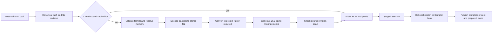

# Preparation, caching and memory

[Review index](README.md) · Baseline `2dbb347`

Follow-up on 2026-10-19 supersedes the baseline cache/history limits and same-allocation-only reuse described below. See [exact idle preparation and memory policy](../performance.md#idle-coverage-and-exact-reuse) and [F05/F06 status](findings.md#f05-cold-history-replay-can-still-take-a-long-time). Settings now provides [seek cache profiles](../performance.md#seek-cache-profiles) over the same exact-history cache. Other baseline observations remain review evidence.

## Media pipeline

[`decode_wav_cancellable`](../../../crates/media/src/lib.rs) validates mono/stereo PCM16, PCM24 or float32 WAV, estimates/reserves output and known scratch, decodes with Symphonia, converts sample rate with Rubato as needed, and builds peaks. Original metadata remains separate from the prepared rate. Immutable stereo frames and peaks live in `Arc<Vec<...>>`. Decode, conversion and peak generation check cancellation between bounded chunks.

[`decode_wav_cached`](../../../crates/media/src/cache.rs) uses canonical path, processing rate, file length and modification time. It checks revision before and after a miss's decode. Its Mutex covers metadata lookup/insert, not decoding. Entries have weak owners, so the cache does not extend PCM life. Simultaneous misses can decode the same file twice; the cache is not an in-flight request coordinator. Equal length plus a restored timestamp can hide content replacement.

The app loads whole sources into memory. There is no disk-backed audio streaming cache, persistent waveform pyramid, persistent transformed-audio store, or saved seek-checkpoint file.

## Stretch stages

1. Core computes a reduced positive output/source ratio, source mapping and final arrangement. Group changes use one validated result, including neighbor trim/removal.
2. Session enumerates timeline and Sampler-input clips, deduplicates `(asset_id, ClipStretch)` requirements and tests existing prepared buffers against source identity and engine revision.
3. Media reserves output/known scratch and calls the selected engine. Ratio 1 with unison pitch reuses the source. Transforms operate on the source buffer; clip offsets select from the prepared result.
4. The Rubber Band wrapper uses its public offline API with linked channels, study/process/retrieve stages and cancellation between work chunks. Rubber Band R3 is the saved default.
5. The independent Integrated engine validates layout/rate/finite input and resource bounds, derives exact output length, handles identity/DC paths, then performs transient analysis and spectral processing. Its own memory preflight is separate from Media's shared admission.
6. Offline pitch uses bounded stages for large offsets and sinc resampling plus stretch composition. Engine and pitch revisions participate in prepared identity. Timeline stretching uses unison pitch; Sampler requests note-relative pitches.
7. Prepared output receives new peaks and shared buffer ownership. Session publishes its new stretch map and Sampler map together only after all preparation succeeds.

Sources: [Session::prepare_stretches_cancellable](../../../crates/project/src/lib.rs), [PreparedStretch/wrappers](../../../crates/media/src/stretch.rs), [independent Request](../../../crates/timestretch/src/lib.rs), [spectral processing](../../../crates/timestretch/src/spectral.rs), [transients](../../../crates/timestretch/src/transients.rs), [pitch composition](../../../crates/timestretch/src/pitch.rs). Backend implementation details and acceptance gates remain in [the stretch specification](../../audio/timestretch.md) and [acceptance plan](../../acceptance/timestretch.md). This review does not declare perceptual acceptance of the experimental backend.

## Sampler stages

| Stage | Behavior |
| --- | --- |
| Assign | A file supplies a new external asset; a clip supplies its visible source mapping. Track effects are not baked into the sample. |
| Compose input | Apply input clip offset/repeat/stretch, then Sampler start/end selection; missing available samples become silence. |
| Duration | Off/Time/Bars settings and project rate/tempo determine output length. |
| Pitch discovery | Session scans the track's referenced patterns, including hidden notes, collects unique pitches, and always includes root. |
| Reuse | Match source `Arc`, input mapping, region, duration ratio, engine/pitch revision and pitch offset; reuse matching variants. |
| Build | Prepare selected region and each missing pitch variant; reuse previous compatible region and variant owners. |
| Publish | Replace the complete bank atomically; root output also serves preview lookup. |
| Runtime | Preallocated voices select immutable buffers by note pitch, then portable Sampler handles local position, trigger, Gain and ramps. |

Sources: [Session Sampler orchestration](../../../crates/project/src/sampler.rs), [PreparedSampler](../../../crates/media/src/sampler.rs), [UI preparation guard](../../../crates/ui/src/sampler_panel.rs), [portable playback](../../../crates/sampler/src/lib.rs).

Cost is roughly proportional to selected duration × required pitches × transform cost, with extra intermediate buffers for wide pitch shifts. Playback does not pay this cost at note-on. A note edit only needs a bank job when the resulting requirements cannot use the current bank; the general transaction path checks this before publication.

## Cache and retained-state inventory

| Store | Key/validity | Owner and retention | Invalidation/eviction | Cost or weak point |
| --- | --- | --- | --- | --- |
| Decoded PCM/peaks | Canonical path + rate + length/mtime | Process-wide weak cache; Session/plan/history own buffers | File revision/rate mismatch; dead entries pruned at lookup | No content digest or in-flight deduplication |
| Session original audio | Asset ID | Current session and snapshots | Map replacement/preparation; asset removal policy is incomplete | Unused external assets can keep decoded media live |
| Prepared stretch | Asset ID + reduced ratio; match source pointer, rate, engine and pitch identity | Session maps, plans/history; immutable output | Preparation rebuilds required map and reuses valid entries | Full-source transforms can exceed visible clip needs |
| Sampler region/bank | Sampler ID; source pointer, mapping, region, duration, revision, pitch | Session, renderers/history | Reuse compatible variants; rebuild required bank | Many pitches multiply retained PCM |
| Waveform peaks | Source buffer's fixed 256-frame blocks | Same AudioData ownership | Rebuilt with PCM | A single peak level still scans many blocks at wide zoom |
| Prepared schedule/identity tables | One immutable plan | Each Renderer and clones | New renderer | Construction and metadata copies scale with project size |
| Transport checkpoints | Same plan allocation; frame + live/stopped rules | Audio worker; base renderer + up to 64 snapshots | Plan change, mode change, FIFO insertion eviction | Count cap only; deep DSP/model copies; cold prefix replay |
| DSP configuration | Current effective parameters | Individual processor | Relevant parameter change/reset | EQ/Limiter reduce repeated work; this is not cached audio |
| Undo/redo | Full normalized Session snapshot | SessionHistory, 100 undo entries plus current/pending/redo state | Oldest undo eviction; new edit clears redo | Shared PCM but cloned model/maps; no independent byte budget |
| Save snapshot | Project ID + change/navigation revisions | Regular Save worker and pending save | Completion/error | Temporary extra metadata/maps; cannot overwrite live state |
| Pending/retired renderer | Request revision and activation clock | Worker/queues/UI drain | Superseded request, activation, control-thread drop | Several copies can coexist; UI progress controls retirement |
| File-hover result | Hover-owned path/rate/request | Hover or import worker | Drop cancels; ownership transfers on release | At most two concurrent decodes, 64 waiting requests |
| UI drafts/geometry | Stable IDs + current view/project | DawUi/egui temporary state | Focus, selection, project/view change and explicit cancellation | No general retained-render cache; immediate UI is rebuilt |
| Unit/track meters | Stable unit/track/target IDs | Output handles retained through retirement | Output replacement; disabled masks/clears readings | Atomics read by UI; not saved; no DSP advancement on reads |

“Eviction” means releasing a store's owner. Another plan, job or undo snapshot can keep the underlying audio alive. Weak cache cleanup cannot reclaim audio still needed by those owners.

## Memory admission

[`AudioReservation`](../../../crates/media/src/memory.rs) enforces a shared **2 GiB PCM/known-scratch admission budget**. Weak sample/peak owners are deduplicated by pointer; reservations include concurrent work and buffers retained by older renderers/history. Arithmetic is checked and key output reservations are fallible. This protects preparation; it is not a process memory cap.

Outside that budget: model snapshots, note schedules, DSP/delay/checkpoint state, native codec/backend internals, egui allocations, GPU resources, stack/thread storage and allocator overhead. One second of stereo f32 PCM is `8 × sample_rate` bytes before peaks. One hour at 48 kHz is about 1.29 GiB before scratch, transformed copies or history. This is arithmetic, not a measured capacity guarantee.

Admission can fail even after a user deletes visible content because old assets or history still retain owners. The current error suggests shortening sources or closing unused projects; it does not show the bytes held by each category. See [F02](findings.md#f02-unused-assets-accumulate) and [F06](findings.md#f06-memory-limits-do-not-cover-total-retention).

## Jobs, cancellation and failure boundaries

| Work | Current cancellation behavior | Publication/error behavior |
| --- | --- | --- |
| File hover | Drop sets cancellation token; chunks observe it | Owner-only result; full queue reports retryable error |
| Audio preparation/prefetch | New revision or worker closure; checked at block boundaries | Stale result cannot activate; active renderer continues |
| Sampler/settings preparation | UI exposes Cancel token; receiver can be dropped | Complete staged Session only; old state stays active on failure |
| Timeline stretch job | Gesture can cancel before release; job calls noncancellable `prepare_stretches()` wrapper | No user cancellation during this job; failure leaves live session intact |
| Open/import | General job uses noncancellable public paths in these entries | One completed session/result; error retains old project |
| Regular Save | No cancel; small separate worker | Exact saved snapshot checkpoint; newer edits stay dirty |
| Export | Progress callback, no cancellation parameter | Finalizes temporary output before publication; failure removes temp where possible |

The lower layers often support cancellation, but that does not make every user action cancellable. See [F09](findings.md#f09-background-job-cancellation-is-inconsistent). A completed worker job is polled by UI; most general jobs use frame polling rather than their own completion wake-up.
