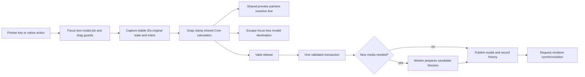

# UI, editing and presentation pipelines

[Review index](README.md) · Baseline `2dbb347`

## Frame stages

The desktop adapter supplies native events and invokes [`DawUi::show`](../../../crates/ui/src/lib.rs). These are logical stages; some controls submit changes during painting.

1. **Native input:** file-drag adapters enrich raw input; native titlebar/menu adapters dispatch shared actions.
2. **Validate interaction state:** ensure history baseline; check active drags against focus, project, track, view and edit availability.
3. **Collect completed work:** poll general jobs and regular Save; publish successful session results before beginning a new pointer undo group.
4. **Handle actions:** keyboard/menu guards preserve text ownership; update file hover; drain output owners/ready plans; read active transport and device errors.
5. **Compose view:** toolbar/status plus Timeline, Instrument, Editor or Mixer. Shared shells draw panels and controls. Current pointer state creates previews or live parameter drafts.
6. **Finish gestures:** release-only actions validate and commit; focus loss/Escape cancel captured gestures. Deferred inline effects edits publish after all instrument rows so older row snapshots cannot overwrite them.
7. **Synchronize audio:** if `sync_needed`, build `Session::plan` and submit it to Output when output exists. This stage currently builds the plan even when no output exists.
8. **Finish UI state:** dialogs, selection/focus cleanup and history-group closure; schedule repaint for playback, preparation, jobs or transitions.
9. **Present:** egui tessellation/render submission and native window presentation are eframe/backend work. Headless egui tests do not measure this stage.

Idle has no unconditional 60 Hz loop. Active playback/preparation/jobs request 16 ms polling; a 250 ms grace period handles final transitions. The audio worker can request an egui repaint. This limits idle work but also makes UI throughput part of the current output-handoff latency.

## Views and shared modules

| Surface | Composition and data | Shared pieces |
| --- | --- | --- |
| Timeline | Catalog/Tracks, project ruler, clip lanes, pinned Master and bottom effects lane | [ControlPanel](../../../crates/ui/src/panels.rs), [clip_lane](../../../crates/ui/src/clip_lane.rs), [clip_paint](../../../crates/ui/src/clip_paint.rs), [mix_controls](../../../crates/ui/src/mix_controls.rs) |
| Instrument | MIDI target selector, scrolling regular layers, pinned Main, inline effects, track effects lane | [instrument_panel](../../../crates/ui/src/instrument_panel.rs), [instrument_main](../../../crates/ui/src/instrument_main.rs), [layer_effects](../../../crates/ui/src/layer_effects.rs), shared unit panels |
| Editor | Track overview and piano roll at project coordinates, own zoom/scroll | [midi_editor](../../../crates/ui/src/midi_editor.rs), [track_overview](../../../crates/ui/src/track_overview.rs), same clip interaction/painting and ruler helpers |
| Mixer | Track and Master mix strips/monitoring | [mixer](../../../crates/ui/src/mixer.rs), shared faders, numeric gain, mix controls and meters |
| Library | Component/effect categories, entries, multi-selection, keyboard navigation | [catalog](../../../crates/ui/src/catalog.rs), type metadata in component/effect registries |
| Unit controls | Shared header, power/collapse, strips, knobs and modulation | [panels](../../../crates/ui/src/panels.rs), [knobs](../../../crates/ui/src/knobs.rs), [parameter_knobs](../../../crates/ui/src/parameter_knobs.rs), [modulation_panel](../../../crates/ui/src/modulation_panel.rs), [rows](../../../crates/ui/src/rows.rs) |
| Dialogs/preferences | Settings, project name/settings, export options/status, errors/unsaved prompt | [dialogs](../../../crates/ui/src/dialogs.rs), focused dialog modules, guarded shared actions |

Native platform code stays in Desktop: macOS menu/titlebar/file drag, Windows caption/input/file drag and Linux file-drag adapter. Windows uses Glow for caption composition; macOS/Linux use wgpu. Preferences persist separately through eframe storage; general egui memory persistence is disabled by the app adapter.

## Input ownership and gesture transaction

Selections are independent: catalog, tracks/clips, notes, layers and installed units. [`selection_focus`](../../../crates/ui/src/selection_focus.rs) and [`unit_selection`](../../../crates/ui/src/unit_selection.rs) own pane focus and shared installed-unit selection shortcuts. Text input takes precedence. Empty component/effect lane focus supports Select All without a preselected unit. Selection alone does not modify Project.

[`drag`](../../../crates/ui/src/drag.rs) supplies movement/focus/edge-scroll/group-insertion primitives. [`effects_reorder`](../../../crates/ui/src/effects_reorder.rs), [`instrument_component_drag`](../../../crates/ui/src/instrument_component_drag.rs) and [`strip_reorder`](../../../crates/ui/src/strip_reorder.rs) compose those primitives for their owner and transaction type. Previews do not construct catalog instances or assign copy IDs. Duplicate modifiers are resolved by the valid release path. Moves retain identities; copies receive new instance/route/target identities as appropriate.

Component ordering is presentation-only with sources pinned first. Effect ordering changes the serial audio chain. The two orders share visual mechanics but must not be treated as one interchangeable audio ordering operation. Provider dependency order is a third, separately prepared order.

## Commit and history path

`Project::edited` clones once, applies a command or `Edit::Batch`, validates the complete proposed model, and returns it without mutating the original. Core owns overlap resolution, source mapping, valid owners, identity constraints and routing validation. UI should supply intent, not reimplement the final transaction rules.

UI's general `edit` checks whether the resulting Sampler requirements need a worker. Otherwise it publishes the model, prunes invalid selection, and calls `changed`: record history/dirty revision and request audio synchronization. Some controls mutate saved settings and then call the same dirty/sync hooks. There is not yet a single typed distinction between audio, metadata and presentation edits.

[`SessionHistory`](../../../crates/project/src/history.rs) snapshots Project and prepared maps; PCM/peaks stay shared. It normalizes source paths and excludes playhead from structural comparison. Pointer groups retain their final changed snapshot; a return to the original state does not consume Redo. Discrete edits commit individually. Undo/redo restores already prepared buffers, retains current save destination and playhead time, clears stale drafts, and submits audio synchronization. Rate/buffer changes recreate output and stop playback.

The history count is bounded, but `record` still clones and normalizes a Session on successful live updates. Grouping reduces committed steps; it does not remove per-update snapshot work. Core model clone, validation, history record and plan clone can all occur on the UI thread. Old snapshot destruction can also run there. See [F04](findings.md#f04-small-edits-still-copy-and-rebuild-broad-state) and [F06](findings.md#f06-memory-limits-do-not-cover-total-retention).

## Painting and monitoring

- Track virtualization skips offscreen fixed-height controls when no captured interaction needs them. Placeholder geometry retains panel/lane/drop alignment. It is not full virtualization of every Instrument or Editor control.
- Shared `clip_paint` draws committed and provisional clips in Timeline/Editor. Waveforms return early for empty clipped bodies, then map pixel windows through source/loop/stretch bounds.
- [`waveforms::source_extrema`](../../../crates/ui/src/waveforms.rs) uses 256-frame peak blocks and exact partial edges. There is no multilevel pyramid; very wide zoom still scans many peak blocks.
- The piano roll paints notes separately from clip miniatures; shared musical coordinates preserve project alignment through clip edits.
- Meters read atomic output snapshots; no UI read advances DSP. Unit power masks stale readings, band colors share disabled behavior, and held peaks remain monitoring state.
- Theme, fonts, icons, panel borders and control geometry are shared. Repeated border and focus fixes in the history indicate integration seams worth testing at adjacent/empty/scrolled surfaces, not a need for another panel system.

## Current structural pressure

UI contains 98 Rust source files and about 60,584 lines including tests at this baseline. `ui/src/lib.rs` includes application orchestration, transport, Timeline behavior and a large embedded test section. These counts describe maintenance surface, not runtime cost. Focused modules already exist; extract additional cohesive action/transport/job services only with a concrete ownership goal. Avoid a broad rewrite while lifecycle behavior is still being specified.

Core/engine validation can test a transaction without graphics. UI input tests can test guards, previews and release behavior without a device. Native menu, GPU presentation, actual pointer gestures, device latency and physical output failures require separate checks.
