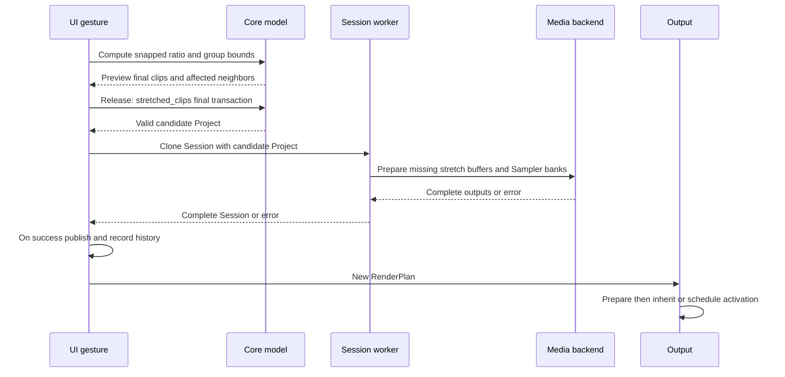

# Workflow catalog

[Review index](README.md) · Baseline `2dbb347`

This catalog traces user actions through processing stages. **Model publication** makes an edit visible and undoable. **Audio activation** makes its prepared renderer audible. They can occur at different times. File publication is a separate boundary.

## W01 Start, open, new and close

1. Desktop reads the optional project path, configures logging/window/backend, installs shared fonts/icons/theme, restores app preferences, and creates native adapters.
2. An initial path or Open action runs `Session::open` on a general job. The old session remains until success.
3. Read `project.json` → deserialize/default/migrate settings → validate model and references → report missing effect types → resolve external source paths.
4. Decode every non-MIDI asset that exists at the project rate. Missing files generate warnings and silent regions; damaged/unsupported files fail. Build stretches and Sampler banks.
5. UI polls completion and replaces the session, clears history/selection/drafts/old output, resets relevant viewport state and establishes a clean baseline.
6. New/Close/quit use a shared pending action. Unsaved state prompts Save/Discard/Cancel. Save-before-continuation completes before the pending action runs. Close-window requests are canceled while the decision is unresolved.

Open has no user cancellation token in its public path. A successful project replacement stops old output. Failed open preserves the original session. Preferences survive project replacement; project edit history does not.

Sources: [desktop startup](../../../apps/desktop/src/main.rs), [DawUi::new/open/request/perform_pending/poll](../../../crates/ui/src/lib.rs), [Session::open](../../../crates/project/src/lib.rs).

## W02 Import or drop a WAV

1. File dialog or OS drag supplies a path. Hover creates a bounded preview request at the current project rate.
2. Worker checks cache/admission, decodes, converts and generates peaks. UI polls an owner-specific result and paints the preview at the snapped placement.
3. Drop captures track/new-track target and placement. A ready hover transfers its prepared buffer; an early drop waits for that result on the import worker, not the UI.
4. Session stages a new asset/clip and optional track. Core's overwrite placement resolves neighbors by trimming, splitting or removing covered ranges.
5. Validate final model → publish session → select imported clip(s) → record history/dirty state → prepare new audio plan.

Hover cancellation does not edit the project. Invalid/outside drop does not add a track. Failed decode/admission/placement keeps the old session. Source files remain unchanged. Duplicate imports can have different asset IDs while sharing cached PCM.

Sources: [file_drop](../../../crates/ui/src/file_drop.rs), [DawUi::import_at/paint_file_hover](../../../crates/ui/src/lib.rs), [Session::import_decoded_overwrite](../../../crates/project/src/lib.rs), [Core placement](../../../crates/core/src/placement.rs).

## W03 Arrange, trim, loop, split, copy or remove clips

| Action | Capture/preview stages | Release/commit stages |
| --- | --- | --- |
| Move/group move | Original selected clips and track gaps → project delta → snapping/clamps → incoming and affected-neighbor previews | `placed_clips`/`OverwriteClips`; remove moving originals before resolving whole group; one transaction |
| Drag copy/paste | Immutable source snapshots → common displacement/new IDs only at valid commit | Preserve source audio and source metadata; copies take placement priority, even over originals |
| Waveform trim | Edge intent at initial press → common delta → per-clip source limits → neighbor resolution | `trimmed_clips`; reject full shortening if any selected clip becomes empty; MIDI can crop/pad source content |
| Contiguous boundary | Press within boundary gesture region → move shared boundary within pair/source limits | `TrimBoundary`; pair outer endpoints fixed; remove fully covered member; other selected clips use ordinary trim rules |
| Header loop resize | Capture base/phase → common snapped delta → resize priority and neighbor previews | `ResizeClips`; preserve each clip's repeat identity; remove fully covered neighbors |
| Split | Selected clips that contain the playhead, from the Edit menu, Command/Ctrl+T, or the clip context menu | `Project::split_clips`; audio uses `Edit::Split` and keeps the source recording; MIDI note division follows the application setting |
| Time range | Command/Ctrl-drag across lanes, including partial clips and silence | `clip_range_slices` / `without_clip_range` via `Clip::retained_range`; move and duplicate reuse group snapping and `placed_clips` |
| Delete | Selected IDs → guarded action | Batch delete; selection pruned; history/audio sync follows |

Timeline and Editor overview reuse [`clip_lane_interaction`](../../../crates/ui/src/clip_lane.rs), [`paint_clip`](../../../crates/ui/src/clip_paint.rs), and shared Core [trim](../../../crates/core/src/trim.rs), [boundary](../../../crates/core/src/boundary.rs), [resize](../../../crates/core/src/resize.rs), [placement](../../../crates/core/src/placement.rs) and [loop](../../../crates/core/src/looping.rs) calculations. Preview does not alter playback. Escape/focus loss cancels captured edits. No-op releases should remain clean. New media requirements take the staged preparation path before publication.

## W04 Stretch one or more clips

The primary duration defines one ratio for all selected clips. Bounds use checked integer arithmetic, each clip's 1/8–8 ratio limit, timeline limits and exclusive ends. Core resolves overlaps once for the whole result. Media uses each source's prepared identity; it does not overwrite original audio. MIDI stretch changes event-time mapping rather than rendering notes into a WAV.

Before release, Escape/focus loss cancels. After release, the current Timeline job calls `prepare_stretches()` without a cancellation token. Editing is blocked during that job; old playback can continue. Any failed preparation prevents the entire candidate session from publishing. This is a cancellation gap, not an atomicity gap ([F09](findings.md#f09-background-job-cancellation-is-inconsistent)).

Sources: [UI stretch](../../../crates/ui/src/stretch.rs), [Core resize/stretch](../../../crates/core/src/resize.rs), [Session preparation](../../../crates/project/src/lib.rs), [backend pipeline](preparation-and-caches.md#stretch-stages).

## W05 Create or edit MIDI notes

1. Creating a MIDI track creates an instrument with an empty regular layer. Creating a pattern adds embedded MIDI content and a clip.
2. Editor captures immutable clip/pattern snapshots and selected note IDs. Drawing, group movement, modifier copies, edge resize and same-pitch overwrite build provisional patterns in project coordinates.
3. Snap and clamp tick/time/pitch bounds. Paint provisional notes and clip overview without publishing them.
4. On release, submit all changed patterns as one batch. `replace_midi_pattern` appends a fresh asset and changes only that clip's reference. Other clips retain their previous content.
5. Check Sampler pitch requirements. If new buffers are needed, prepare before publishing. Otherwise publish immediately, record one history step, and request an audio plan.
6. Worker rebuilds scheduling and prepares the runtime. Compatible state is retained; incompatible Envelope-history state uses reconstruction/catch-up while the old audio continues.

Double-click deletion, Delete/Backspace and clipboard actions use the same guarded editing model. Selection changes and canceled/no-op gestures stay out of history. Old pattern assets currently remain in the live Project even after no clip references them ([F02](findings.md#f02-unused-assets-accumulate)).

Sources: [midi_editor](../../../crates/ui/src/midi_editor.rs), [Core MIDI](../../../crates/core/src/midi.rs), [Sampler requirement guard](../../../crates/project/src/sampler.rs), [MIDI runtime](../../../crates/engine/src/midi.rs).

## W06 Add a unit to a multilayer instrument

1. Select a MIDI track and regular layer or Main. Catalog selection/folders/focus are UI state.
2. Double-click/Enter or begin catalog drag. Registration metadata checks availability and supplies preview eligibility without constructing units.
3. A valid release/add action invokes registered constructors on candidate instrument settings. Oscillator/Sampler are mutually exclusive in a regular layer; neither is allowed in Main. Main supports shared modulators. Amplitude is an optional regular-layer stage.
4. Keep audio sources first in presentation. Add provider/target IDs and saved default controls. Commit through `SetInstrument` and complete model validation.
5. If needed, prepare source media. Publish the candidate → history → RenderPlan → worker prepares provider graph, source/voice capacity and bus state → callback activation.
6. New units use `PanelStyle::unit`, shared knobs and modulation controls. Discovery uses descriptors/settings rather than a separate source-type list in drag code.

Adding an effect uses the Effects catalog and owner-specific `SetEffects`, `SetLayerEffects` or `SetMasterEffects`. Instrument inline effects follow components visually, but process on their bus after source/Amplitude summing. Sources pinned first is not a generic constraint on effect-chain reorder.

Sources: [component registry](../../../crates/ui/src/instrument_catalog.rs), [effect registry](../../../crates/ui/src/effects_catalog.rs), [layer effect addition](../../../crates/ui/src/layer_effects.rs), [Core edits](../../../crates/core/src/lib.rs), [unit composition](../../../crates/unit-core/src/lib.rs).

## W07 Move, duplicate, reorder, remove and modulate units

| Flow | Stages and invariants |
| --- | --- |
| Component group move/copy | Shared selection capture → source/destination compatibility preview → Core group transfer on release → remap providers/targets/routes → one instrument publication. Moves preserve IDs except required collision remapping; copies get fresh identities. |
| Whole Oscillator/individual strip | Header group moves/copies the unit contents; strip drag moves/copies/reorders an individual oscillator. Compatible destination Oscillator units merge. Target IDs remain attached to the oscillator. |
| Macro strips | Add/remove/power/rename or reorder via shared strip controls; stable strip ID remains the routing identity. Name editing is presentation metadata. |
| Effect group move/copy | Shared effects drag/insertion preview → `Project::transfer_effects` → batch source removal/destination insertion. Regular layer, Main and track chain of the instrument share this path. Compatible history follows effect IDs; latency relocation can require replay. |
| Same-lane reorder | Components change `component_order`; effects change chain order; modulation strips change saved route order. Each keeps its own processing meaning. |
| Select All/remove selection | Focused lane + exact shortcut guards → shared selection replacement/removal → one owner edit. Text fields keep their shortcuts; no selection-only dirtying. |
| Assign modulation | Add destination-owned strip → choose scope/cycle-valid source and stable target → amount/power change → Core validation → prepared graph/routes → cached source publication → typed input/smoother/DSP. |
| Remove provider/target | Core component helpers preserve retained settings where supported and repair references according to transfer/removal semantics; removed oscillator targets lose their routes. Validate full result rather than leaving invalid IDs. |
| Collapse/open modulation | Saved presentation flags change through shared shell/owner edit; DSP settings stay present. These changes can still trigger broad synchronization today. |

A cross-instrument or Master drop is not automatically supported merely because the chain target enum can represent it. The visible gesture targets and source-scope validation constrain valid transfers. Main is an instrument bus; Master is the application mix bus.

Sources: [component transfer](../../../crates/core/src/component_transfer.rs), [group transfer](../../../crates/core/src/component_group.rs), [Macro transfer](../../../crates/core/src/macro_transfer.rs), [effect transfer](../../../crates/core/src/effect_transfer.rs), [drag](../../../crates/ui/src/instrument_component_drag.rs), [effects drag](../../../crates/ui/src/effects_reorder.rs), [shared strips](../../../crates/ui/src/strip_reorder.rs), [modulation UI](../../../crates/ui/src/modulation_panel.rs).

## W08 Assign and edit a Sampler

1. Add a Sampler to a source-free regular layer; choose a WAV or drop an audio clip/file onto it.
2. Capture the input source mapping. Decode on a worker or consume the shared hover result. Original source and track processing stay separate.
3. Choose input region, root/sharp, Off/Time/Bars duration and One-shot/Gate. Core validates the candidate settings.
4. Session determines required note pitches, composes the selected input, reuses valid region/variants, and builds missing transforms under memory admission.
5. Publish all variants and settings together; root output provides preview peaks. Failure/Cancel retains old Session and sound.
6. During playback, note-on selects a prepared buffer. Sampler Gain uses the common per-note destination contract. Telemetry reports actual prepared sample position.

Changing tempo, sample rate, root, duration, input region, stretch engine or required note pitches can change bank requirements. Knob-only Gain updates reuse PCM. See [Sampler pipeline](preparation-and-caches.md#sampler-stages) and [sampler_panel](../../../crates/ui/src/sampler_panel.rs).

## W09 Mix, tempo, settings and transport

| Action | Processing stages | Publication/limit |
| --- | --- | --- |
| Track/layer/Main/Master mix | Shared control → model → history → prepared targets → compatible ramps | Solo-over-mute uses Core rule; layer and track scopes differ |
| Track/layer reorder/rename/color | Stable IDs → owner/model validation → presentation refresh | Some metadata changes still request new plans; display order must not become provider identity |
| Tempo | `SetTempo` → checked frame scaling of beat-relative starts/MIDI/loop bounds → whole-project overlap validation → Sampler recheck | Audio durations stay fixed; MIDI ticks stay fixed; playhead frame stays fixed; failure is atomic |
| Processing settings | Clone candidate → rescale frame coordinates for rate → decode/convert sources → rebuild stretch/Sampler data | Cancel/error retains session; success replaces output and stops playback |
| Play/Pause/Stop/seek/loop | Shared action → desired transport/revision → immediate command or worker preparation → callback status | See [transport map](audio.md#transport-and-plan-activation); text owns Space when editing |
| Meter reset | Atomic held-peak/clipping reset → subsequent readings | No project edit or audio change |
| Theme/titlebar/view/zoom | App/UI state → shared theme/native adapter/layout | No audio model change; view changes cancel incompatible gestures |

Sources: [mix_controls](../../../crates/ui/src/mix_controls.rs), [audio settings Core](../../../crates/core/src/audio_settings.rs), [Project settings worker](../../../crates/project/src/lib.rs), [transport controls](../../../crates/ui/src/transport_controls.rs), [Output](../../../crates/output/src/lib.rs).

## W10 Save, Save As and unsaved changes

1. Regular Save captures an immutable Session and project/change/navigation revisions. A separate worker lets editing and playback continue.
2. Resolve external sources against the existing folder; rebase to relative paths where possible at the destination. MIDI patterns remain embedded. Recordings are referenced, not bundled.
3. Validate → pretty JSON → uniquely named temporary file in destination folder → write and `sync_all` → replace manifest.
4. Worker completion marks the exact saved checkpoint. It never publishes its old snapshot over current edits. Newer edits/navigation remain dirty.
5. First Save/Save As ask for a name and parent, create a new project folder, and refuse an existing folder. The blocking path publishes updated name/folder only on success; pending close/open actions can then continue.

History survives Save As with source references normalized against their original folders. Rename/save does not move original recordings. Errors attempt temporary cleanup and retain prior live state. POSIX rename, Windows backup-rename, directory durability and concurrent target replacement have distinct guarantees; see [F07](findings.md#f07-save-publication-is-not-fully-crash-durable).

Sources: [regular_save](../../../crates/ui/src/regular_save.rs), [Session::save/save_new/replace_file](../../../crates/project/src/lib.rs), [project-name flow](../../../crates/ui/src/project_name_dialog.rs).

## W11 Undo and redo

1. Guard against text editing, active gestures, modal jobs and unavailable stacks.
2. Finish any pending history group. Move the current normalized Session snapshot between undo/redo stacks.
3. Restore Project and prepared audio maps, current save destination and playhead time. Do not touch source recordings or reverse exports.
4. Clear obsolete drafts/selection; update dirty state against the saved checkpoint and explicit-navigation revisions.
5. Synchronize audio through the ordinary prepared-output path. If rate/buffer differs, drop/recreate output and leave playback stopped.

Undo performs no decode/stretch/file read. A new committed edit clears Redo; a structural no-op does not. History is not persisted. See [SessionHistory](../../../crates/project/src/history.rs) and [UI history actions](../../../crates/ui/src/history.rs).

## W12 Export a mix

1. Choose WAV codec or MP3 bitrate and destination; confirm replacement where applicable. Validate format and path, reject project manifest/source targets, reject empty arrangement.
2. Snapshot Session on the worker; ensure prepared stretch/Sampler data; construct independent Renderer and seek frame zero.
3. Render sequential project-rate blocks with the shared units/scheduling/mixing. Export covers frame zero to `Project::end`, not the selected loop or an automatic tail extension.
4. Encode: stereo PCM16/24 with deterministic triangular dither; float32 retains headroom; MP3 uses LAME and rate conversion to at most 48 kHz. Integer/MP3 output clamps and reports clipping.
5. Report frame progress → finalize encoder/temp file → recheck destination policy → publish file → mark status complete. A 100% frame count alone is not successful publication.
6. Failure reports in the status dialog and attempts temporary cleanup. Current export has no cancellation token; editing is blocked until the status flow closes. Project and source files remain unchanged.

The no-overwrite recheck and rename are separate operations ([F08](findings.md#f08-export-no-overwrite-has-a-check-then-rename-race)). Effect tails after arrangement end are omitted ([F16](findings.md#f16-export-stops-at-the-arrangement-end)).

Sources: [UI export status](../../../crates/ui/src/export_status.rs), [Session::export_with_progress](../../../crates/project/src/lib.rs), [encoders](../../../crates/media/src/export.rs).

## W13 Headless CLI and stretch tools

- **DAW validate:** clap parses arguments → `Session::open` performs full decode/preparation/validation → warnings go to stderr → valid project summary. This is not a cheap manifest-only check.
- **DAW render:** validate arguments/codec → open Session → shared export pipeline → warnings/success or error. Exit 0 success, 1 project/media failure, 2 invalid arguments. No UI or device initialization.
- **Independent stretch tool:** WAV request/options → portable Request or explicit reference backend adapter → output/measurement/report stages. Comparison scripts and acceptance gates are independent of DAW playback. Reference dependencies do not enter the portable engine.
- **Build/delivery:** locked workspace checks and CLI smoke → per-platform release packaging → dependency/font/backend notices → artifacts/logs. Windows/macOS/Linux jobs do not wait for another platform's aggregate result. ThinLTO and one codegen unit affect release build time and cross-crate optimization.

Sources: [DAW CLI](../../../apps/cli/src/main.rs), [stretch tool](../../../crates/timestretch-cli/src/main.rs), [platform workflow](../../../.github/workflows/platform.yml), [build matrix](../../../.github/workflows/build-and-test.yml), [tools](../../../tools).

The stretch tool's Process path validates source/output/report identity, hashes the source, decodes/converts, transforms, computes independent diagnostics/fixture metrics, stages audio and a JSON report, rechecks paths/cancellation, then publishes. Audio and report are separate publications: if the second fails, it reports partial publication and retains the published audio. Compare runs each engine in a child process with timeout/cancellation, retains logs and failures, verifies comparable source/prepared identities, and publishes a comparison summary. This is stronger process isolation than the in-process DAW transform worker, and has different cancellation/failure semantics.
