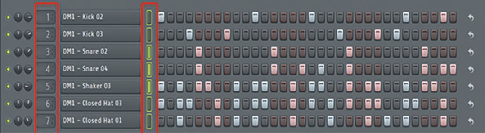

# Beat pattern editor design and decisions

Implementation requirements and design records. For user instructions, see the [user guide](../../docs/views/beat-editor.md).

Status: Beat MVP implemented across the project model, storage, renderer, CLI and both views; native platform acceptance remains open. Last updated: 2026-10-31.

The beat editor is the lower editor for beat clips in Editor. It shows one step row per beat subtrack. Instrument shows each subtrack as an expandable group with a one-row header. Its children are source layers, LFO, Envelope and Output. One overall Output lane follows all groups. Both views share subtrack creation, single/group selection, deletion, rename, reorder, gain and pan. Mixer controls the parent beat track.

The [staged implementation plan](beat-tracks-plan.md) defines delivery gates, shared-code boundaries and remaining data/UI decisions. It supersedes the older Units-view placement and D33's historical exclusion of beat processing from Instrument. Current views are Timeline, Instrument, Editor and Mixer. A beat subtrack is the child previously called a beat lane; it is not a project track group or a MIDI instrument layer.

## Confirmed requirements

| ID | Requirement | Consequence |
| --- | --- | --- |
| B01 | Support audio, MIDI, and beat track types. | Keep track type separate from editor view mode. |
| B02 | Add a beat pattern editor in the Editor view with lanes and step toggles. | Users can enable or disable steps to build beats. |
| B03 | Every beat subtrack is an instrument. | Source choice belongs to its layers; do not classify subtracks as audio or MIDI. |
| B04 | Each lane has its own sources and effects, including samples or synths as appropriate. | Lane processing must be independent and use the shared modular-unit core. |
| B05 | Mixer controls tracks only, including each beat track as a whole. | Beat lanes do not have individual mixer strips. |
| B06 | The Instrument view controls sources, effects, and modulators for beat subtracks. | Keep subtrack processing inside its Instrument group. |
| B07 | The beat pattern editor handles beat creation only. | Keep step and pattern editing in Editor and processing configuration in Instrument. |
| B08 | Each beat subtrack is one independently configured instrument with its own source layers. | Retain future subtrack polyphony without introducing audio/MIDI subtrack types. |
| B09 | Use Timeline, Instrument, Editor, and Mixer as the view names. | Editor chooses the clip editor; Instrument handles processing and Mixer handles tracks. |
| B10 | Treat beat and MIDI patterns as clip audio sources, like audio files. | Clip trimming and looping change the clip without changing its underlying source. |
| B11 | Editing a beat or MIDI pattern creates a new source. | Other clips retain their existing source and content. |
| B12 | A parent beat track has its own effects, in addition to each lane's effects. | Reuse subtrack effects inside Instrument and the existing parent-track effects lane. |
| B13 | Beat lanes have independent controls. | Expose subtrack processing in Instrument and shared mix controls in Editor/Instrument; Mixer controls the parent track. |
| B14 | The user sets pattern length and step resolution. | Store these settings with the pattern source. |
| B15 | All lanes in a pattern share its length and resolution. | Lane-specific lengths and resolutions are not supported. |
| B16 | Eventually allow customized trigger duration, including one step, until the next trigger, or stopping based on another lane. | Keep trigger duration separate from pattern length and grid resolution. |
| B17 | Let users connect lanes so triggering one stops another. | Use lane trigger events to stop the connected lane; an open/closed hi-hat pair is the reference example. |
| B18 | The Beat MVP allows at most one active voice per subtrack instrument. | Different subtracks can sound together; general MIDI-track polyphony remains governed by D29. |
| B19 | The Beat MVP provides on/off steps, per-step velocity, and one trigger-pitch setting per subtrack. | Defer per-step pitch, swing, probability, and repeated hits. |
| B20 | Each enabled step triggers its subtrack instrument, with note-off after one step. New triggers replace the active voice. | Source trigger modes, envelopes and Amplitude determine audible duration; One-shot sample sources can continue after note-off. Reuse normal instrument lifecycle and short stop fades. |
| B21 | The Beat MVP includes simple lane-stop connections. If connected lanes trigger together, the stopping lane wins. | Stop or suppress the target lane's hit and play the stopping lane's hit. |
| B22 | Open a beat clip from Timeline in Editor using the beat pattern editor, and retain its clip/subtrack selection when switching to Instrument. Keep the same instrument identity when its layer sources change. | No audio/MIDI subtrack creation or conversion command. |
| B23 | Editor and Instrument share subtrack gain, pan, mute and solo; Instrument provides serial subtrack effects. Sum lanes through serial track-level effects. | Defer parallel audio paths, shared-effect sends, and audio sidechains. |
| B24 | Default to one bar at 1/16 resolution. Offer 1–16 bars and 1/4, 1/8, 1/16, or 1/32 resolution. | Apply one grid to every lane in the pattern. |
| B25 | Place the beat pattern editor inside the shared Editor view, alongside audio and MIDI pattern editors chosen by clip type. | Replace the earlier standalone Beat view; preserve the accepted beat-editing and processing rules. |
| B26 | Give each beat track one beat instrument containing all its lanes. | Each subtrack instrument retains its own source layers, controls, effects, and voice state. Combine lanes into one output bus before parent-track effects and gain/pan. |
| B27 | Add beat track appears in the menubar/application Track menu, Tracks Plus dropdown and creation context menus. | Share one command, label and guard path with the existing Add actions. |
| B28 | Editor shows one lower-editor row per subtrack; Instrument shows one expandable group per subtrack. | Retain one parent beat track and one beat instrument. |
| B29 | Both views add, select one/several, delete, rename and reorder subtracks. | Share stable IDs, selection, transactions and release-only reorder behavior. |
| B30 | Both views expose the same subtrack gain and pan. | Bind shared controls to one canonical bus stage. |
| B31 | Each Instrument subtrack group owns independent LFO and Envelope sublanes. | Restrict additions to the matching child lane and isolate provider ownership/routes between subtracks. |
| B32 | A subtrack has a compact one-row group header and a separate Output child; one overall Output follows all groups. | Reuse the track-group header layout and normal instrument Output body. Header and Output controls bind to one canonical bus, with no additional processing stage. This supersedes the earlier named-output-header layout on 2026-10-31. |
| B33 | Beat subtracks are instruments, not audio tracks or separate audio/MIDI lane types. | Add one instrument subtrack directly. Choose Sampler/Oscillator/other supported sources inside its layers; preserve the same subtrack identity when sources change. |
| B34 | Reject beat clip moves, copies and paste between different beat tracks for now. | Preserve stable subtrack bindings; do not match rows by name or position or silently copy instruments. Same-track operations remain allowed. |
| B35 | Retain steps hidden by a shorter or coarser grid. | Hidden steps are silent and return at their original tick and velocity when the grid includes them again. |
| B36 | Beat and MIDI Instrument pages use the same layout shell. | Share header/Plus geometry, the left control-column fill and divider, lane toolbars and pinned Output position. Beat uses a Subtracks header; each subtrack retains its own instrument group. |

Audio tracks accept effects only. MIDI tracks accept sources and effects. These shared rules and the unit architecture are defined in [Modular audio units design and decisions](../architecture/modular-audio-units.md). Beat tracks support effects on each lane and on the parent track.

### View responsibilities

The view model was revised on 2026-10-11 through B25 and D28 in the unit design. B02, B07, B09, and B22 reflect this correction. The beat editor keeps its own design document, but is an editor inside Editor. Choosing Sampler or Oscillator inside a subtrack does not change which clip editor opens.

| View | Responsibility for beat tracks |
| --- | --- |
| Editor (beat pattern editor) | Edit the active clip's steps; manage and mix the shared beat subtracks. |
| Instrument | Configure each subtrack group, including independent sources, effects, LFO/Envelope sublanes and shared mix controls. Parent-track effects use their existing lane. |
| Mixer | Control the beat track as a whole. |

BQ05's Mixer and beat-editing responsibilities were resolved on 2026-10-11 through B05–B07. BQ07's parent-track effects and independent lane controls were confirmed through B12–B13; B23 fixes the MVP control set and serial routing.

### Instruments and voices

A beat track owns one beat instrument containing subtrack instruments. Each subtrack owns source layers, its own LFO/Envelope lanes and an Output child lane. Different layers can use Sampler, Oscillator or other supported instrument sources. A sample-based kick and a synthesized snare are both instruments, not different subtrack types. A voice is the processing state for one active note or triggered hit. Initially each beat lane has at most one active instrument voice. Several beat lanes can sound together because the limit applies separately to each lane.

An instrument can contain multiple reusable source units, effects, and modulators. These units form one lane instrument. B18's initial scope was confirmed on 2026-10-11; D29 later enabled polyphony for general MIDI tracks. The Beat MVP retains one voice per lane and replaces the active voice on a new trigger, as specified in B20. Polyphonic beat subtracks remain deferred. B26 follows the shared [source-container architecture](../architecture/modular-audio-units.md#one-source-container-per-track); one parent container does not impose one shared voice across all lanes.

## Accepted Beat MVP scope

Accepted on 2026-10-11 through B19–B24, with navigation revised by B25. This is the implemented initial beat pattern editor scope within Editor.

| Area | Initial behavior | Deferred work |
| --- | --- | --- |
| Pattern grid | 1–16 bars; 1/4, 1/8, 1/16, or 1/32 resolution. Default one bar at 1/16. All lanes share the grid. | Wider grid options. |
| Step controls | On/off and per-step velocity; one trigger-pitch setting per subtrack. | Per-step pitch, swing, probability, repeated hits. |
| Playback | Steps trigger instruments and send note-off after one step. Source trigger modes, envelopes and Amplitude determine audible duration. New triggers replace the current voice. | Customizable trigger-duration modes and subtrack polyphony. |
| Lane stops | Simple directional stop connections, with a short fade. The stopping lane wins when connected lanes trigger together. | More advanced trigger-control rules. |
| Navigation | Open a beat clip from Timeline in Editor using the beat pattern editor; retain its clip/lane context in Instrument. Add an instrument subtrack, then configure its source layers. | Additional step-editor tools. |
| Controls and audio routing | Shared lane gain, pan, mute, and solo in Editor/Instrument; serial lane effects followed by lane gain/pan, summed lanes, then serial track effects followed by track gain/pan. Mixer controls the whole track. | Parallel audio paths, shared-effect sends, audio sidechains. |

Preserve the source rules in B10–B11 throughout. Editing the pattern or its grid creates a new source; clip trims and loops preserve the source.

## Lane and step interaction

A lane is one row of step toggles. A step is a time slot that the user can enable or disable. The editor will show one row per lane, with toggles across the row. The user chooses one pattern length and step resolution shared by all lanes.

The provided reference shows the lane-and-step interaction. Its exact colors, controls, spacing, and highlighted areas are not requirements.

### Pattern length and trigger duration

BQ02's length and resolution policy was resolved on 2026-10-11 through B14–B16. Pattern length defines the shared grid's extent; resolution defines the time between steps. Trigger duration defines how long an enabled step keeps a note or hit active. Different trigger durations do not give lanes different grid lengths or resolutions.

Customizable step trigger-duration modes remain future work. The MVP sends note-off after one step; source behavior follows normal instrument settings, including Sampler One-shot/Gate, with retrigger replacement and simple lane stops. The until-next-trigger mode and user-selectable duration modes follow later. Grid edits retain hidden steps under B35; stop fades use the shared 5 ms duration.

Lane stops use trigger events. Audio sidechains and shared-effect sends are deferred beyond the Beat MVP.

### Lane stop connections

Users can connect a triggering lane to a lane that it stops. For example, connect the closed hi-hat lane to the open hi-hat lane: when a closed hi-hat step triggers, it stops the open hi-hat and plays the closed hi-hat. B17 defines the lane stop feature; B21 includes simple stop connections in the MVP.

This connection uses trigger events rather than sending one lane's audio through another. Initially the target lane has at most one active voice. Stop it with a short fade. If both connected lanes trigger at the same time, the stopping lane wins: its hit plays and the target hit is suppressed. Use the shared 5 ms stop fade. Reject self-links, duplicate targets, missing targets and cycles. Apply mute/solo before compiling trigger intents. All remaining intents issue their stops before simultaneous hits are admitted, including intents whose hits another lane suppresses. This keeps chained stops independent of display order. Selecting affected voices becomes a later question when subtrack polyphony is added.

## Pattern sources and clip editing

BQ01 was resolved on 2026-10-11 through B10–B11. Audio files, MIDI patterns, and beat patterns use the same clip-source model. Clips reference a source and hold their own placement, source range, and loop settings. Trimming or looping a pattern clip preserves the complete underlying pattern, just as those operations preserve an audio file.

Multiple clips can reference the same pattern source. A pattern edit creates a new source with a new identity for the clip being edited. Other clips keep the original source. For example, if clips A and B reference pattern P, editing A creates P2 for A; B continues to reference P. Trimming or looping A changes neither P nor P2.

Pattern length and resolution follow B14–B15. Changing these settings edits the pattern source and follows the new-source rule in B11. The edited clip and selected lane remain the active context when moving between Editor and Instrument, as specified in B22. Pattern sources own immutable step data; tracks and lanes own instrument/effect setups under D26 in the unit design. Changing a lane instrument or its effects changes processing for clips using that track/lane; editing pattern content still creates a new source for only the edited clip.

## Proposed architecture

### Shared unit processing

Use the same unit core and graph runtime for beat lanes and regular MIDI tracks. The beat pattern editor in Editor changes pattern events; the Instrument view configures the selected lane's sources, effects, and modulators. Both views operate on the same saved lane identities and state.

Enabled steps produce note events for their subtrack instruments. Each instrument reuses the existing source-layer model, including sample-based sources referencing shared project audio assets. Every subtrack initially has one voice; subtrack polyphony can follow later. The MVP uses per-step velocity and one trigger-pitch setting per subtrack. Send note-off after one step and use the instrument's normal source/envelope lifecycle. Sampler One-shot may continue after note-off; this is a source setting, not a subtrack type. New triggers replace the active voice. Future duration modes follow B16. Value defaults, release details, and source-unit limits within an instrument remain implementation choices.

### Routing

The accepted MVP signal path is steps → lane source/instrument → serial lane effects → lane gain/pan → summed subtrack outputs → overall beat Output → serial beat-track effects → track gain/pan → track mix. The beat track has one mixer strip that controls the beat as a whole. Editor and Instrument share subtrack mix controls. Instrument provides subtrack groups, local modulators and serial effects; parent effects use the shared track-effects lane. D23 in the [Units MVP scope](../architecture/modular-audio-units.md#accepted-units-mvp-scope) fixes gain/pan placement and Master effects before Master gain and output meters.

The MVP uses serial lane/track effect paths and lane stop events. Instrument and modulation graphs may branch internally under the accepted Units scope. Parallel lane/track effect paths, shared-effect sends, and audio sidechains are deferred. Their design remains separate from the accepted lane stop connections.

### Patterns and timing

Keep pattern source data separate from clip placement and editing metadata. Clip copies can share the same source; trims and loops change only clip metadata. When a pattern edit is committed, publish the new source and the edited clip's source reference together. Source creation or preparation failure must retain the original source reference and pattern. Persistence must preserve both the original and edited sources while clips reference them.

Schedule step events from project musical time and convert them to sample offsets through the shared engine. UI frame timing must not drive playback. Use the same event scheduling and unit processing for live playback and export.

## Question status and remaining details

The Beat MVP scope was accepted on 2026-10-11. Preserve the question IDs as decision history; the original scope questions are resolved for the MVP.

| ID | Status | Decision |
| --- | --- | --- |
| BQ01 | Resolved. | Clip sources and isolated pattern edits: B10–B11. |
| BQ02 | Resolved for MVP. | Shared user-set grid, defaults, and choices: B14–B15 and B24. |
| BQ03 | Resolved for MVP. | On/off, velocity, and lane pitch: B19. Other step controls are deferred. |
| BQ04 | Resolved for MVP. | One voice, fixed duration rules, retrigger replacement, fading lane stops, and stopping-lane priority: B18 and B20–B21. |
| BQ05 | Resolved. | The beat pattern editor in Editor creates patterns; Instrument configures independent subtrack groups; Mixer controls tracks: B05–B07 and B25. |
| BQ06 | Resolved for MVP. | Editor chooses the editor by clip type; clip/subtrack context is retained between views; source replacement keeps instrument identity: B22 and B25. |
| BQ07 | Resolved for MVP. | Lane controls, both effect levels, and serial routing: B12–B13 and B23. Advanced audio routing is deferred. |

The [shared model contract](beat-model.md) fixes velocity at 1–127, a default enabled-hit velocity of 100, trigger pitch 60, retained hidden steps, local mute/solo and acyclic stop links. Parent-track mute/solo remains in the existing track bus path. Selection fallback and exact Editor navigation remain integration work under the [clip editor model](../architecture/modular-audio-units.md#clip-editors). General MIDI-track voice behavior and gain/pan placement are resolved in the [Units MVP scope](../architecture/modular-audio-units.md#accepted-units-mvp-scope); polyphonic beat subtracks remain deferred.

## Implementation sequence

Use the [beat tracks and editor plan](beat-tracks-plan.md) for Stages 0–6: contracts, shared models/storage, preparation/rendering, creation/navigation, Editor, grouped Instrument, and integrated acceptance. Versioned containers and immutable embedded patterns now use Project/Asset, transactional edits, history, source collection and worker audio preparation. The engine compiles beat instruments into its existing instrument/bus runtime. Creation, Editor rows and grouped Instrument lanes are connected. Automated checks are recorded in validation; native platform acceptance remains open.

## Placement decision history

On 2026-10-12, D33 split the former Units view into Instrument and Effects and excluded beat processing from Instrument until a dedicated design existed. Later view changes removed the standalone Effects view. On 2026-10-31, B27–B33 explicitly place beat subtrack processing in Instrument, including per-subtrack LFO and Envelope sublanes. B33 also replaces the earlier audio/MIDI lane classification in B03 and its creation/conversion rules. Trigger duration now follows instrument source/envelope settings rather than a lane-type distinction. These current requirements supersede the old placement restriction; existing source, voice, routing and immutable-pattern requirements still apply.

## Validation criteria

Verify that a beat track owns one beat instrument and exposes one output bus after lane processing. Lane source settings, controls, voices, and stop connections must remain independent. Parent effects and gain/pan process the combined output. Verify that pattern edits preserve source isolation and do not change the instrument setup.

Check on/off step scheduling, independent lane sources/effects, subtrack instruments using different source units, tempo changes, loop boundaries, pattern save/reopen, and playback/export consistency. Verify one instrument and at most one active voice per lane, different instruments across lanes, and simultaneous playback of separate lanes. Verify that Mixer controls the whole beat track, lane sources/effects/modulators are controlled through the Instrument view, and the beat pattern editor in Editor handles beat creation. Test voice replacement, one-step instrument note-off, source trigger modes and sample tails, and serial lane/track routing. Add multiple-voice and stealing checks when subtrack polyphony is implemented. Preserve the modular runtime's callback, preparation, and atomic-publication rules.

Verify independent lane controls and effect state. Check that each lane's effects precede lane gain/pan and the parent track's effects process the combined lane output before track gain/pan. Verify both levels can be configured through Instrument without creating lane strips in Mixer.

Verify per-step velocity, one fixed trigger pitch per subtrack, and gain/pan/mute/solo controls. Check that opening a beat clip from Timeline selects the beat pattern editor in Editor and establishes the correct editing context, including clips with subtrack instruments using different source units. Verify that switching to Instrument preserves its clip/lane selection. All subtracks are instruments; changing their source units does not convert a subtrack type.

Verify user-set pattern length and resolution apply to every lane. Check save/reopen and source isolation when these settings change. Test the one-bar/1/16 default and every accepted length/resolution. Verify one-step instrument note-off and simple lane stops across pattern and clip-loop boundaries. Add tests for user-selectable duration modes when that later feature is implemented.

Verify the open/closed hi-hat example: triggering the connected closed hi-hat lane stops the open hi-hat and plays its own hit. Check that unconnected lanes are unaffected and save/reopen preserves the connection. Verify the short stop fade and stopping-lane priority for simultaneous triggers; add affected-voice checks with future subtrack polyphony.

For both MIDI and beat pattern sources, verify that two clips can share one source; trimming and looping preserve it; editing one clip's pattern creates a new source without changing the other clip; and save/reopen retains both source identities and clip references. Verify rollback if new-source preparation fails.

## Decision record maintenance

Keep B01–B36 as confirmed requirements and accepted choices. B34–B35 were confirmed on 2026-10-31. Add accepted design choices with a decision date and rationale. Keep proposals and open questions separate from implementation and validation results.

Related documents: [modular audio units](../architecture/modular-audio-units.md), [scope and roadmap](../architecture/mvp-scope.md), [repository guidelines](../../AGENTS.md), and [validation history](../validation/README.md).

### Compact lower editor layout

The lower editor uses one horizontal topbar for Add beat subtrack, Bars,
resolution, and the shared fit/zoom controls. These controls do not occupy the
step canvas. Subtrack lanes are 32 points high. Each header uses `[name] [M] [S] [pan] [gain]` on one row, with the
track panel's six-point control/group gaps and four-point gap between the standard pan/gain slots. A single shared musical ruler starts
at the step grid's left edge, after the subtrack header column. Step boundaries
use the same project-frame transform as the ruler, including zoom and scroll.
There is no second pattern ruler.

### Subtrack group hierarchy

Instrument subtracks use the shared track-group disclosure button. Groups start
expanded. Their source layers, LFO, Envelope and Output lanes are nested
with the shared one-level track-panel indent and a vertical hierarchy guide.
Keep the control-column divider, unit bodies and lane toolbars aligned with the
parent. Reduce the child control-column width by the indent; do not shift its
right edge. Child row separators stop at the inset edge and do not cross the
group gutter. The expanded subtrack header's bottom divider also starts at the
child edge, leaving the gutter open like a track group. A collapsed subtrack has a complete header bottom boundary and no child rows.
Group collapse hides all child lanes, including Output. It is UI state, separate from each output strip's collapse setting;
it does not change project data, audio, history or dirty state. The final Output
remains outside the groups and pinned in place.

Beat patterns use the shared Timeline/Editor overview double-click creation
gesture. Do not add a separate Create beat pattern button to the lower topbar.
Without an active clip, retain subtrack controls and explain the existing gesture.

The Instrument hierarchy reuses `panels::GroupPanel` with Timeline track groups
for indentation, fixed-right-edge columns and depth-aware row dividers. Nested
left edges reuse `ControlPanel::row_left_divider`; do not add beat-specific border
geometry or painters.

When no pattern is selected, keep an empty 1/16 step grid visible across the
lower ruler viewport. Disable the step widgets, including keyboard activation;
clicks do not select another clip, create assets or change project/history state.
The display uses no other clip's steps. Retain subtrack controls and the current
ruler transform, including scrolling. Bound placeholder painting to 2048 cells
per row at extreme zoom-out. Selecting a pattern restores its saved grid and steps.

Subtrack group headers use `MASTER_HEIGHT` and the shared compact track frame.
Expanded headers contain the disclosure, name and standard Add layer button.
They contain no units or mix controls. Remove the nested Layers title row.
Collapsed headers hide Add layer and use `track_rows::HeaderRows`, shared mix
controls and stereo meter reservation to expose output controls. The Output child is hidden while the group is collapsed. The nested instrument body uses source lanes,
LFO, Envelope, then Output; all child rows are hidden on group collapse. Output holds the existing main bus and
its units; header gain/pan and output gain edit that same bus. Group disclosure
is independent of Output strip collapse. Overall beat Output stays pinned outside
the group scroll region.

Pin the expanded header's Add layer button at its right inner inset regardless
of name length. Source/provider row heights account for their shared border
pixels so Envelope's bottom and Output's pinned top occupy the same pixel.
After painting the children, paint the full group bottom through the shared
`GroupPanel::row_dividers`, including the gutter and unit canvas. Retain it in
both source-expanded and source-collapsed states and beneath selection outlines.

Collapsed subtracks occupy exactly the compact header row. Do not render the
subtrack Output lane or retain any hidden child drop geometry. Output controls
remain available in the compact header; Add layer stays hidden. The overall beat
Output outside the groups retains its existing pinned behavior.

Editor subtrack headers reuse the compact track `HeaderRows` geometry and shared
`header_row` mix controls. Reserve the full mix region at the right inner inset;
truncate the name in the remaining left region. Name length must not move the
mute/solo buttons or knobs. Keep the standard track control/group/knob spacing.

Instrument clears selected subtrack IDs through the shared view-level
`selection_escape` handler before child widgets process Escape. This includes
disclosure buttons, child controls and catalog focus; leave the event available
for catalog deselection, matching instrument-layer behavior. Beat Editor uses that same shared view-level Escape path, including after
header control interactions. Remember Editor text focus so Escape cancels text
drafts before deselection. Keep the primary inspection target, track/clip
selection, project, history and dirty state unchanged. Text editing and active
gestures take priority; Escape cancels those without clearing subtrack selection.
Respect disabled UI, focus and existing job/dialog guards.

Use `ControlPanel::selected_row` for subtrack selection outlines, exactly as Tracks
does. Paint outlines after all row and control-column dividers, with the original
row/container bounds and pane clipping. Retain the shared two-point inside stroke
and corner radius; a neutral divider must not overwrite the right edge.

Editor subtrack selection covers the whole header panel. A primary press in empty
space or on a control selects that row using shared plain/Shift selection. Name
clicks use their existing handler once; do not toggle Shift membership twice.
The background senses clicks below child widgets so padding cannot activate an
adjacent step. Controls retain pointer and keyboard actions; only blank panel
clicks claim header keyboard focus. Control presses do not grant header-only Delete.
Selection alone must not edit the project, dirty state or clip/track selection.

Layer selection belongs to the Instrument view, even though per-subtrack UI state
is cached separately. A plain primary interaction within a subtrack clears
layer/provider/Output selections in the other cached owners before painting their
outlines. Keep selection within the clicked owner for existing same-owner drag
and Shift rules. Shift preserves other owners' selected layers. The overall beat
Output participates in the same replacement policy. Inactive groups must not
create automatic default layer selections during initialization. View-level Escape
clears both current and cached layer selections. Preserve IDs, settings, project
data, history and dirty state; do not treat popup clicks as background ownership.
